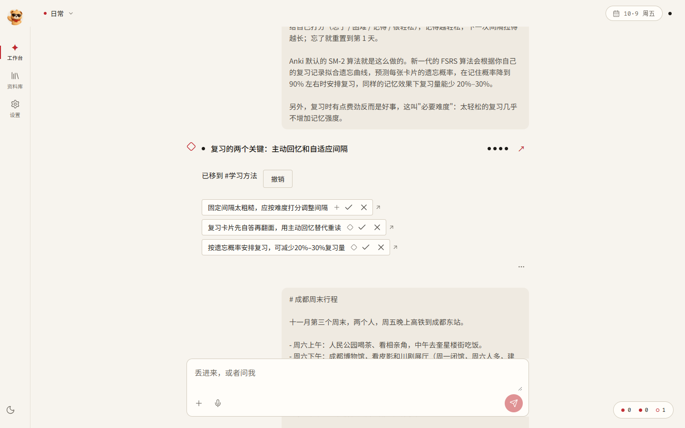
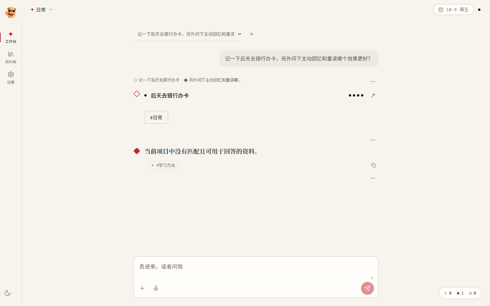
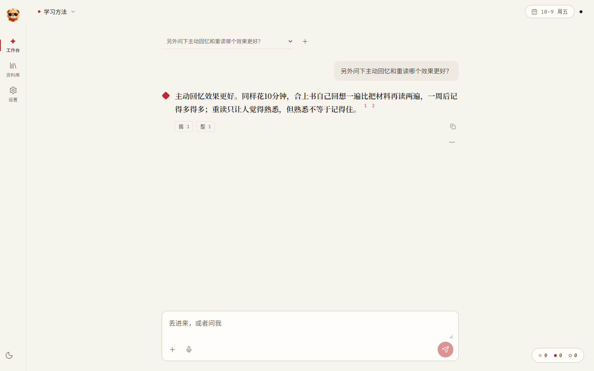
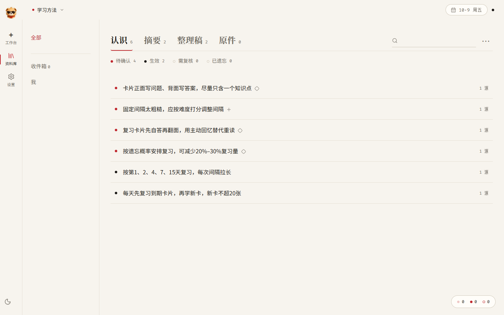
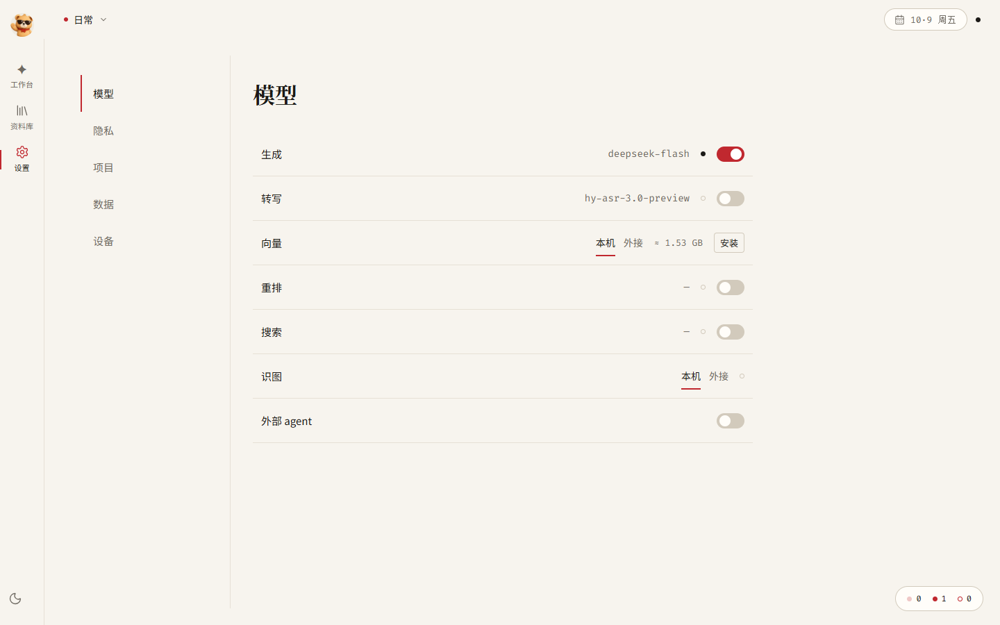
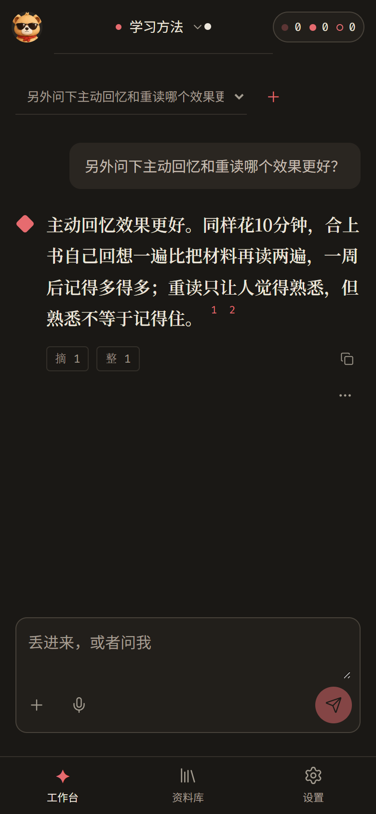
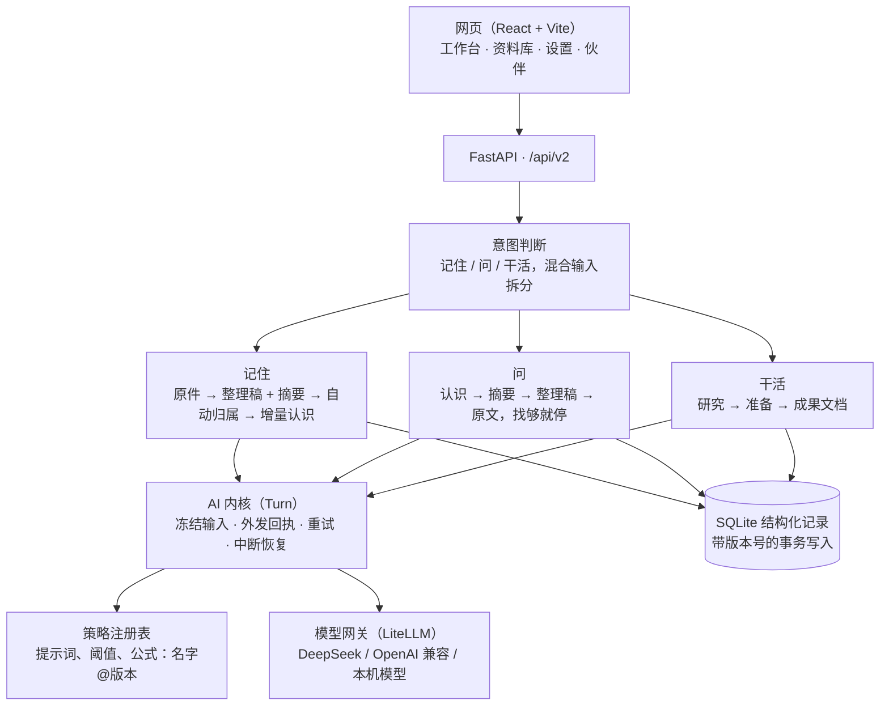
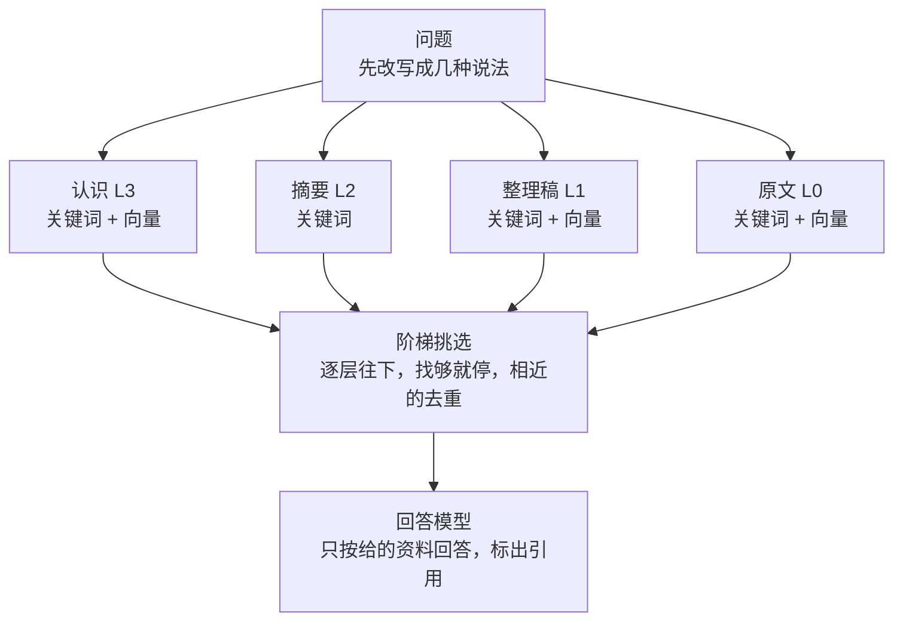

<div align="center">

[简体中文](README.md) · [English](README.en.md)


# Incremind · 积微

**只记增量的第二大脑**

把你挑过的资料交给它：它整理、归档，只提炼你**还不知道**的部分，等你一键确认，才成为长期记忆。

[快速开始](#快速开始) · [它能做什么](#它能做什么) · [怎么用](#怎么用) · [架构](#架构) · [隐私](#隐私与数据) · [开发](#开发)


[](LICENSE)




</div>

## 为什么做它

我想打造一个能长期陪我工作的第二大脑。

这个想法来自日常调研：围绕同一个项目，每次向 AI 提问或交办任务，都要重新讲一遍背景、已有判断和之前找到的资料。知识积累了很多，对话却常常从头开始。

Incremind 的设计围绕两件事展开：

1. **把随手投喂变成持续积累。** 接收文章、个人判断、录音、视频和随手记下的灵感，自动整理并归入对应的项目与场景，把资料沉淀成可以回看的知识和待确认的认识。
2. **带着已有积累理解问题并完成任务。** 根据我的要求识别问题，找到相关项目与场景，结合其中已有的认识、资料和上下文调用模型，回答基础问题、完成日常任务，减少反复交代背景。

收藏了很多文章和视频，真正记住、用上的却很少。因此，积累还需要有取舍：

Incremind 只记**信息增量**：

- **每份新资料都和你已有的认识对照**，只提炼三类内容：**补充**（新条件、例子、做法）、**不同**（和你已知的主张不一样）、**新方法**（你还没有的）。只是重复已知内容的资料，不新增条目，只给原来的认识多记一个来源。
- **方法按"什么时候该想起"来存**：每条认识都写明适用条件。问问题、干活时，按情境把该用的方法找回来。
- **你确认的才算数**：系统提炼的认识先是"待确认"，你在回执上一键 ✓ 才生效。确认、编辑、遗忘都当场生效；系统的推断放在后台慢慢做。
- **像人一样记和忘**：常用的越来越牢，不用的慢慢淡出自动召回，但原文永远在资料库里，随时能找回、一键恢复。

例子：先记一篇《间隔重复入门》，系统提炼出"按第 1、2、4、7、15 天复习"。几天后再记一篇讲"主动回忆和自适应间隔"的文章，它不会把间隔重复再讲一遍，只提出："固定间隔太粗糙，应该按难度调整"（不同）、"复习时先自答再翻面"（新方法）。

## 它能做什么

| | 功能 | 说明 |
|---|---|---|
| ✅ | **一个输入框** | 记住、问、干活不用选模式，系统自动判断；"记一下周五交物业费，另外问下……"这种混在一起的话会自动拆开分别处理 |
| ✅ | **自动整理** | 原件 → 整理稿 + 摘要 → 认识，逐层沉淀；支持文字、链接、PDF |
| ✅ | **自动归到项目** | 没写 `#项目` 时，自动归进最相关的已有项目，或为新主题新建一个；零散琐事留在"日常"。归错了一键撤销 |
| ✅ | **增量认识** | 对照已有认识，只提炼补充、不同和新方法；在回执上一键确认 |
| ✅ | **带引用的回答** | 先查认识，不够再查摘要、整理稿、原文，找够就停；回答里每处引用都能点开看原文。在"日常"里问不到时，自动去对应的项目里问 |
| ✅ | **干活** | 带着你的记忆写成果文档，可以接着改、重做 |
| ✅ | **资料库** | 认识、摘要、整理稿、原文四层下钻；确认、编辑、遗忘、恢复 |
| ✅ | **隐私可控** | 数据都在本机；私密项目不外发；每次调用外部模型都有回执 |
| 🧪 | 更多格式 | 图片识字、录音和视频转写、B 站收藏夹导入（需要在设置里配好对应模型） |
| 🧪 | 遗忘与每日整理 | 按使用频率和遗忘曲线降权；每天把反复出现的内容归纳成规律，等你确认 |
| 🧪 | 本机向量 | 设置里一键安装 EmbeddingGemma（约 1.5 GB），语义召回不用联网 |
| 🧪 | 接入 Claude Code、Codex | 通过 MCP 让它们查你的记忆；方法认识可导出成 skill，见 [docs/agents.md](docs/agents.md) |
| 🧪 | 服务器与多用户 | 家庭服务器或云服务器部署、设备配对、备份恢复，见 [docs/server.md](docs/server.md) |

✅ 已用真实模型（DeepSeek）完整走通；🧪 已实现并有自动化测试，真实环境验收还在进行。

## 快速开始

**需要：**

- Windows 10 / 11
- [Python 3.12](https://www.python.org/downloads/)（安装时勾选 *Add python.exe to PATH*）
- [Node.js 22 LTS](https://nodejs.org/)（或 20.19 以上）
- 一个大模型 API Key，推荐 [DeepSeek](https://platform.deepseek.com/)；任何 OpenAI 兼容接口都可以

**三步：**

1. 下载代码，放在较短的路径下（例如 `D:\incremind`；路径太深会碰到 Windows 260 字符的路径上限）：

   ```bash
   git clone https://github.com/qingmingyiyang/Incremind.git incremind
   ```

2. 双击仓库里的 **`start.bat`**。第一次运行会自动安装依赖（几分钟），之后半分钟内启动，浏览器自动打开 <http://127.0.0.1:4173>。关掉这个黑色窗口就停止。
3. 打开 **设置 · 模型**，填入模型的接口地址、模型名和 API Key。

然后把 [`samples/`](samples/) 里的示例资料依次发进工作台，就能看到整理、自动归属和增量认识的效果。

<details>
<summary>数据放在哪、怎么换位置</summary>

- 所有数据默认在仓库下的 `runtime/`，不进 Git。
- 想放到别处：`start.bat -DataRoot D:\IncremindData`
- 只启动、不自动开浏览器：`start.bat -NoBrowser`
- 启动日志在 `logs/`。
- 备份：停止后把整个数据目录复制一份，或用 `tools/backup.py`（见 [docs/server.md](docs/server.md#备份与恢复)）。

</details>

<details>
<summary>开发者：分别启动后端和网页</summary>

```powershell
py -3.12 -m venv .venv
.\.venv\Scripts\python.exe -m pip install -r requirements-web.txt -r requirements-dev.txt
cd src/frontend; npm ci; cd ../..

.\run-web.ps1    # 后端 http://127.0.0.1:8001，数据根固定为 runtime/
.\run-ui.ps1     # 网页 http://127.0.0.1:4173（Vite 开发服务器，代理 /api 到 8001）
```

用临时数据目录试验时，不要用 `run-web.ps1`，改为直接启动：

```powershell
$env:CHRIPTMAS_APP_ROOT = "$PWD\work\try-root"
$env:PYTHONPATH = "$PWD\src"
.\.venv\Scripts\python.exe -m uvicorn backend.memory_app.app:app --host 127.0.0.1 --port 8001
```

</details>

macOS 和 Linux 暂时没有一键启动；Linux 服务器部署见 [docs/server.md](docs/server.md)。

向量模型可在电脑上手动加载或卸载，也可交给独立私有服务器计算，资料库仍留在电脑。独立向量服务和整个应用的服务器部署是两条可选路径；向量配置与 Linux 模板见 [私有服务器计算向量](docs/vector-server.md)。自建模式仍受向量外发开关和私密规则约束，目前按提问填入缓存，真实服务器联通待验证。

整站部署把资料和应用一起放到服务器，所有用户共用服务器本机的向量模型，各自保留独立资料与缓存。启动默认未加载，由管理员加载或卸载；CPU/CUDA 配置、模型安装和用户配对见 [服务器部署](docs/server.md)。已在 Ubuntu 22.04 CPU 实例验证安装、设备配对及向量加载、计算、卸载与重新加载；HTTPS 和 GPU 联通仍待验证。

建议以本机开发提交为代码源，沿公开仓库现有的干净 AGPL 历史发布过滤后的代码增量。服务器按固定发布版本更新，记录 `deployment-version.json`，先备份代码，再重启并检查健康状态，保留撤回路径。服务器不要直接推送私有开发历史、`runtime/`、密钥、模型配置或个人资料；资料备份与迁移单独处理。

## 怎么用

**工作台**：唯一的输入框。

| 你输入 | 系统做什么 |
|---|---|
| 粘贴一段文字、一个链接，或拖进文件 | **记住**：整理成整理稿和摘要，归到项目，提炼待确认的认识 |
| 一个问题 | **问**：从你的记忆里找答案，带引用 |
| "帮我写……""整理一份……" | **干活**：带着相关记忆生成成果文档 |
| 混在一起的一句话 | 自动拆成几部分，分别处理 |
| 开头写 `#项目名` 或 `#项目名/场景` | 指定归属或提问范围；不写就自动判断 |

回执上的认识可以直接 ✓ 确认或 ✕ 不要；"已移到 #项目"旁边可以撤销自动归属。

**资料库**：按项目看全部认识、摘要、整理稿和原文，逐层下钻到原文证据；在这里确认、编辑、遗忘或恢复。

**设置**：模型、隐私（哪些项目私密）、项目、数据与备份。

**伙伴**：点左上角的小熊，可以聊聊、回顾这周记住了什么、专注和安排。

<table>
<tr>
<td width="50%"><br/><sub>一句话拆成"记住"和"问"；"日常"里找不到答案，指向"学习方法"</sub></td>
<td width="50%"><br/><sub>自动转到"学习方法"项目里回答，上标数字可点开原文</sub></td>
</tr>
<tr>
<td width="50%"><br/><sub>资料库：认识分待确认和生效，标出补充（＋）和新增（◇）</sub></td>
<td width="50%"><br/><sub>设置：按用途选模型，外发开关一目了然</sub></td>
</tr>
<tr>
<td width="50%"><br/><sub>手机尺寸、深色主题</sub></td>
<td width="50%"></td>
</tr>
</table>

## 架构



**记忆阶梯**：原件（L0）→ 整理稿（L1）+ 摘要（L2）→ 认识（L3）。存的时候自下而上沉淀，问的时候自上而下找：先查认识，不够再往下一层，找够就停。

**几条设计原则：**

- **事实只追加，推导可重建**：能重新算出来的都不当作事实存。
- **决策点是带版本号的纯函数**：提示词、阈值、归属规则都登记成 `名字@版本`（在 `src/backend/memory_app/v2/policies/`）。换算法就是登记新版本、切换一行；改回来就是回退。
- **三条管线，一个入口**：记住、问和干活、学习三条路径分开，共用入口、模型网关和事实日志。
- **每个事实只有一个主人**：记忆事实归领域服务，执行事实归 AI 内核；编排层和界面不存状态。

**目录：**

| 路径 | 内容 |
|---|---|
| `src/backend/memory_app/` | 产品应用层，ASGI 入口 `backend.memory_app.app:app` |
| `src/backend/memory_app/v2/` | 工作台、资料库、设置等全部 v2 接口与编排 |
| `src/backend/memory_app/v2/policies/` | 带版本号的策略：意图、归属、提炼、召回、排序、遗忘…… |
| `src/backend/recognition/` | 认识领域：候选、确认、修订、遗忘 |
| `src/core/` | 领域与存储底座（AI 内核、文档引擎、SQLite 存储），不依赖 backend |
| `src/frontend/` | 网页 |
| `apps/desktop-electron/` | 桌面安装包外壳（发行准备中） |
| `deploy/` | 服务器部署模板（systemd、Caddy） |
| `tests/` | pytest 与 vitest 测试 |
| `samples/` | 体验用的示例资料 |

更细的设计见 [ARCHITECTURE.md](ARCHITECTURE.md)（架构与接口约定）、[DESIGN.md](DESIGN.md)（界面）和 [COMPONENTS.md](COMPONENTS.md)（可复用能力）。

## 提问时怎么找资料



**每一层怎么匹配**

- **关键词**：把问题拆成整句（权重 5）、英文单词（权重 2）和相邻两个汉字（权重 1），最多 32 个，看资料里出现了几个。所以"怎么才能记得牢"和"间隔重复"在字面上对不上，要靠向量。
- **认识的关键词优先，意思补充**（默认策略 `rank@4`）：认识召回分数以命中词数为基础，有向量时用相似度区分命中词数相同的认识；没有关键词命中但相似度 ≥ 0.55 的认识也能入选，基础分低于关键词命中。最终排名还会按使用强度、明确到期的适用条件等调整。整理稿与原文的文段采用下述评分。
- **认识**：本机模式读取后台已缓存的认识向量，按上面的规则召回；适用条件与当前情境匹配的方法也能补充进来。关键词或向量找到的认识，都能带入与它相关、支持或矛盾的有效认识。
- **摘要**：当前只按关键词，不单独建立摘要向量。这是工程选择；把摘要前缀放进文段向量，并不能证明独立的摘要向量没有价值。
- **整理稿和原文**：每份资料切成几百字一块。`rank@4` 按词语在本资料中的稀缺程度加权，标题和摘要前缀作为较低权重的提示；有缓存向量时按 0.45 × 加权关键词得分 + 0.55 × 意思相似度，没有时只看关键词。`ladder@15` 在命中位置周围保留回答所需的连续正文、问答和限定条件，按问题需求与新增信息选择片段，普通资料不固定窗口数量或宽度。普通主题问题的已确认认识和非对话正文不会仅因缺少句末标点而失去增量资格；问句、说话者、日期关系和原文连续性边界保留，摘录不补造标点。选材规则仍是启发式，不能保证语义完整。
- **块的向量带上下文**：计算文字准确为 `标题 + "\n" + 摘要[:120] + "\n" + 块正文`；这里是 120 个 Python 字符，空摘要时仍保留标题和正文。后台索引与提问读取使用同一格式，见 [EmbeddingIndex](src/backend/memory_app/v2/embedding_index.py) 和 [chunk_vector_scores](src/backend/memory_app/v2/contextual_chunk_vectors.py)。这是固定的标题与摘要前缀；[Anthropic 的 Contextual Retrieval](https://www.anthropic.com/engineering/contextual-retrieval) 会用模型为每块生成专属上下文，效果需要分别评测。
- **可选重排**：工作台在每层选取证据前使用已配置并启用的重排模型；云端调用还需打开该用途的外发开关。默认 `rerank@2` 按实际输入成本选择有限片段，不固定前 12 条；问题与片段合计仍不超过 6,000 词元及本轮输入预算，认识保持正文与条件完整。按原排名 40% 与模型排名 60% 融合，只交换同一连接和概览优先组内的次序，融合分数相同时保留场景优先。送评分的编号必须全部返回有效分数；预算内未送评分的资料保留原次序。未配置、禁止外发或调用失败时使用原排序，一次失败后本轮不再尝试重排。发送前和返回后复验来源、私密、遗忘、场景和片段，调用记录在重排用途回执中；只读覆盖检查和外部 agent 上下文不因此增加外发。

**阶梯怎么挑**

- **默认组合**：`compose@30 / ladder@15 / retrieve@5 / rerank@2`。仍按认识 → 摘要 → 整理稿 → 原文逐层查找，按问题中的事实、日期、关系和列举需求选择有限资料，不固定普通资料份数。我项目的画像独立使用最多 600 词元的背景块，认识正文与适用条件整体保留。相关、支持和矛盾连接按新增信息与预算准入，矛盾连接优先；仍受来源资格与总预算约束，预算不足时不保证两方都能进入模型。
- **实际预算**：证据使用扣除输出预留、指令、Schema、问题、画像、对话历史和消息包装后的余额，再校验完整输入。受支持的官方 `api.deepseek.com` 的 `deepseek-flash` 路由总容量上限为 200,000 词元；预留 7,000 输出时，输入至多 193,000。未知路由不据此升到 200k，仍使用保守的 16,000 总窗口；无法取得有效窗口和预留时使用 4,000 输入回退预算。UTF-8 字节数除以 3 向上取整是预算估算，不是服务商精确分词或实际计费用量。不以填满窗口为目标。
- **查缺与停止**：`retrieve@5` 对照原问题和已选证据判断缺口，必要时沿既有路径补查。列举问题检查不同事项，关系问题检查完整关系链；新增链先独立重排和准入，再按来源聚合。无明确主体的普通问题保留原处理路径。没有有效新增信息或预算不足时停止，词语覆盖率和停止理由都不等于答案充分性的证明。
- **去重**：没有通过新增信息资格判断的资料，再按相似度 ≥ 0.8 检查近重复，只读已有的缓存向量，缺少可比向量时用相邻两字的重合度。通过动态策略新增需求或关系资格的片段不因词语相近而合并；有效矛盾连接对也不因相似而被去重，同一份资料在不同层的内容不互相比。去重本身不会现场计算向量，新增信息判断仍是启发式。
- **矛盾怎么判断**：确认认识后、以及启动后的整理中，模型会提出支持、矛盾或取代建议，你在资料库接受后才成为有效连接。提问时读取已生效的 `refutes` 连接，要求回答说明两方依据及分歧；向量相似度不能判定逻辑矛盾。只有相关连接可以自动建立。

**数量与预算的依据**：当前默认按问题缺口、边际信息和剩余预算动态选材；这些规则及保留的专门预算都是工程选择，尚无评测证明最优。[Lost in the Middle](https://arxiv.org/abs/2307.03172) 表明长上下文中的证据位置会影响模型表现，支持按任务评测选材。更大窗口和更多资料本身不能证明回答更准确，仍需真实回答及未参与开发的新题验证。

**回答模型拿到什么**：规则（只按资料回答、标出引用、没依据就说不知道，以及用到淡忘资料、存在矛盾、用了网页搜索时的说明）、"我"的画像、编号的资料（认识整条给出并带适用条件，其他层只给命中的片段）、标明"不是证据"的对话历史，最后是问题。

**两轮回答与出处校验**

`compose@30` 用两次主要模型调用形成事实草稿、逐项复核纠正并作答。首稿要求每个与问题有关的独立事实只写一次；事实题尽量保留原词，推理题给出有据前提，时间题引用程序计算的完整日期范围。指令要求说不知道或否定前检查完整资料目录、根据实际说话者判断人物归属，并在开放列举中保留每个独立项目，而不只给代表例子。这些要求用于引导模型，不能保证语义正确或总体正确率。

事实或推理声明优先使用空的 `date_refs`；附带合法日期引用时，程序先验证其真实单元、原话和计算记录，然后仅将其视为没有计算权限的附带元数据。原始模型结果保持不变，这些引用不生成日期注释、计算绑定或后续精度说明资格。把相对时间换算成绝对日期或区间，仍必须实际使用日期声明类型，并精确绑定对应原文、相对时间表达与记录日期；错误引用、跨单元借用和借附带引用授权计算仍会被拒绝。

普通事实或推理可以明确写出记录或会话日期作为上下文，但日期须匹配同单元的完整支持原句和冻结来源的真实记录锚。这不授予事件发生日、当天指代或更精确区间的计算资格；原话的上周、下周仍是相对时间，合法绝对日期推算仍须独立通过日期类型、引用和完整结果校验。

结构合规的首稿中，错误日期引用、原话、支持角色、日期文字或重复项，会按条目给出具体字段路径、失败条件与修复要求，原始首稿保持不变，末轮仍核对完整资料目录。最终必须实际纠正或排除错误条目，纠错理由不能替代字段修改；清空日期引用也不能修好文字中仍然无据的绝对日期。冻结资料损坏仍立即终止，最终错误引用、无据日期或完全重复的声明仍会阻止发布，普通声明也不能靠改变附带引用逃过去重。程序生成引用，公开响应仍为 `AskOutput`。这些校验检查结构和出处；提示中的去重要求也不能保证模型从不重复或截断。

各版本的真实逐题结果、耗时和评测边界见 [RAG 评测记录](docs/rag-pilot.md)，历史候选实现和 [回答流程图](docs/rag-pilot.md#回答流程与出错位置) 保留对应版本。小批样本与工程控制不代表总体正确率。

**本机向量**

- **怎么运行**：EmbeddingGemma 2，只用文字部分，输出 256 维，在后端进程的专用线程里用 CPU 运行，最多 8 个 CPU 线程。每次启动默认未加载，在设置 · 模型 · 向量手动加载或卸载；卸载等待正在运行的批次结束后释放编码器引用，保留权重与已有向量缓存，不承诺进程内存立即全部归还操作系统；提问优先于后台补算，最多积压 64 个请求。
- **资源与准备**：下载约 1.5 GB，只留文字部分后约 580 MB；内存峰值约 1.8 GB；一个问题约 0.16 秒，每段资料约 0.07 秒。这些是测试机器上少量样本的观测，实际耗时与内存需在使用机器上确认。先安装 [`requirements-local-vectors.txt`](requirements-local-vectors.txt)（含 torch）中的可选依赖，再下载模型；缺少依赖或权重时，向量路径回退关键词。
- **初始化会补算**：手动加载成功后，后台为已有的认识 L3、整理稿 L1 与原文 L0 分块建立缓存，设置显示已索引数量；模型已加载时，每次记住完成也触发补算，正在运行的索引随后再补一轮。启动约 60 秒后和每 24 小时的补算仅在已加载时运行；未加载时跳过，不自动加载。加载权重与后台索引的完成状态分别显示。
- **提问时算什么**：本机前台只现算问题向量，同一轮按模型身份与问题文本复用；认识和文段只读后台缓存。模型未加载或正在加载、卸载时本轮使用关键词；模型已就绪但某条材料尚未索引时，该条仍走关键词，前台不会为它补算材料向量。
- **缓存**：`recognition-vectors.sqlite3`，按项目、条目、修订号、模型四项定位，内容包括每条认识与每个 L1/L0 分块的向量。模型身份包含模型名、维度与向量策略版本。资料修改后修订号变化，旧向量不再命中；更换模型身份后由后台补算。修改、删除或私密设置等写入口会清理相关派生缓存；遗忘通过召回资格生效，不能据缓存记录仍存在就判断可以召回。定期整理清掉失效、损坏或过期的向量，不调用模型；遗忘不删除原件和历史正文。
- **为什么本机计算也检查并留回执**：计算前和接纳结果前都核对资料资格、修订、来源可用性，以及向量配置是否变化，变化后不接纳结果。与外接服务共用这条路径，外接模式还检查外发开关并拦截私密资料；本机模式不算外发，私密资料也能用。回执记录计算内容、用量与结果，本机费用记 0；缓存让中断的后台索引下次接着补算。

`compose`、`retrieve`、`rerank`、`rank`、`ladder`、`vector` 和 `elsewhere` 的版本会记录在相应轮次的策略快照中，续行使用对应版本；旧版仍可显式选择，见 [policies/pipelines.py](src/backend/memory_app/v2/policies/pipelines.py)。

**还没定下来的**

- 按意思召回的门槛 0.55 是初始工程值，还没有在真实 EmbeddingGemma 2 的相似度分布上校准。
- 动态召回的资料量、连续片段和 200k 容量仍需用真实长资料与多来源任务验证，分别检查漏答、错答、引用、耗时和用量。

## 隐私与数据

- **本地优先**：资料、整理稿、认识和对话都存在本机数据目录的 SQLite 里。
- **密钥加密**：模型密钥用 Windows DPAPI 加密，保存后界面上读不回来，不写日志。
- **外发可控**：只有你在 **设置 · 模型** 里打开外发开关的用途才会调用外部模型；标成**私密**的项目和资料永远不外发；每次外发都留回执，写明发了什么、给了哪个模型。详见 [docs/models.md](docs/models.md)。
- **不删原件**：遗忘只影响自动召回，原件、整理稿、认识正文和历史修订都保留，随时恢复。

## 开发

```powershell
.\.venv\Scripts\python.exe -m pytest tests/memory_app/v2 -q   # 后端测试
cd src/frontend; npm test; npm run build                       # 前端测试与构建
.\.venv\Scripts\python.exe tools/run_import_linter.py          # 依赖方向检查
```

- 改提示词或算法：在 `v2/policies/` 登记新版本，离线对比后，单独一次提交切换 `ACTIVE`。
- 前端只用 `src/frontend/src/styles.css` 里的设计 token 和 `shared/ui/` 组件。
- 更新项目介绍、功能状态或使用说明时，同步维护 `README.md` 和 `README.en.md`。
- 提交前钩子 `tools/task_guard.py` 会检查疑似密钥、误提交的数据目录和新增的跳过标记；新克隆后运行一次 `.\.venv\Scripts\python.exe tools/task_guard.py --install` 安装。

## 已知限制

- **速度**：记住一份资料约 15–20 秒，提问约 5–15 秒，确认一条认识几乎立即完成。在"日常"里提问、资料在别的项目时，会先指向那个项目再在那里回答，共约 10 秒。每次启动约 1 分钟后会跑一轮整理（当天第一次启动还会备份），这期间会慢一些。
- **平台**：只在 Windows 上完整验证；界面只有中文。
- **在路上**：手机外壳、共享项目、局域网和公网服务器的真实环境验收。

## 致谢

- 模型接入参考了 [pi-ai](https://github.com/earendil-works/pi/tree/main/packages/ai) 的协议适配与测试方法。
- MCP 接入、代理接入等思路借鉴了 Mem0 OpenMemory、Supermemory、basic-memory 和 TencentDB Agent Memory。
- 用到的开源项目包括 [FastAPI](https://fastapi.tiangolo.com/)、[LiteLLM](https://github.com/BerriAI/litellm)、[LangGraph](https://github.com/langchain-ai/langgraph)、[React](https://react.dev/)、[Vite](https://vite.dev/)、[ProseMirror](https://prosemirror.net/)（编辑器内核，MIT）、[sqlite-vec](https://github.com/asg017/sqlite-vec)。各依赖的许可证见 `requirements-*.txt` 与 `src/frontend/package-lock.json`。

## 许可证

Copyright (C) 2026 Incremind contributors.

本项目采用 **GNU Affero General Public License v3.0（AGPL-3.0-only）**，完整条款见 [LICENSE](LICENSE)。

修改后的版本通过网络提供服务时，须按协议向与其交互的用户提供对应源代码。

第三方组件与数据保留各自的许可证和署名要求。
