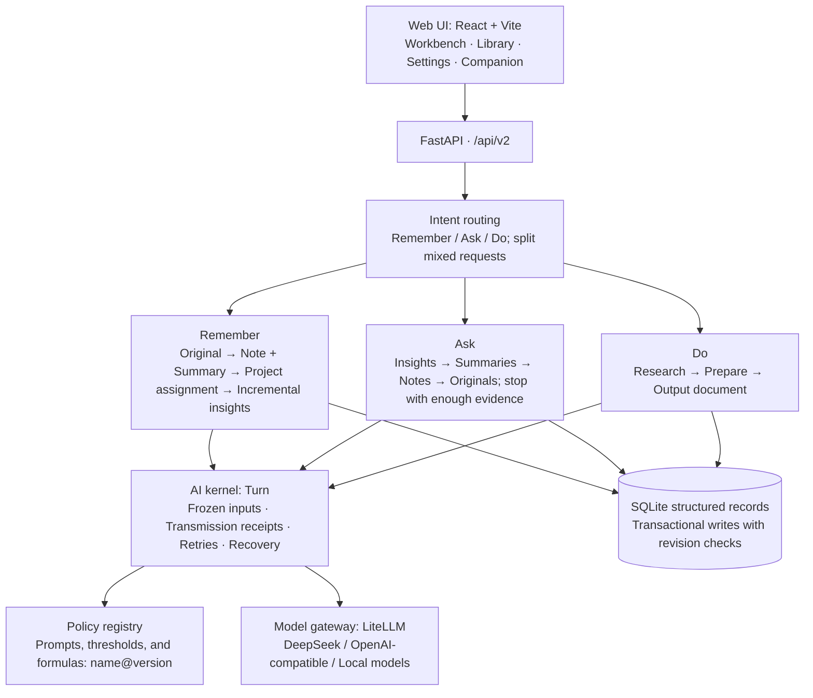
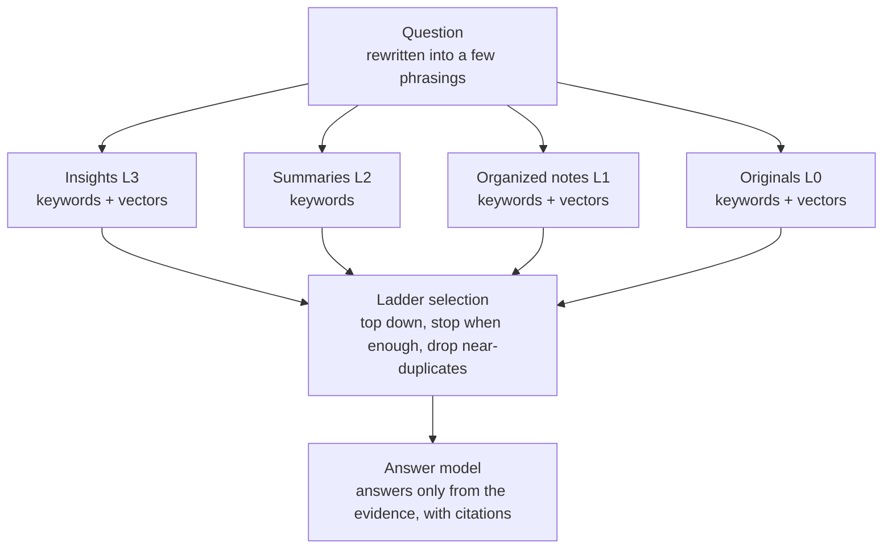

<div align="center">

[English](README.md) · [简体中文](README.zh-CN.md)


# Incremind

**A second brain that remembers what is new.**

Give it the material you choose. It organizes and archives it, extracts what adds to **what you already know**, and turns proposed insights into long-term memory only after you confirm them.

[Quick start](#quick-start) · [Features](#features) · [Evaluation](#evaluation-and-verification) · [Usage](#usage) · [Architecture](#architecture) · [Privacy](#privacy-and-data) · [Development](#development)


[](LICENSE)


</div>

## Why I am building it

I want a second brain that can work alongside me over time.

The idea comes from everyday research. Whenever I ask AI a question or give it a task about the same project, I have to explain the background, my existing judgments, and the material I have already found all over again. Knowledge accumulates, but conversations often start from scratch.

Incremind is designed around two goals:

1. **Turn things I share into lasting knowledge.** Accept articles, personal judgments, recordings, videos, and ideas captured on the go; organize them by project and scene; and turn them into knowledge I can revisit and insights I can confirm.
2. **Use that knowledge to understand questions and complete tasks.** Identify what I am asking, find the relevant projects and scenes, and give the model their existing insights, sources, and context so it can answer everyday questions and handle routine tasks with less repeated explanation.

Saving articles and videos does not automatically make their contents useful or memorable. Incremind therefore focuses on **what each new source adds**:

- **Compare new material with existing insights.** Extract three kinds of changes: **additions** such as new conditions, examples, or practices; **differences** from an existing claim; and **new methods**. Material that repeats what you already know adds a supporting source to the existing insight rather than creating another entry.
- **Store methods with their conditions of use.** Each insight says when it applies, so relevant methods can be recalled when you ask a question or work on a task.
- **Let you decide what becomes established knowledge.** Extracted insights start as pending confirmation. A single click on the receipt activates them. Confirmation, edits, and forgetting take effect immediately; further inference runs in the background.
- **Remember and forget in a human-like way.** Frequently used knowledge becomes stronger, while unused knowledge gradually leaves automatic recall. Originals remain in the Library and can be found and restored at any time.

For example, an introductory article on spaced repetition might produce an insight about reviewing on days 1, 2, 4, 7, and 15. A later article on active recall and adaptive intervals should add only the relevant differences and methods: adjust intervals to difficulty, and try answering before revealing the answer.

## Features

| Status | Feature | What it does |
|---|---|---|
| ✅ | **One input box** | Automatically handles remembering, asking, and doing tasks. Mixed requests, such as a reminder followed by a question, are split and handled separately. |
| ✅ | **Automatic organization** | Builds memory in layers: original → organized note + summary → insight. Supports text, links, and PDFs. |
| ✅ | **Automatic project assignment** | Without an explicit `#Project`, assigns material to the most relevant existing project or creates one for a new topic. Everyday items stay in the Everyday space. Assignment can be undone with one click. |
| ✅ | **Incremental insights** | Compares material with existing insights and proposes additions, differences, and new methods for confirmation on the receipt. |
| ✅ | **Answers with citations** | Searches insights first, then summaries, organized notes, and originals as needed. Stops when there is enough evidence. Citations open the original source. Questions in Everyday can be routed to the relevant project. |
| ✅ | **Task execution** | Uses relevant memory to create output documents, which you can continue revising or regenerate. |
| ✅ | **Library** | Browse insights, summaries, organized notes, and originals; confirm, edit, forget, or restore insights. |
| ✅ | **Privacy controls** | Keeps data on the computer or server hosting the application, excludes private projects from external model requests, and records a receipt for each external call. |
| 🧪 | More input formats | Image OCR, audio and video transcription, and Bilibili favorites import; requires the corresponding models to be configured. |
| 🧪 | Forgetting and daily organization | Adjusts recall weights by usage and a forgetting curve. Daily organization proposes patterns from recurring material for your confirmation. |
| 🧪 | Local embeddings | Install EmbeddingGemma from Settings, approximately 1.5 GB, for semantic retrieval without a network connection. |
| 🧪 | Claude Code, Codex, and DeepSeek Harness | All three clients can access memory tools through plugins. Workbench delegation saves new drafts; server-side delegation is currently limited to DeepSeek Harness. See installation requirements and validation limits in [the agent guide](docs/agents.md) (Chinese). |
| 🧪 | Servers and multiple users | Home or cloud server deployment, device pairing, backup, and recovery. See [the server guide](docs/server.md) (Chinese). |

✅ Basic usage paths are implemented. 🧪 Optional dependencies or further real-environment validation are required. The table below states the actual validation scope; the icons do not establish coverage of every scenario.

## Evaluation and verification

Updated 2026-10-13. Current defaults `compose@30 / ladder@15 / retrieve@5 / rerank@2` were checked against the originals by an independent Agent on 12 fixed LoCoMo development questions over 19 conversation originals: **8 correct, 4 partially correct, 0 wrong, 0 unpublished**. The run used DeepSeek Flash and local EmbeddingGemma 2. Supported unknown answers can count as correct; omissions remain. These questions were repeatedly used during development, so this is not a held-out or overall accuracy estimate.

The run made 36 real model requests and used **335,444 input / 12,498 output tokens**. Median total latency over all 12 questions was **22.160 s**, with **14.292 s** median retrieval latency. Usage and timings describe that run; no monetary cost was inferred from pricing.

Engineering verification below is separate from answer quality:

| Area | Environment and scope | Observed result |
|---|---|---|
| **DeepSeek Harness task to draft** | Isolated data root on Ubuntu 22.04; real Harness and DeepSeek Flash, including authenticated MCP memory tools | After a fix, one real task passed **29 checks**. Both real attempts used **4,017 input / 1,226 output tokens** in total; the first MCP tool-call failure is retained. |
| **Correction after Hy-ASR** | Real SQLite, Turns, and confirmation; simulated ASR delivery and model transport | **30 new checks and 13 existing targeted checks passed**; one pre-existing comment-fetch failure is retained. Real recognition and correction quality await evaluation. |
| **Server CPU embeddings** | Ubuntu 22.04 instance, real model assets, and device pairing | Loading, encoding, unloading, and reloading verified. GPU and standalone vector-service integration remain unverified. |

The material-analysis candidate has confirmed L1 notes for 7/19 sources; the next source failed quotation validation. No new 12-question answer evaluation was run. Candidates `compose@31, @32 / ladder@16` produced wrong or unpublished answers in retests; defaults remain `30/15`.

The [evaluation overview and reproduction entry points](docs/evaluation.md) (Chinese) list versions, samples, latency, usage, failures, and validation limits. The [RAG pilot report](docs/rag-pilot.md) (Chinese) retains earlier protocols and results. There is no comparison with OpenViking under a shared evaluation protocol.

## Quick start

**Requirements:**

- Windows 10 or 11.
- [Python 3.12](https://www.python.org/downloads/). Select *Add python.exe to PATH* during installation.
- [Node.js](https://nodejs.org/): 20.x ≥ 20.19.0, 22.x ≥ 22.13.0, or ≥ 24.0.0. Version 22.x ≥ 22.13.0 is recommended.
- A model API key. [DeepSeek](https://platform.deepseek.com/) is the suggested provider; OpenAI-compatible endpoints are also supported.

**Three steps:**

1. Clone the repository into a short path, such as `D:\incremind`. Deep directory paths can encounter the Windows 260-character path limit.

   ```bash
   git clone https://github.com/qingmingyiyang/Incremind.git incremind
   ```

2. Double-click **`start.bat`** in the repository. The first run installs dependencies and takes a few minutes. Later launches normally take less than half a minute. Your browser opens at <http://127.0.0.1:4173>. Closing the terminal window stops the application.
3. Open **Settings → Models** and enter the endpoint URL, model name, and API key. The application interface currently uses Chinese; the names in this guide are English translations of its controls.

Send the example files in [`samples/`](samples/) to the Workbench in order to try organization, project assignment, and incremental insights. The sample material is in Chinese.

<details>
<summary>Data location, launch options, and backups</summary>

- Data is stored in the repository's `runtime/` directory by default and is excluded from Git.
- Choose another location: `start.bat -DataRoot D:\IncremindData`.
- Start without opening a browser: `start.bat -NoBrowser`.
- Startup logs are in `logs/`.
- To back up data, stop the application and copy the entire data directory, or use `tools/backup.py`. See the backup and recovery section of [the server guide](docs/server.md) (Chinese).

</details>

<details>
<summary>Developers: start the backend and frontend separately</summary>

Set up the dependencies from the repository root:

```powershell
py -3.12 -m venv .venv
.\.venv\Scripts\python.exe -m pip install -r requirements-web.txt -r requirements-dev.txt
cd src/frontend
npm ci
cd ../..
```

Run each command below in a separate PowerShell terminal at the repository root:

```powershell
.\run-web.ps1
```

The backend runs at <http://127.0.0.1:8001>. This script fixes the data root to `runtime/`.

```powershell
.\run-ui.ps1
```

The Vite development server runs at <http://127.0.0.1:4173> and proxies `/api` requests to port 8001.

For experiments with a temporary data directory, start the backend directly:

```powershell
$env:CHRIPTMAS_APP_ROOT = "$PWD\work\try-root"
$env:PYTHONPATH = "$PWD\src"
.\.venv\Scripts\python.exe -m uvicorn backend.memory_app.app:app --host 127.0.0.1 --port 8001
```

</details>

One-click startup is currently available for Windows. For Linux server deployment, see [the server guide](docs/server.md) (Chinese).

Recommended synchronization: use local development commits as the code source, and publish filtered code changes along the public repository's existing clean AGPL history. Update servers to a fixed release, record `deployment-version.json`, back up code before restarting, check health, and retain a rollback path. Do not push private development history, `runtime/`, credentials, model configuration, or personal material from the server. Handle data backups and migration separately.

Load or unload the vector model on your computer, or use a standalone private server for vector computation while keeping the library on your computer. The standalone vector service and full application deployment are separate options. See [Private server vectors](docs/vector-server.md) (Chinese) for configuration and Linux templates. Self-hosted mode still follows the vector egress switch and privacy rules; it fills the cache on demand during questions. Real-server integration remains unverified.

Full server deployment keeps both the application and its data on the server. Users share the server's local vector model while retaining separate libraries and caches. The model starts unloaded; an administrator controls loading and unloading. See [Server deployment](docs/server.md) (Chinese) for CPU/CUDA configuration, model installation, and device pairing. Installation, device pairing, CPU vector loading, encoding, unloading, and reloading, trusted HTTPS for the public IP address, and multi-user API isolation have been verified on an Ubuntu 22.04 instance. GPU and standalone vector-service integration remain unverified.

## Usage

The **Workbench** provides a single input box.

| Input | Result |
|---|---|
| Paste text or a link, or drop a file | **Remember:** create an organized note and summary, assign a project, and propose insights for confirmation. |
| Ask a question | **Ask:** answer using your memory, with citations. |
| Request a document or another piece of work | **Do:** create an output document using relevant memory. |
| Combine several requests | Split them into parts and handle each separately. |
| Begin with `#ProjectName` or `#ProjectName/Scene` | Specify the assignment or retrieval scope. Otherwise, the system infers it. |

On a receipt, use ✓ to confirm an insight or ✕ to dismiss it. The project assignment receipt also offers an undo action.

The **Library** groups insights, summaries, organized notes, and originals by project. Follow each layer down to its source evidence, or confirm, edit, forget, and restore insights here.

**Settings** contains model configuration, privacy controls, projects, data, backups, devices, and websites.

**Speech vocabulary:** manage a personal vocabulary in Settings → Models → Transcription. Paste a batch or import UTF-8 TXT, CSV, or JSON, preview it, then add or update terms. Built-in faster-whisper transcription uses hotword hints for uploaded audio and video, prioritizes whole terms by weight, and records how many fit within the model's token capacity. Realtime Qwen uses its native vocabulary. The current Hy-ASR synchronous endpoint does not support hotwords. Local transcription still needs its dependencies and model assets; importing terms does not install or switch a model.

**Vocabulary correction after Hy-ASR:** the default `organize@1` pipeline sends uploaded audio or video transcripts and the same personal vocabulary to the configured auxiliary generation model for proposed local term corrections. The program validates allowed terms, original positions, overlapping edits, literal similarity, and protected content before applying edits. It accepts no free rewriting and preserves numbers, dates, negation, and already correct terms; ambiguous cases remain uncertainties. Organized notes include the corrected transcript and edit positions. Original media, raw transcripts, and quotation coordinates stay intact. Confirmation freezes the correction version, so later vocabulary changes cannot rewrite confirmed notes; retries reuse completed transcription.

Correction uses the existing transmission settings, privacy guards, receipts, actual auxiliary capacity, and shared context preparation. Model failures or invalid edit proposals retain the raw transcript; capacity and source changes have explicit states. Empty vocabularies, native local hotword transcription, and ordinary text add no correction call. Long inputs may require several calls, with known usage and unknown costs recorded separately. Automated checks use synthetic ASR delivery and model transport; real recognition and correction quality remain to be evaluated. Optional `organize@2 / material_analysis@1–4` pipelines do not yet use this correction stage.

**Agent data operations:** a bundled skill exposes scoped vocabulary read, preview, import, and verification tools. Saving requires a complete vocabulary explicitly supplied by the user; automatically discovered terms remain suggestions. Tools do not accept arbitrary SQL or database paths. See [Agent data operations](docs/agent-data-tools.md) (Chinese) for the instruction format and permission boundaries.

**Mobile sharing:** install the HTTPS web app on Android to send text, links, images, and videos from other apps; use Shortcuts on iPhone. Full Xiaohongshu and Bilibili share text is accepted, and multiple images can form one original. See [mobile sharing](docs/mobile-share.md) (Chinese) for pairing, retries, and shortcut setup.

**Website login:** import Bilibili or Xiaohongshu cookies in Settings → Websites so the server can reuse the session when reading that website. Bilibili also displays an official QR code for confirmation on your phone, then saves the session encrypted. Xiaohongshu browser login needs an optional runtime; a real QR code has not yet been obtained. See [website login](docs/platform-login.md) (Chinese) for usage and verification limits.

Open the **Companion** through the bear avatar in the upper-left corner to chat, review what you remembered this week, focus, or plan.

The screenshots below show the current Chinese interface.

<table>
<tr>
<td width="50%"><br/><sub>A mixed request is split; a question without an answer in Everyday is directed to the Learning Methods project.</sub></td>
<td width="50%"><br/><sub>The relevant project supplies the answer. Superscript citations open the original sources.</sub></td>
</tr>
<tr>
<td width="50%"><br/><sub>The Library separates pending and active insights and marks additions (+) and new insights (◇).</sub></td>
<td width="50%"><br/><sub>Choose models by purpose and control external transmission.</sub></td>
</tr>
<tr>
<td width="50%"><br/><sub>A mobile viewport in dark mode.</sub></td>
<td width="50%"></td>
</tr>
</table>

## Architecture



**Memory layers:** original (L0) → organized note (L1) + summary (L2) → insight (L3). Material is organized from the bottom up. Retrieval works from the top down: start with insights, descend when necessary, and stop when there is enough evidence.

**Analyze material before extracting insights.** Optional `organize@2 / material_analysis@1, @2, @3, or @4 / extract@6` pipelines are registered; version 2 and later use `context_preparation@1`. Active defaults remain `organize@1 / material_analysis@1 / extract@5`. These candidate pipelines are not enabled by default.

1. The model reads the material and plans suitable analysis angles, without reading later questions or reference answers.
2. Long material is grouped into complete paragraphs; oversized paragraphs split at sentence boundaries. Each worker first receives the verified full body plus its focus and actual coordinates. If both exceed capacity, version 2 uses the shared text preparation entry point: semantic sections, paragraph and argument boundaries, hierarchical summaries, focus originals, and necessary adjacent originals. Version 1 retains its explicit capacity failure and existing replay behavior. Concurrency follows the actual auxiliary route: serial locally, at most two workers remotely. Results merge in frozen segment order.
3. Segment analysis retains actors, conditions, negations, facts, inferences, plans, and unknowns. A final model synthesizes multiple segments while covering every original claim. The organized note retains all claims and evidence; synthesis inferences are labeled separately. Version 4 requests separate citations for discontinuous evidence. Only a unique exact join of adjacent complete single-line `[id] Speaker: body` utterances can be split into actual original spans, with no additional model call. Skipped utterances, record headers, partial sentences, omissions, rewriting, and repeated bodies are rejected. Coordinates allow speaker readback; this check does not establish the semantic correctness of the claim or actor attribution.
4. Temporal analysis runs only when the material involves dates, ordering, or freshness. A deterministic calculator resolves relative dates against the closest preceding valid record header. Original expressions, coordinates, and precision remain available; dates cannot be borrowed across records or from historical quotations. Version 3 retains events with no time expression using `null`: their time stays unknown, with no anchor or calculation, while event states such as asserted or planned remain intact. Non-null expressions use the existing parser. A limited guard rejects omitted recognizable direct relative expressions, sentence-leading dates, or explicitly introduced event dates, excluding record headers, historical quotations, and dates modifying source documents. A guard miss does not prove that the original contains no temporal information.
5. Extraction compares the analysis with existing insights and proposes complete additions according to independent information and actual budget. Counts vary with the material, and every proposal requires human confirmation. Comments retain separate provenance. Body boundaries, source revisions, and generation records are rechecked during extraction and display. Manual note edits retain the existing revision checks and leave analysis evidence frozen.

The pipeline reuses existing Turns, transmission receipts, leases, and confirmation transactions. Recovery reuses successful steps; auxiliary configuration changes fail explicitly. Automated checks use real temporary databases and domain flows with simulated model transport. Real answers, timings, and improvement on the same 12 questions still await evaluation.

**Shared text context preparation.** `v2.context_preparation.prepare_context` returns fitting messages unchanged, with zero compression calls. Oversized inputs use summaries that retain goals, concepts, facts, arguments, conditions, exceptions, unresolved issues, and original coordinates. Originals remain available for scoped readback. The shared entry point audits summaries against protected prior items and original text. The `material_analysis@2` adapter and its successor `@3` separately retain progress judgments, states, evidence, and follow-up links, audit that progress, and review cross-segment consistency, omissions, duplication, and broken reasoning. Other callers must arrange their own final analysis review. Semantic audits rely on model judgment. Programmatic checks verify complete audit participation and actual quotations; they do not guarantee perfect semantic detection.

Callers supply the actual auxiliary capacity, verified original spans, and their existing lawful Turn adapter. `input_limit` is the net input capacity after subtracting `max(actual reserve, output_limit)` from the window. Instructions, summaries, originals, and progress all count. This integration fragment uses variables supplied by the caller's budget and provenance checks:

```python
from backend.memory_app.v2.context_preparation import prepare_context
from backend.memory_app.v2.policies.context_preparation import ContextPreparationInput

request = ContextPreparationInput(
    task=task, instructions=instructions, original_messages=messages,
    focus=verified_focus, fixed=fixed_original_spans,
    surrounding=compressible_original_spans,
    input_limit=net_input_limit, output_limit=output_limit,
)
prepared = prepare_context(
    request, read_original=read_verified_original, validate_current=validate_current,
    complete_stage=complete_via_existing_turn,
)
```

Each `ContextSpan` carries source identity and revision, coordinate space, actual bounds, and verbatim text. `read_original` returns the corresponding complete original; `validate_current` rechecks eligibility before dispatch and commit; `complete_stage(stage, messages, parser)` returns a parsed result through the existing Turn. The entry point currently supports text messages and spans. Images, audio, and tool-call messages require explicit future adapters. The first integrated version is `material_analysis@2`; `@3` extends its temporal contract, and `@4` adds strict separation of adjacent complete utterances. Both inherit the same entry point. Previous messages and replay remain frozen. Questions retain dynamic retrieval and current budgeting; insight extraction retains its capacity preflight. Other callers need explicitly versioned integration, preserving existing replay behavior.

**Design principles:**

- **Facts are append-only; derived results can be rebuilt.** Results that can be recomputed are treated as derived data.
- **Decision policies are versioned pure functions.** Prompts, thresholds, and assignment rules are registered as `name@version` in `src/backend/memory_app/v2/policies/`. Register a new algorithm version and switch the active selection; an earlier version can be selected again.
- **Three pipelines share one entry point.** Remembering, asking and doing, and learning use separate paths with a shared entry point, model gateway, and fact log.
- **Each fact has one owner.** Domain services own memory facts; the AI kernel owns execution facts. The orchestration layer and interface do not own persistent state.

**Repository layout:**

| Path | Contents |
|---|---|
| `src/backend/memory_app/` | Product application layer; ASGI entry point: `backend.memory_app.app:app`. |
| `src/backend/memory_app/v2/` | v2 endpoints and orchestration for the Workbench, Library, Settings, and related features. |
| `src/backend/memory_app/v2/policies/` | Versioned policies for intent, assignment, extraction, retrieval, ranking, and forgetting. |
| `src/backend/recognition/` | Insight domain: proposals, confirmation, revision, and forgetting. |
| `src/core/` | Domain and storage foundations, including the AI kernel, document engine, and SQLite storage; independent of the backend layer. |
| `src/frontend/` | Web interface. |
| `apps/desktop-electron/` | Desktop installer shell; release preparation is in progress. |
| `deploy/` | Server deployment templates for systemd and Caddy. |
| `tests/` | pytest and Vitest tests. |
| `samples/` | Example material for trying the application. |

Further documentation is available in [ARCHITECTURE.md](ARCHITECTURE.md) for architecture and interface contracts, [DESIGN.md](DESIGN.md) for the interface, and [COMPONENTS.md](COMPONENTS.md) for reusable capabilities. These documents are in Chinese.

## How a question finds its evidence



**How each layer matches**

- **Keywords.** The question is split into the whole sentence (weight 5), Latin words (weight 2), and pairs of adjacent Chinese characters (weight 1), up to 32 terms; a match counts how many appear in the material. A question about remembering things well and material about spaced repetition can share no surface terms, so vectors are needed to connect them.
- **Keywords first, meaning second for insights** (default policy `rank@4`). Insight recall scores start with the matched term count; available vectors break ties by similarity. Insights with no keyword match can also qualify at similarity ≥ 0.55, with a base score below keyword matches. Usage strength and explicitly expired conditions can further adjust the final ranking. Organized-note and original passages use the scoring described below.
- **Insights.** In local mode, retrieval reads cached insight vectors and uses the rule above; methods whose conditions match the current situation can supplement the result. Insights found through either keywords or vectors can bring in eligible related, supporting, or contradicting insights.
- **Summaries.** Currently keyword-only, without separate summary vectors. This is an engineering choice; adding a summary prefix to block vectors does not establish that independent summary vectors would have no value.
- **Optional reranking.** Workbench questions can use a configured, enabled reranking model before evidence selection in each layer; remote services also require the reranking egress switch. Default `rerank@2` selects limited excerpts by actual input cost, without a fixed first-12 cap. The question and excerpts still share a 6,000-token ceiling and the question's input budget; insights retain their complete statement and conditions. Original rank contributes 40% and model rank 60%; ordering changes only within the same connection and overview priority group, with scene preference breaking fused-score ties. Every submitted ID must receive a valid score; material not submitted within the budget retains its original order. Missing configuration, denied egress, or failure preserves the original order; the first failure disables further reranking for that question. Source revisions, privacy, forgetting, scenes, and excerpt coordinates are checked before and after dispatch, with reranking usage receipts. Read-only coverage and external-agent context do not gain additional remote calls.
- **Organized notes and originals.** Each source is split into blocks of a few hundred characters. `rank@4` weights terms by their rarity within that source and gives title and summary-prefix matches less weight. Available cached vectors give a score of 0.45 × weighted keyword score + 0.55 × similarity; without them selection uses keywords. `ladder@15` retains continuous text, question-and-answer context, and necessary conditions around matches, selecting passages by the question's needs and new information. Ordinary material has no fixed window count or width. Confirmed insights and non-dialogue text for ordinary topic questions retain incremental eligibility without terminal punctuation. Question, speaker, date-relation, and continuous-source boundaries remain; excerpts receive no invented punctuation. Selection remains heuristic and cannot guarantee semantic completeness.
- **Block vectors carry context.** The exact text is `title + "\n" + summary[:120] + "\n" + block_text`: 120 Python characters, with title and body retained when the summary is empty. Background indexing and question-time lookup use the same format; see [EmbeddingIndex](src/backend/memory_app/v2/embedding_index.py) and [chunk_vector_scores](src/backend/memory_app/v2/contextual_chunk_vectors.py). This implementation uses a fixed title and summary prefix; [Anthropic's Contextual Retrieval](https://www.anthropic.com/engineering/contextual-retrieval) generates context for each individual block with a model. Their effects require separate evaluation.

**How the ladder selects**

- **Default combination.** `compose@30 / ladder@15 / retrieve@5 / rerank@2`. Retrieval still follows insights → summaries → organized notes → originals. It selects limited evidence by the facts, dates, relationships, and list requirements in the question, without fixed ordinary-source counts. Your "Me" profile uses a separate background block of at most 600 tokens, retaining each insight and its conditions together. Related, supporting, and contradicting neighbors are admitted by new information and available budget, with contradicting neighbors expanded first. All require eligible sources and available capacity, so a tight budget can prevent both sides from reaching the model.
- **Actual budget.** Evidence uses the remainder after output reserve, instructions, Schema, the question, profile, history, and message framing; the complete input is checked too. The supported official `deepseek-flash` route at `api.deepseek.com` has a 200,000-token total cap; a 7,000-token output reserve leaves at most 193,000 input tokens. Unknown routes retain a conservative 16,000-token total window. If valid window and reserve information is unavailable, the input fallback is 4,000 tokens. UTF-8 bytes divided by three, rounded up, estimates the budget; it is not exact provider tokenization or billed usage. Filling the window is not a goal.
- **Gaps and stopping.** `retrieve@5` compares the original question with selected evidence and uses the existing follow-up path when needed. List questions check different items; relationship questions check complete chains. New chains are reranked and admitted independently before aggregation by source; ordinary questions without an explicit subject retain their existing path. Stop when useful new evidence runs out or capacity is exhausted. Term coverage and a stopping reason do not prove answer sufficiency.
- **De-duplication.** Material without qualifying new information is checked for near-duplicates at similarity ≥ 0.8, using existing comparable cached vectors or adjacent-character overlap. Passages qualifying for a new demand or relationship under the dynamic policy are not merged merely because they share terms. Active contradiction pairs are also exempt from similarity-based removal, and layers of the same source are not compared with each other. De-duplication never computes new vectors; the new-information rules remain heuristic.
- **How contradictions are identified.** After insight confirmation and during startup maintenance, the model proposes supporting, contradicting, or superseding links. They become active only after you accept them in the Library. Retrieval reads these active `refutes` links and asks the answer model to explain both sides' evidence and disagreement; vector similarity does not establish logical contradiction. Only related links can be created automatically.

**Why these counts and budgets?** Current defaults select evidence dynamically by question gaps, marginal information, and remaining capacity. These rules and retained special-purpose budgets are engineering choices, not established optima. [Lost in the Middle](https://arxiv.org/abs/2307.03172) shows that evidence position affects performance in long contexts, supporting task-specific evaluation. More capacity or evidence alone does not establish better answers; real answers and previously unused questions still need validation.

**What the answer model receives:** the rules (answer only from the evidence, cite it, say "I don't know" without support, plus notes for faded material, contradictions, and web search), your "Me" profile, numbered evidence (insights in full with their conditions, other layers as matched excerpts), the conversation history marked as "not evidence", and finally the question.

**Two-stage answers and provenance checks**

`compose@30` uses two primary model calls to draft facts, then review, correct, and answer. The draft requests each independent, relevant fact once. Fact questions preserve original terms where possible; inference questions provide supported premises; time questions refer to complete date ranges calculated by the program. Instructions require checking the full evidence catalog before unknown or negative answers, identifying people by the actual speaker, and retaining each independent item in open lists rather than representative examples. These guide the model; they do not guarantee semantic correctness or overall accuracy.

Fact and inference statements should use empty `date_refs`. If valid references are attached, the program first verifies their real units, quotations, and calculation records, then treats them as incidental metadata without calculation authority. Original model outputs remain unchanged. These references produce no derived date notes, calculation bindings, or later precision authorization. Converting relative time into absolute dates or ranges still requires an actual date statement and precise binding to the corresponding original text, relative expression, and record date. Invalid references, references borrowed across units, and calculations claiming authority from incidental references remain rejected.

Ordinary facts and inferences may explicitly identify a record or conversation date as context, provided it matches the complete support sentence in the same unit and the frozen source's real record anchor. This grants no authority to assign an event day, a same-day reference, or a narrower range. The source's last or next week remains relative; absolute calculations still require independent validation of date kind, precise references, and complete legal results.

In schema-valid drafts, invalid references, quotations, support roles, calendar text, and duplicates receive per-item diagnostics with field paths, failed conditions, and repair requirements. The original draft stays unchanged and the final call still reviews the full catalog. Final responses must actually correct or exclude invalid items; a reason alone changes no field, and emptying references does not repair unsupported absolute dates still in the text. Corrupted frozen material stops execution. Invalid final references, unsupported dates, and exact duplicate statements still prevent publication; ordinary statements cannot evade de-duplication by changing incidental references. Citations are generated by the program and the public response remains `AskOutput`. These checks validate structure and provenance; prompt instructions also cannot guarantee that a model never repeats or truncates output.

See [the evaluation overview](docs/evaluation.md) (Chinese) for each version's real answers, timings, and evaluation limits. Earlier results and [the answer flow diagram](docs/rag-pilot.md#回答流程与出错位置) retain their version context. Small samples and engineering controls do not establish overall accuracy.

**Local vectors**

- **Runtime.** EmbeddingGemma 2, text only, 256 dimensions, runs on a dedicated worker in the backend process with up to 8 CPU threads. Each process starts unloaded. Load or unload it explicitly in Settings → Models → Embedding. Unload waits for the running batch and releases encoder references while keeping weights and cached vectors; process RSS may not immediately return to its initial value. Questions take priority over background indexing, with at most 64 pending requests.
- **Resources and setup.** About 1.5 GB to download and about 580 MB once reduced to the text model; peak memory about 1.8 GB; about 0.16 s per question and 0.07 s per block. These are small-sample observations on the test machine; verify latency and memory on the machine being used. Install the optional dependencies in [`requirements-local-vectors.txt`](requirements-local-vectors.txt), including torch, then download the model. Missing dependencies or weights make the vector path fall back to keywords.
- **Initialization fills the cache.** Successful manual loading starts background indexing of existing insights (L3), organized-note blocks (L1), and original blocks (L0), with indexed counts shown in Settings. While loaded, remembering completion also triggers indexing; a pass already running repeats afterward. Further passes run about 60 seconds after startup and every 24 hours only when loaded; they never load the model implicitly. Weight loading and material indexing have separate status.
- **What a question computes.** The local foreground path encodes only the question, reusing results within the turn by model identity and question text; insights and blocks read the background cache. While unloaded, loading, or unloading, the turn uses keywords. Once the model is ready, individual unindexed items still use keywords; the foreground never fills their missing material vectors.
- **Cache.** `recognition-vectors.sqlite3`, keyed by project, item, revision, and model, stores each insight vector and each L1/L0 block vector. Model identity includes the model name, dimensions, and vector policy version. Edits change revisions, preventing old-vector matches; a changed model identity is filled by background indexing. Edit, deletion, and privacy write paths clear affected derived cache entries. Forgetting changes recall eligibility; surviving cache rows do not make an item eligible for recall. Periodic maintenance removes invalid, damaged, or expired vectors without calling a model. Forgetting retains originals and historical text.
- **Why local computation still checks and records receipts.** Before encoding and before accepting results, the system checks material eligibility, revisions, source availability, and vector configuration; a change prevents results from being accepted. Remote mode shares this path and additionally checks transmission switches and blocks private material. Local mode is not outbound and can use private material. Receipts record inputs, usage, and results, with local cost 0; the cache lets interrupted background indexing resume later.

The applicable turn snapshots record `compose`, `retrieve`, `rerank`, `rank`, `ladder`, `vector`, and `elsewhere`, and continuation uses those versions. Older versions remain explicitly selectable; see [policies/pipelines.py](src/backend/memory_app/v2/policies/pipelines.py).

**Not settled yet**

- The 0.55 meaning threshold is an initial engineering value, not yet calibrated against real EmbeddingGemma 2 similarity distributions.
- Dynamic evidence volume, continuous passages, and 200k capacity still need validation on real long documents and multi-source tasks, checking omissions, wrong answers, citations, latency, and usage separately.

## Privacy and data

- **Local first.** Sources, organized notes, insights, and conversations are stored in the data directory on the computer or server hosting the application. SQLite stores structured records; uploaded originals such as PDFs, images, audio, and video are stored as separate files. Back up the entire data directory.
- **Server permissions.** Ordinary users have separate spaces. Administrators can enter user spaces according to their permissions, and access logs are visible to the affected user. Private material is not hidden from administrators.
- **Encrypted credentials.** Model keys and website cookies use the existing encrypted secret store: DPAPI on Windows and the existing server store on servers. Saved values are not returned or logged. Website cookies are excluded from model inputs.
- **Controlled external transmission.** External models are called only for purposes whose transmission switches you enable in **Settings → Models**. Private projects and sources are excluded. Every external request leaves a receipt recording what was sent and which model received it. See [the model guide](docs/models.md) (Chinese).
- **Originals are retained.** Forgetting affects automatic recall. Originals, organized notes, insight text, and revision history remain available for restoration.

## Development

Run backend tests and dependency checks from the repository root:

```powershell
.\.venv\Scripts\python.exe -m pytest tests/memory_app/v2 -q
.\.venv\Scripts\python.exe tools/run_import_linter.py
```

Run frontend tests and the build from `src/frontend/`:

```powershell
npm test
npm run build
```

- For prompt or algorithm changes, register a new version in `v2/policies/`, compare it offline, and switch `ACTIVE` in a separate commit.
- Use the design tokens in `src/frontend/src/styles.css` and the components in `shared/ui/` for frontend changes.
- Keep `README.md` and `README.zh-CN.md` in sync when updating the project description, feature status, or usage instructions.
- The commit hooks in `tools/task_guard.py` check for possible secrets, accidentally staged data directories, and newly added test-skip markers. After cloning, install them with `.\.venv\Scripts\python.exe tools/task_guard.py --install`.

## Known limitations

- **Speed:** latency varies with material length, model, selection, and cache state. Individual runs are recorded in the [evaluation overview](docs/evaluation.md). Startup maintenance, backups, and indexing also affect response times.
- **Platform:** basic complete flows have been checked on Windows. Application deployment, CPU embeddings, and real DeepSeek Harness execution in isolation have been checked separately on Ubuntu 22.04. The application interface is currently Chinese only.
- **Mobile sharing and website login:** OS sharing and iPhone Shortcuts await device validation; real-account QR confirmation has not been verified. Xiaohongshu sessions currently use cookie import.
- **In progress:** validation of the mobile shell, shared projects, production public-network task submission, and real-account execution and reconnection for Claude Code and Codex.

## Acknowledgments

- Model integration draws on the protocol adapters and testing approach in [pi-ai](https://github.com/earendil-works/pi/tree/main/packages/ai).
- MCP and agent integration ideas draw on Mem0 OpenMemory, Supermemory, basic-memory, and TencentDB Agent Memory.
- Dependencies include [FastAPI](https://fastapi.tiangolo.com/), [LiteLLM](https://github.com/BerriAI/litellm), [LangGraph](https://github.com/langchain-ai/langgraph), [React](https://react.dev/), [Vite](https://vite.dev/), [ProseMirror](https://prosemirror.net/) (editor engine, MIT), and [sqlite-vec](https://github.com/asg017/sqlite-vec). Dependency listings are in `requirements-*.txt` and `src/frontend/package-lock.json`; consult the respective projects for their licenses.

## License

Copyright (C) 2026 Incremind contributors.

This project is licensed under the **GNU Affero General Public License v3.0 (AGPL-3.0-only)**. See [LICENSE](LICENSE) for the full terms.

If you offer a modified version over a network, you must provide its corresponding source code to users interacting with it, as required by the license.

Third-party components and data retain their own licenses and attribution requirements.
