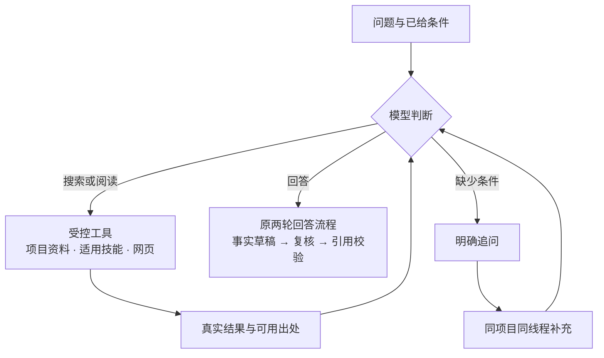

# Agentic RAG

当前默认组合为 `compose@33 / ladder@15 / retrieve@8 / rerank@2`。模型自主决定检索、阅读、继续调查或追问，事实回答继续经过原有出处校验。

模型先判断这一轮是否需要检索，再选择查询或阅读工具。每次工具返回的真实结果都进入下一次模型请求，由模型继续调查、交给原回答流程，或明确追问缺少的条件。

| 阶段 | 行为 | 本项目中的对应能力 |
| --- | --- | --- |
| S1 朴素 RAG | 固定检索，再生成回答 | 作为演进起点；旧检索版本保留显式回放 |
| S2 自主检索 | 模型决定要不要查、搜索词、阅读对象与是否继续 | 有界决策循环；搜索和阅读结果返回模型后再判定 |
| S3 多源调查 | 结合本地资料、技能说明与网页结果继续查询 | 复用记忆四层检索、当前项目已启用且适用技能的只读加载及已配置网页搜索 |
| S4 多轮协作 | 缺少条件时显式追问，收到补充后继续 | 同项目、同线程的真实待补充状态承接原问题及新增条件 |

## 工具与资料范围

- **本地资料**沿用项目、场景、来源修订和私密范围。搜索给出真实目录，阅读只接受目录中允许的对象与范围。`summary` 阶段包含认识 L3 和摘要 L2，再沿认识与文档关联读整理稿 L1、原件 L0。当前层没有合格候选时，同一次查询依次检查下层，在首个有候选的层停止；已经查过的空层与实际命中层均记录在调查深度中。有上层关联时，下层仍须满足原关联资格。真实正文、坐标和引用身份继续由原资料服务读取和校验。
- **技能**复用已有目录、加载器、绑定及原启用与适用性规则，只有当前项目已启用、符合触发条件、任务种类及所需项目和来源上下文的技能才可读取。说明用于安排调查，不自动成为事实依据，也不授予脚本执行权限。
- **网页**需要先在设置中配置并启用搜索用途及其外发权限。模型可以看到工具当前是否可用；未配置或未启用的网页工具返回不可用状态，供模型改换来源。各次实际搜索保留自己的查询、真实子轮次、结果、权限闭包与回执；引用仍对应产生该结果的搜索。成功和失败搜索的实际调用都保留用量归属，未知用量继续标为未知。

记忆的定义保持为原件 L0、整理稿 L1、摘要 L2、认识 L3。调查中的深入阅读表示从概览追到正文与原件，不产生新的 L4 记忆层。当前工具范围不包括任意业务表查询、运行日志读取或任意命令执行。

## 继续、回答与追问

模型读取已有结果后再决定下一步。每次提问最多 6 次调查决策，单次决策的有效期限为 20 秒；重复工具操作、连续两步没有新增资料或阅读深度、完整输入容量不足、决策超时或次数用尽时结束调查。停止原因只说明执行为何结束，不证明证据已经语义完整。

新组合允许最多 9 个嵌套模型句柄，分别供最多 1 次历史压缩、6 次调查决策和原作答流程的 2 次主要调用使用。这是内核的句柄额度，实际传输次数、重试、搜索调用和费用按各自真实回执计量。

进入事实回答时，由 `compose@33` 沿原两次主要调用形成草稿、复核纠正并校验引用。明确会话或记录日期须匹配同一来源冻结标题或非引语日期头的唯一日期；该资格只用于记录上下文，事件日及计算引用继续原校验。原件资格、修订、私密、遗忘与外发权限在派发和结果使用时继续复验，历史对话只用于理解条件与指代。

只有同项目、同线程最新一轮的真实追问才能等待补充，其标记须与已完成轮次及原模型决策相符。后续补充即使没有问号也能承接原问题；已解决的追问不再恢复，不同项目或线程、显式记住等操作不继承。补充的条件用于新一轮调查，旧历史不替代本轮资料证据。

普通回答路径没有可用资料时，保留原无匹配落点，日常项目仍可沿原入口转到相关项目。模型正在明确追问时保留当前对话，等待用户补充。

## 版本与验证边界

自主循环自 `retrieve@6` 引入。`retrieve@7` 的通用提示要求清空各动作不适用的字段，并在缺少决定答案的产品、版本或环境等必要条件时先追问。当前 `retrieve@8` 继承这些规则，并在当前层为空时，复用同一次查询的合格候选依次检查下层。该检查沿用原六次决策、连续两次无进展和最多八条结果的预算；有候选即停，搜索次数与模型请求保持原规则。`compose@33` 修复同源会话日期上下文误拒，`ladder@15 / rerank@2` 保持；旧检索与回答版本可显式回放。

原固定开发集的 12 题属于 `compose@30 / ladder@15 / retrieve@5 / rerank@2`。2026-10-21 完整原文复核同一批冻结回答为 10 正确、2 部分正确、0 错误、0 未发布；原 36 次请求、335,444 输入与 12,498 输出词元保持。各批样本、评分日期、失败与用量见 [测评总览](evaluation.md) 与 [RAG 试点评测](rag-pilot.md)。

`retrieve@6` 当时默认配置的完整应用工厂，已在临时 SQLite、真实 Turn 与领域流程中通过 31 个断言：重查、分层阅读、追问衔接、网页未配置及幂等。模型响应来自本机回环 HTTP 固定运输替身。

另行的隔离控制检查网页成功和失败调用的用量归属、技能资格及撤权，网页结果使用固定返回。这些控制与上述 31 个断言分别记录。这一批工程验收未增加付费模型调用，也不提供真实模型的回答正确率、检索质量、耗时或费用结论。

2026-10-15 的真实 DeepSeek 验收在两条预索引合成场景中，最终以 `retrieve@7` 完成三个工作台输入、17 项功能检查：搜索和阅读后再判定、真实追问，以及同线程无问号补充后的承接。追问正文也含条件差异说明，但该轮没有主要作答调用或正式引用，不计作最终引用审阅后的事实回答。

首轮 `@6` 的决策字段失败和第二轮 `@7` 的内部历史证明重复展开失败均保留。三期共 38 次真实模型请求、51,797 输入 / 4,877 输出词元，未知用量 0，未核实货币费用。真实逐轮结果与耗时见 [测评总览](evaluation.md#agentic-rag-真实多轮验收)；这些少量功能样本不代表总体正确率、真实网页或向量质量，也不提供性能提升结论。
