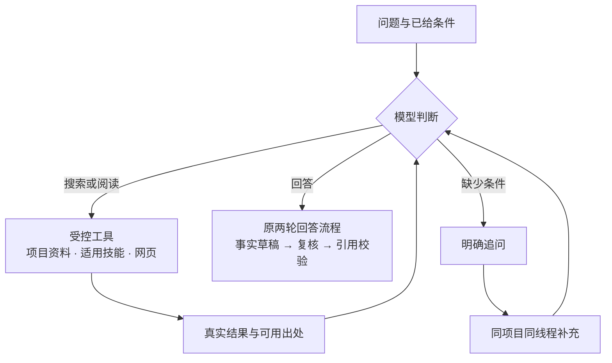

# Agentic RAG

当前默认组合为 `compose@34 / ladder@15 / retrieve@9 / rerank@2`。模型自主决定检索、阅读、继续调查或追问，事实回答继续经过原有出处校验。

模型先判断这一轮是否需要检索，再选择查询或阅读工具。每次工具返回的真实结果都进入下一次模型请求，由模型继续调查、交给原回答流程，或明确追问缺少的条件。

| 阶段 | 行为 | 本项目中的对应能力 |
| --- | --- | --- |
| S1 朴素 RAG | 固定检索，再生成回答 | 作为演进起点；旧检索版本保留显式回放 |
| S2 自主检索 | 模型决定要不要查、搜索词、阅读对象与是否继续 | 有界决策循环；搜索和阅读结果返回模型后再判定 |
| S3 多源调查 | 结合本地资料、技能说明与网页结果继续查询 | 复用记忆四层检索、当前项目已启用且适用技能的只读加载及已配置网页搜索 |
| S4 多轮协作 | 缺少条件时显式追问，收到补充后继续 | 同项目、同线程的真实待补充状态承接原问题及新增条件 |



## 工具与资料范围

- **本地资料**沿用项目、场景、来源修订和私密范围。搜索给出真实目录，阅读只接受目录中允许的对象与范围。`summary` 阶段包含认识 L3 和摘要 L2，再沿认识与文档关联读整理稿 L1、原件 L0。当前层没有合格候选时，同一次查询依次检查下层，在首个有候选的层停止；已经查过的空层与实际命中层均记录在调查深度中。有上层关联时，下层仍须满足原关联资格。真实正文、坐标和引用身份继续由原资料服务读取和校验。
- **技能**复用已有目录、加载器、绑定及原启用与适用性规则，只有当前项目已启用、符合触发条件、任务种类及所需项目和来源上下文的技能才可读取。说明用于安排调查，不自动成为事实依据，也不授予脚本执行权限。
- **网页**需要先在设置中配置并启用搜索用途及其外发权限。模型可以看到工具当前是否可用；未配置或未启用的网页工具返回不可用状态，供模型改换来源。各次实际搜索保留自己的查询、真实子轮次、结果、权限闭包与回执；引用仍对应产生该结果的搜索。成功和失败搜索的实际调用都保留用量归属，未知用量继续标为未知。

记忆的定义保持为原件 L0、整理稿 L1、摘要 L2、认识 L3。调查中的深入阅读表示从概览追到正文与原件，不产生新的 L4 记忆层。当前工具范围不包括任意业务表查询、运行日志读取或任意命令执行。

## 继续、回答与追问

模型读取已有结果后再决定下一步。每次提问最多 6 次调查决策，单次决策的有效期限为 20 秒；重复工具操作、连续两步没有新增资料或阅读深度、完整输入容量不足、决策超时或次数用尽时结束调查。停止原因只说明执行为何结束，不证明证据已经语义完整。

新组合允许最多 9 个嵌套模型句柄，分别供最多 1 次历史压缩、6 次调查决策和原作答流程的 2 次主要调用使用。这是内核的句柄额度，实际传输次数、重试、搜索调用和费用按各自真实回执计量。

进入事实回答时，由 `compose@33` 沿原两次主要调用形成草稿、复核纠正并校验引用。明确会话或记录日期须匹配同一来源冻结标题或非引语日期头的唯一日期；该资格只用于记录上下文，事件日及计算引用继续原校验。原件资格、修订、私密、遗忘与外发权限在派发和结果使用时继续复验，历史对话只用于理解条件与指代。

只有同项目、同线程最新一轮的真实追问才能等待补充，其标记须与已完成轮次及原模型决策相符。后续补充即使没有问号也能承接原问题；已解决的追问不再恢复，不同项目或线程、显式记住等操作不继承。补充的条件用于新一轮调查，旧历史不替代本轮资料证据。

普通回答路径没有可用资料时，保留原无匹配落点，日常项目仍可沿原入口转到相关项目。模型正在明确追问时保留当前对话，等待用户补充。

## 版本与验证边界

自主循环自 `retrieve@6` 引入。`retrieve@7` 的通用提示要求清空各动作不适用的字段，并在缺少决定答案的产品、版本或环境等必要条件时先追问。当前 `retrieve@8` 继承这些规则，并在当前层为空时，复用同一次查询的合格候选依次检查下层。该检查沿用原六次决策、连续两次无进展和最多八条结果的预算；有候选即停，搜索次数与模型请求保持原规则。`compose@33` 修复同源会话日期上下文误拒，`ladder@15 / rerank@2` 保持；旧检索与回答版本可显式回放。

原固定开发集的 12 题属于 `compose@30 / ladder@15 / retrieve@5 / rerank@2`。2026-10-21 完整原文复核同一批冻结回答为 10 正确、2 部分正确、0 错误、0 未发布；原 36 次请求、335,444 输入与 12,498 输出词元保持。各批样本、评分日期、失败与用量见 [测评总览](evaluation.md) 与 [RAG 试点评测](rag-pilot.md)。

`retrieve@6` 当时默认配置的完整应用工厂，已在临时 SQLite、真实 Turn 与领域流程中通过 31 个断言：重查、分层阅读、追问衔接、网页未配置及幂等。模型响应来自本机回环 HTTP 固定运输替身。

另行的隔离控制检查网页成功和失败调用的用量归属、技能资格及撤权，网页结果使用固定返回。这些控制与上述 31 个断言分别记录。这一批工程验收未增加付费模型调用，也不提供真实模型的回答正确率、检索质量、耗时或费用结论。

2026-10-15 的真实 DeepSeek 验收在两条预索引合成场景中，最终以 `retrieve@7` 完成三个工作台输入、17 项功能检查：搜索和阅读后再判定、真实追问，以及同线程无问号补充后的承接。追问正文也含条件差异说明，但该轮没有主要作答调用或正式引用，不计作最终引用审阅后的事实回答。

首轮 `@6` 的决策字段失败和第二轮 `@7` 的内部历史证明重复展开失败均保留。三期共 38 次真实模型请求、51,797 输入 / 4,877 输出词元，未知用量 0，未核实货币费用。真实逐轮结果与耗时见 [测评总览](evaluation.md#agentic-rag-真实多轮验收)；这些少量功能样本不代表总体正确率、真实网页或向量质量，也不提供性能提升结论。

## 初检快路径候选（未默认启用）

`retrieve@10` 是独立候选，默认仍为 `@9`。离线应用测试通过既有策略配置显式启用，并把版本冻结到同一 Turn：

```python
from backend.memory_app.v2.policies import override

with override(retrieve='@10'):
    # 在隔离应用中发起正常的工作台 ask 请求。
    response = client.post('/api/v2/workbench/turns', headers={
        'Idempotency-Key': 'initial-memory-example'}, json={
        'project_id': 'alpha', 'intent': 'ask',
        'text': '星桥服务在开发环境的重试上限是多少？'})
```

该候选先用原查询收集 L3/L2/L1，再沿现有选材和容量合同判断。只支持明确主体、有限属性、非负整数及有限单位的单槽直述。主体保留 ASCII 标识符，并支持“两个汉字名干＋服务/系统/项目/组件/模块”的裸中文名，如“星桥服务”；其他中文名须用成对的 `「…」` 或 `“…”` 标明名称边界，内部为2至16个连续汉字。含指代、时间、量化、连接、条件或否定等保留字符的中文主体继续调查，不尝试消解自由语义；部分合法名称也可能保守回退，主体内部空白或中英混排不支持。

属性为重试上限、并发上限、连接上限、超时上限、等待时长、批次大小或缓存上限；适用条件为空或明确的开发、测试、生产、预发布环境标签。例如真实发布的认识正文为“星桥服务的重试上限为 3 次。”，适用条件为“开发环境”，可回答“星桥服务在开发环境的重试上限是多少？”及等价的“星桥服务在开发环境的重试上限为多少？”。引用名称也沿同一主体规则匹配，例如 `「星河数据平台」的缓存上限是多少？`；“几次/多少秒”这类带请求单位的问法尚未支持。只允许语法词项之间的空白，不能合并主体或数字内部的空白。原问题、认识正文与全部条件必须严格匹配。真实发布、当前来源资格、确认时间和有效区间、同槽全集及登记冲突、完整引用均须可核验。缺字段或无法判定就继续调查，不以相似度、词覆盖或 `heuristic_sufficient` 代替充分性证明。

满足门槛时只省去调查 decision，仍经过 `compose@34` 的事实首稿、复审和公开前引用校验。最终值或引用不符沿既有失败路径保留记录。门槛本身不调用模型；实际检索仍可能使用已配置的 embedding/rerank，不能据此承诺一次请求或几秒响应。

不满足时，首轮调查看到真实初检窗口。同一原查询补查 L0并复用已取得的上层结果，新的查询继续普通检索。前文依赖、未解澄清、复合条件、多槽、开放列举、比较、推断、不支持的时间问法不进入首版直答。只有 L0 的原文简单事实目前也继续调查；该候选尚未实现“原文已充分即可快答”。可见的历史 L1/L2 不自动视为已确认的 L3。

`trace[0].initial_memory` 记录 `route`、`reason`、`probe_collections`、`remainder_collections`、`reused_queries`、`probe_seconds` 及 `decision_invocations`。这些是实际分支和领域调用/逻辑决策次数，**不是服务商物理请求数**；物理请求、重试与实际 token 仍以原生模型尝试和回执为准，缺失用量保留未知。`route=direct` 表示路由选择，最终成功还须核同轮终态，不能把失败快答计作成功。

中文零模型链路控制通过正常工作台文本创建、整理与文档确认，再生成经历及原文候选、HTTP 编辑与确认认识，最后走实际 collector 和工作台；确认记录、有效期和来源投影由原服务产生。候选确认不能替代来源文档确认。它分别检查已确认单事实命中、未确认与已确认同槽冲突回调查，并核本地原生调用记录。整理和回答运输与用量数字为合成控制，不证明自动模型提炼的自然命中率、真实回答质量或延迟。

固定48题直接导入长对话且上三层为空，应作为原文调查回归，不能称为记忆塔评测。记忆塔场景需另用无 heldout 交叉的资料，走真实整理与人工确认、发布后冻结记忆；标准答案不参与建塔。两组分别报告路由率、质量、物理请求、实际输入/输出 token 及全部尝试的平均/中位/P95耗时，建塔成本另列。零模型合成运输控制只验证流程与计量，不提供真实模型质量或性能改善结论。

## 原文抽取快路径候选（未默认启用）

`retrieve@11` 是单独的原文候选，默认仍为 `@9`，既有 `@10` 不变。用上述 `override(retrieve='@11')` 显式启用并冻结到 Turn。该候选同一次收集 L3/L2/L1/L0，再尝试原文合同；只接纳本次完整取得的 L0 Source，不把上层认识或截断对话伪装成原文直述。默认 `compose@34` 两轮合同保持；候选接受时使用独立 `raw-answer-v1` 单轮生成及冻结证明，回调查后仍用旧决策和两轮作答。

最小支持域是开放词面的单事实问句及同形直述，例如：

| 原问题 | 完整原文 |
| --- | --- |
| 星河项目的重试上限是多少？ | 星河项目的重试上限是3次。 |
| 小明的家乡是哪里？ | 小明的家乡是“苏州”。 |
| What is the retry limit of Project Cedar? | The retry limit of Project Cedar is 3 retries. |
| What is Maya's hometown? | Maya's hometown is Oslo. |

主体和属性从原问题独立解析，不枚举业务名字或属性。只支持有限属格句法；显式环境前缀和 ISO 日期前缀必须与原文逐项一致。当前支持的环境为开发、测试、生产、预发布及对应的 development/testing/production/staging。值仅支持数值及有限计量单位、单个 ASCII 标识符，或成对引号包住的字面字符串；引用字符串保留引号及每个原字，不能借引号外附加文字隐藏限定。任意多词或未标界中文字符串不能证明是无附加条件的值，例如无引号中文姓名会继续调查，不靠无限排除词假装语义已确定。记录导入时间不替代事件日期；当前、最新、相对日期、跨记录指代、语义同义改写、开放计数或多要求问题继续调查。部分正常措辞也会因保守语法排除而回退。

原文必须是实际完整窗口中的平铺独立声明，每个非空行都可解析。标题、对话头、未知限定、否定、缺失上下文或截断窗口不能靠摘取一句证明充分。新候选只在既有窗口长度上限内补足相关完整原文的发现，保留同主体、同属性的一般声明、条件例外和未知限定，不能在发现阶段先只留下单条“足够”的材料。最终统一检查检索到的全部记录：同槽不同值、无条件问题存在必要限定，或一般声明与显式条件记录冲突，均回调查。这个检查**不证明检索范围外不存在冲突**。

原问题或原文主体、属性中的“最新、现任、截至”等明确时序修饰，以及 `latest/newest/current/up-to-date/as-of` 等英语表达，会保留原字并回调查；不会删去修饰后构造空时间合同。英语语法词按大小写折叠及空格、连字符、下划线等已允许的边界识别，也检查中文槽位中的英语混排。单条明确 ISO 日期不能证明“最新”，因此带日期又要求最新的问句仍回调查；既有不含相对修饰的日期精确匹配保持。引号内的完整字面值可以包含这些词，但不替原问题提供时效证明。裸业务名与这些语法词重合时也可能保守回退；有限语法排除不构成任意时序同义表达的语义识别。

单次生成返回回答、完整引文、unit及主体/属性/值/条件/时间的结构覆盖。程序重新从原问题和原文解析这些字段，逐项比对，模型不能删减槽位或用 `covered=true` 自证充分。最终只发布原文的完整值或整条声明，程序加引用及“检索到的原文”范围说明；任意释义不在该合同内。来源必须具有现有接纳 owner 的确认状态、hash、项目、URI和时间，并在派发前后、发布前复验真实修订与外发资格。

验收不足或稳定的生成失败会复用初检缓存进入调查，不再重复同一查询；已有引用但漏覆盖也会拒收。被拒收的原始输出、失败尝试和未知用量保留。没有增加专用充分性模型请求，也不再请求一轮“修补快答”。来源、授权或冻结配置变化会停止本轮，不能当普通证据不足继续使用旧资料。

`trace[0].raw_fast_path` 记录路由原因、初检/复用/调查次数、`generation_invocations`、`generation_physical_attempts`、生成耗时及用量是否完整。一个成功的无重试控制为一次逻辑生成、一次物理尝试；运输重试可增加物理请求。候选的总句柄上限由9增为10以容纳被拒收的一次生成，原六次调查决策上限不变。回退的实际调用数必须包含该生成及其全部重试，不能笼统称“一次请求”。

原文-only零模型链路使用现有 `CaptureWorkbenchTextSource` 接纳 owner：自行产生原文确认状态、来源身份和真实索引，只发布 Source，上三层记录确实为空，不伪造文档确认或门槛字段。工作台文档确认本身会生成 L1/L2，属于另一条链路。合成运输控制分别验证中英直答、完整性拒收、已知条件冲突、调查复用、失败重试和回放；它们不代表任意长聊天可快答，也不提供真实质量、Recall、token或延迟收益。原48题回归与真实上层记忆收益继续分轨，建塔成本另列。

## 日期复核投影候选（未默认启用）

显式 `override(retrieve='@11', compose='@35')` 可测试日期复核候选。默认仍为 `retrieve@9 / compose@34`，旧34的冻结消息与验收行为保持。35沿用34的Schema、calendar3和两轮作答预算；原文及已确认认识的初检门槛兼容35，门槛本身不放宽。

普通 `fact` 中出现派生日期时，合法ref也不自动授予计算资格。35仅在首末核心字段一致、首稿位置单一、错误限于日历分类、已有ref绑定完整唯一原句且合法计算结果吻合时，在派生副本中实际改为 `kind=date` 和 `action=correct`，随后重跑原出处、日期和位置守卫。不会只修改reason、宽免adopt、猜补ref或重锚相邻事件。

无法验证换算但原始引文合格时，候选可保留真实相对时间原句，明确本轮换算未验证；记录层标签与引用片段分开，不据此推断片段内人称归属或拼造原文。不能残留无据绝对日期或宣称资料没有答案。损坏的来源、授权、引用和冻结输入继续中止。没有第三轮修补生成或额外充分性请求。

原生冻结模型输入和Pydantic模型结果保持不变；程序派生结果由执行端与proof选择器共用纯函数复算。`trace[0].calendar_review` 仅记录路由、计数和固定码，日志只保留脱敏诊断码，不记录题目、引文、日期值或异常正文。HTTP请求成功与答案本地验收分别保留，不能把本地拒收改成服务商传输失败。零模型控制不提供新质量、费用或延迟结论。

`compose@36` 在35之上增加有据日偏移解释的参照日期核验，默认仍为34。仅 `kind=date`、唯一已绑定完整原句的计算ref、同源支持引文及冻结派生注释共同有效时，才能把紧邻日偏移短语的真实记录锚识别为计算参照；偏移方向、数量须与完整合法结果一致，两日期须通过完整括号或紧邻等价解释桥配对，不能跨句借权。中文有限日偏移与英文数词沿用现有计算器，不扩大任意时间语义。

该资格只属于本次算术参照的具体日期位置，不能授权同段“事件发生于记录日”等额外日期、跨来源借锚、错误偏移或缺失ref。旧34/35的冻结验收行为保持；36复用35的分类修正和原文降级，仍无额外修补生成，运行端和proof核对同一结果。服务器真实复验须显式冻结36。
