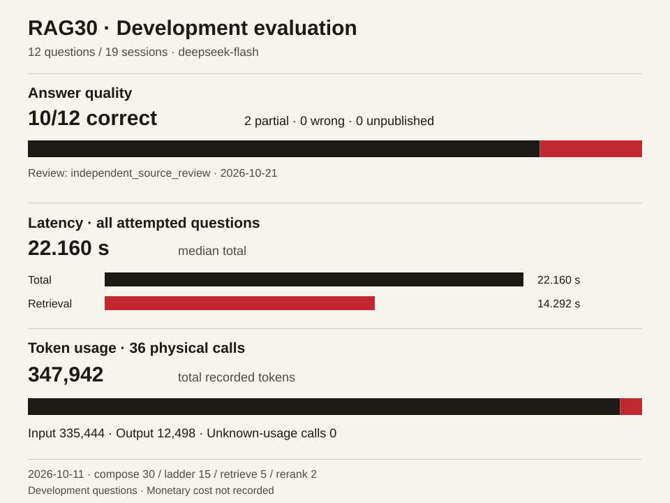

# 测评与验收

更新于 2026-10-21。先列固定开发题的回答质量、延迟与用量，再列多轮功能验收和历史实验。所有指标保留各自的样本、版本与评分方式。

## 固定开发题结果

`RAG30-20261011` 使用 LoCoMo 第一份英文对话的 19 个 session、12 道固定开发题，以及真实 DeepSeek Flash 和本机 EmbeddingGemma 2。这轮运行的策略为 `compose@30 / ladder@15 / retrieve@5 / rerank@2`。



2026-10-21 对这批冻结回答重新逐题核对全部原文，结果为 **10 正确、2 部分正确、0 错误、0 未发布**。全 12 次尝试的总耗时中位数为 **22.160 秒**，输入 **335,444**、输出 **12,498** 词元，共 **36 次物理模型请求**。用量包含主要作答和重排；货币费用没有记录。这些题反复参与开发，本次审阅沿用原回答，没有新增作答请求。

图示与[机器可读聚合](images/evaluation-summary.json)由 [`tools/rag_report.py`](../tools/rag_report.py) 从实际逐题结果、调用用量和独立审阅生成。工具逐项核对送审回答与运行回答、问题分母、策略、调用数量及原文件内容；SVG 内含聚合数据，并校验条形比例。用公开聚合重建图示，无需模型或私有语料：

```powershell
.\.venv\Scripts\python.exe tools/rag_report.py `
  --summary docs/images/evaluation-summary.json `
  --output work/evaluation-report
```

已有完整原始档案时，可以重新汇总并用 `--check` 核对现有产物。以下为通用目录示例：

```powershell
.\.venv\Scripts\python.exe tools/rag_report.py `
  --rag30 work/evaluation/rag30-results `
  --pilot work/evaluation/pilot-results `
  --review work/evaluation/independent-review.json `
  --output work/evaluation-report --check
```

原始目录包含 `manifest.json`、`project-*.json`、主要调用的 `canonical-*.json`、`rerank-wires.json`、冻结运行与送审清单。独立裁决使用 `kind=independent_source_review`、`method` 和 `verdicts`；每题有 `qa_index`、`verdict`，取值为 `correct / partial / wrong / unpublished`。单独的送审清单只证明覆盖范围。公开聚合保留来源类型及复核日期，原文、标准答案、逐题回答和私人运行信息保存在本地档案中。

当前问答默认是 `compose@30 / ladder@15 / retrieve@7 / rerank@2`，另用 `rank@4 / vector@1`。整理默认仍为 `organize@1 / material_analysis@1 / extract@5`。较新的候选实现可显式选择，是否合入源码与是否启用为默认分别记录。

## 留出数据与标注质量

`locomo-heldout@1` 固定种子 `20261021`，在原始 10 份会话中先排除开发会话，再要求原类别 1–4 各至少 3 题，从符合条件的会话中抽取 4 份，每份按类别各取 3 题。抽样先于答案生成与评分，清单、原话投影及标注质量分别冻结。

| 数据 | 会话 | 问题 | 对话 session / 消息 | 状态 |
|---|---:|---:|---:|---|
| 原开发集 | 1 | 12 | 19 / 419 | 冻结回答与原文复核见上节 |
| 新留出集 | 4 | 48 | 116 / 2,536 | 仅准备资料，模型调用 0 |

新会话为 `conv-41 / conv-44 / conv-47 / conv-49`，原数组位置为 `2 / 5 / 6 / 8`；类别 1–4 各 12 题。与原开发集的会话和问题文本重叠均为 0。新题没有作答或语义评分。

48 题均有答案和非空证据标注，其中 47 题的全部原子证据编号可在对应原文中找到。`conv-47` 的 `qa_index=38` 包含不存在的 `D4:36`，另两条证据 `D18:1 / D18:7` 存在。原标注保持，显式新数据运行将该题记为 `invalid_source_annotation`，Evidence Recall 与 `all_evidence_found` 为 null，有效证据 Recall 问题分母为 47；答案语义仍可独立评分。编号存在的检查只验证定位资格，具体证据与答案的关系由后续事实审阅判断。

`quality.json` 登记全部 1,986 条上游 QA 的类别、缺失标注、组合编号、无效格式及不存在的编号。类别 5 按其原有标注边界另列。标准答案、类别及上游总结保留在评测侧，`sessions.json` 只由唯一原始文件的对话消息生成，供原检索与生成流程读取。

使用本地已有的原始 LoCoMo、许可证和开发清单准备数据；原资料继续按上游 CC BY-NC 4.0 管理。运行入口不复制整份原始文件：

```powershell
.\.venv\Scripts\python.exe tools/rag_dataset.py `
  --raw-data work/rag-pilot-20261010/locomo10.json `
  --development-manifest work/rag-pilot-20261010/manifest.json `
  --license work/rag-pilot-20261010/LICENSE.locomo.txt `
  --seed 20261021 --conversations 4 `
  --output work/evaluation-data/heldout-v1
```

入口为输出目录的 `index.json`，它指向四份原形状 `manifest.json` 和四份原话 `sessions.json`，同目录另有质量记录 `quality.json`。复现时加 `--index work/evaluation-data/heldout-v1/index.json`，并将 `--output` 指向新目录。已有输出先整体核对，相同重放保留字节与修改时间，冲突在写入前抛出错误。

原 `rag_pilot.py` 与 `rag_compare.py` 可直接消费冻结会话。以下仅准备第一份新会话，另外三份将 `conversation-2` 换为 `conversation-5 / conversation-6 / conversation-8`，并分别使用新的输出目录：

```powershell
.\.venv\Scripts\python.exe tools/rag_pilot.py `
  --raw-data work/rag-pilot-20261010/locomo10.json `
  --manifest work/evaluation-data/heldout-v1/conversation-2/manifest.json `
  --seed 20261021 --output work/evaluation-data/pilot-conv41 --prepare-only

.\.venv\Scripts\python.exe tools/rag_compare.py `
  --raw-data work/rag-pilot-20261010/locomo10.json `
  --manifest work/evaluation-data/heldout-v1/conversation-2/manifest.json `
  --seed 20261021 --output work/evaluation-data/compare-conv41 --prepare-only
```

`--prepare-only` 在模型配置、索引和问答执行前结束。两种入口先核冻结题目、完整原话与 baseline 身份；已有答案只能沿对应冻结输入读取。原默认 12 题清单和原 36 条已保存结果的默认评分保持。真实验证包括八次会话准备、四次失配前置拒绝、十份 JSON 重建一致及已有文件保护，新增模型调用 0。

## Agentic RAG 真实多轮验收

2026-10-15，复用项目已配置的 DeepSeek 模型，在隔离数据根运行两条合成场景，预定三个用户输入。合成的旧格式原件已预先建立索引；三期沿用原问题、正文及严格输出校验。

| 批次 | retrieve | 实际结果 | 新增物理模型请求 |
| --- | --- | --- | ---: |
| 01 | @6 | 两个首问均搜索、阅读后提出作答，但决策字段不合法，进入原 compose 回答；第二条未追问。A / B 耗时 9.614 / 9.910 秒，多轮验收未通过 | 10 |
| 02 | @7 | A 多轮检索后作答，B 合法追问，C 补充轮因内部历史证明重复展开触发既有深度限额，工作台返回 502。A / B / C 耗时 9.286 / 4.775 / 14.025 秒 | 14 |
| 03 | @7 | 修复内部证明承接后，三个工作台响应均为 200，17 项功能检查通过 | 14 |

01 的错误源于 answer 决策携带非空 ids；@7 只补充通用动作字段与必要条件追问指令，保留严格校验。03 使用原不可变输入引用承接历史证明，未放宽既有深度、引用或权限约束。38 个模型请求的运输与内核模型终态均成功，01 和 02 的工作台流程失败仍单独保留。

| 03 用户输入 | 真实决策与结果 | 物理模型请求 | 记录耗时 |
| --- | --- | ---: | ---: |
| A，第一条链 | search → read → answer，进入原有据作答流程 | 5 | 9.709 秒 |
| B，第二条链首问 | search → read → clarify，追问必要条件 | 3 | 4.908 秒 |
| C，同线程无问号补充 | 承接原问，search → read → answer | 6 | 14.175 秒 |

B 的追问同时解释了已读到的条件差异，实际动作为 clarify，没有调用主要作答阶段，也没有正式引用；这段解释不计作已完成引用审阅的事实回答。表中耗时按各用户输入分别记录，不是含用户等待时间的整条链指标。

01 使用 14,478 输入 / 1,647 输出词元；01–02 累计 24 次请求、33,072 / 3,238 词元。03 新增 14 次请求、18,725 / 1,639 词元。三期合计 **38 次真实模型请求、51,797 输入 / 4,877 输出词元，未知用量调用 0**，包含前两期失败成本；货币费用未核实，未按价格换算。

独立只读复核核对了三个响应、九个合法决策、真实工具结果反馈、16 个目录证据单元的原文坐标及连续 38 条用量记录，复核未新增模型调用。这是两条合成链的功能验收，不是 38 道题或总体正确率，也未验证真实网页搜索、上传后的 AI 整理、冷索引或向量质量。它与旧 12 题及固定运输的 31 个断言分别记录，不作性能提升结论。

## 历史 12 题问答（retrieve@5）

运行标签 `RAG30-20261011`，当时已激活组合为 `compose@30 / ladder@15 / retrieve@5 / rerank@2`。DeepSeek Flash 真实作答，EmbeddingGemma 2 文字模型输出 256 维向量。2026-10-21 独立 Agent 完整读取 19 个 session、419 条消息、12 份最终回答及其 34 项引用，按来源事实逐题审阅；审阅没有新增模型 API 调用。

| 指标 | 实际结果 |
|---|---:|
| 固定问题 / 对话原件 | 12 / 19 |
| 2026-10-21 事实复核：正确 / 部分正确 / 错误 / 未发布 | **10 / 2 / 0 / 0** |
| 新增真实模型请求 | 36 |
| 输入 / 输出词元 | 335,444 / 12,498 |
| 合计词元 | 347,942 |
| 全 12 题总耗时中位数 | 22.160 秒 |
| 召回耗时中位数 | 14.292 秒 |

正确要求主要结论与完整原文一致，并完成问题需要的事实；有证据支持的未知回答及明确标注的合理推断可以正确。部分正确表示已有内容有依据，但漏掉关键事实或可完成的日期推算；本轮两题分别存在关键身份线索与日期遗漏。错误表示主要结论与原文冲突，或将无依据的关键判断当成事实；未发布表示没有最终公开回答。判定逐题读取完整回答，结合说话人、时间和图像说明，不按答案子串、F1 或长度自动定级。样本只有一份英文对话。

该轮复用 112 条已有资料向量；问题向量缓存命中不计作新编码。新请求在原账本之后追加，范围为 259–294，旧前缀保留，无隐藏单题重试。输入与输出是实际记录用量，未依据价格换算账单。延迟包含该轮检索与回答，不代表所有设备、模型或材料长度的响应保证。

## 问答协议与未激活候选

数据来自 [LoCoMo 官方仓库](https://github.com/snap-research/locomo)，使用第一份完整对话的 19 个 session，保留日期、说话人、发言身份与图片文字描述。种子 `20261010` 从原数字类别 1–4 各抽 3 题，固定清单后作答；类别 5 和专门注入的无答案问题未覆盖。上游数据采用 [CC BY-NC 4.0](https://github.com/snap-research/locomo/blob/main/LICENSE.txt)，原文、标注和逐题输出不随本项目的 AGPL 代码分发。

这些问答库直接播种 L0 原件，不摄入上游总结或 QA 标注；标准答案及题型标签不传给检索或生成。路径覆盖真实 `WorkspaceQuery.prepare_ask → execute_ask`、向量缓存、内核回答及回执，HTTP 上传、AI 整理、每日归纳和 L3 确认需要分别验收。

以下三轮历史问答使用相同 12 题和 `deepseek-flash`、温度 0、空历史，每题有两次主要生成调用并使用重排。总容量上限为 200,000 词元，输出预留 7,000，指令、Schema、画像、历史和消息包装均计入预算。预算估算不等于服务商精确分词。各轮均完整尝试 12 题，失败题保留且计入全尝试耗时；配置中的评分预留没有被当作已执行调用。

| 运行标签与日期 | compose / ladder / retrieve / rerank | 实际结果 | 全 12 次尝试总耗时中位数 | 输入 / 输出词元 |
|---|---|---|---:|---:|
| **RAG30 · 2026-10-11，当时已激活** | 30 / 15 / 5 / 2 | 2026-10-21 复核：10 正确、2 部分、0 错误、0 未发布 | 22.160 秒 | 335,444 / 12,498 |
| RAG31 · 2026-10-12，未激活 | 31 / 16 / 5 / 2 | 8 正确、2 部分、1 错误、1 未发布 | 22.4875 秒 | 363,001 / 11,188 |
| RAG32 · 2026-10-12，未激活 | 32 / 16 / 5 / 2 | 6 题发布、6 题未发布；已发布题为保守有据回答，仍漏一处已知庆祝日 | 25.525 秒 | 465,671 / 17,920 |

RAG31 与 RAG32 是 2026-10-12 的未激活候选，策略组合见上表；各新增 36 次真实请求，范围分别为 295–330、331–366。全部请求的运输结束标记为 `stop`，最终出处与内容守卫仍可能拒收回答。RAG32 只看成功 6 题的中位数为 20.228 秒，不能代替表中完整 12 次尝试的 25.525 秒。

RAG32 对保守未知的分类与 RAG30 不完全一致，生日题虽然保守有据，仍漏已知庆祝日。独立事实审核、早期同模型盲评和各版机器复核合同分别保留，不合并成一条准确率曲线，也不把结构校验通过当成语义正确。

## 历史三组试点

以下是 2026-10-10 的历史结果，正确数来自同一模型匿名盲评，已有独立审查发现漏判。证据 Recall 的分母为 11 道有证据标注的题；正确性使用全部 12 题。原分数保持，不改写为当前默认成绩。

| 运行与策略 | 模式 | 原始盲评正确 | 证据 ID Recall | 重排成功 / 回退 |
|---|---|---:|---:|---:|
| 初轮 `compose3 / ladder2 / retrieve3 / rank3 / rerank1` | 关键词 | 5/12 | 61.36% | 不适用 |
| 同初轮 | 关键词＋本机向量 | 6/12 | 70.45% | 不适用 |
| 同初轮 | 关键词＋向量＋DeepSeek 重排 | 6/12 | 70.45% | 3/9 |
| 复测 `compose5 / ladder5 / retrieve3 / rank4 / rerank1` | 关键词 | 5/12 | 75.00% | 不适用 |
| 同复测 | 关键词＋本机向量 | 7/12 | 77.27% | 不适用 |
| 同复测 | 关键词＋向量＋DeepSeek 重排 | 8/12 | 81.82% | 12/0 |

初轮没有显示重排增益；复测包含检索、回答策略与评分桥接的共同变化，不能把差异单独归因于某一项。早期完整原文对照中的 `7/12` 与 `9/12` 也只是原始模型评分，有已记录的漏判与答案矛盾。不同复核合同的 `validated_correct` 不能直接比较，合同通过也不保证客观正确。完整历史方法、F1、用量、失败和耗时保留在 [RAG 试点评测](rag-pilot.md#历史试点协议与记录)。

## 材料先分析实验

运行标签 `MATERIAL-20261012`，可选组合 `organize@2 / material_analysis@4 / context_preparation@1 / extract@6`。材料处理不读取后续问题或标准答案；计划处理同 19 份公开会话，以真实 DeepSeek 调用完成分析、整理及领域确认流程，再进行新的问答对照。

实际只完成 **7/19 份 L1 确认**。原账本 366 后新增 **38 次材料付费请求**；累计调用序号 **404** 的分析虽然运输与 Core 记录成功，却引用了重点段外的两条依据，领域合同拒收后停止。404 是累计请求序号。原失败保留，没有取合法子集拼成成功结果；已完成步骤的复用没有产生新运输。

目前没有最终材料冻结、新向量索引或新一轮 12 题回答与评分。该结果说明材料流程仍有未完成步骤，不能据此判断材料分析提高了召回、回答质量或速度。本次公开整理没有恢复该付费运行。

## 内置任务 v2 召回

2026-10-15，内置任务执行者的 `memory.recall` 复用现有 `WorkspaceQuery` 选材与资料库翻书，包含当前项目资料和已确认的“我”画像。读取证明冻结实际入选材料及关联资料、遗忘偏好的修订，不复制正文；草稿继承项目与画像各自的真实来源。由已读内容派生的向量或重排检索，在运输前后仍核验此前来源的权限，嵌套检索保留外层校验。

本轮使用临时合成资料，**21 项独立定向控制通过**，以下三组互不叠加早期重复计数：

| 场景 | 结果与覆盖范围 |
| --- | --- |
| 资料选取与读取边界 | **18 项通过，另 2 项未选入该组**。覆盖来源与修订、私密和遗忘、画像与翻书后的总条数、项目与画像归属、派生检索及嵌套权限校验；部分存储控制使用轻量 Turn 夹具 |
| 此前来源撤权 | **2 项通过**。从完整流程已发生的读取证明建立隔离副本：新材料 B 有效而此前 A 已撤权时，检索 HTTP 为 0；在首个检索响应期间撤销 A 时，拒收结果，不再发送后续请求或写入新的读取证明。正向控制实际使用原运输适配器，HTTP 返回为替身 |
| 明确最终交付的完整派活 | **1 项通过**。完整应用实际召回项目认识与画像，写入无正文的读取证明，以匹配交付目标的 `final_for` 新建草稿并得到完成回执；最终来源图包含读取证明、项目资料和画像，撤销画像来源权限后拒绝派生成果外发 |

存储、选材、任务与 Agent 记录、读取证明、草稿和回执使用项目实现，模型 HTTP 使用替身。21 项为 18 + 2 + 1；18 项已包含更早的 13 项存储控制和 2 项条数/归属控制，不重复相加。五个变更 Python 文件的 F821/F823 检查及差异检查通过。本轮新增付费模型请求为 **0**，不更新或覆盖此前真实 DeepSeek 的回答、用量及延迟结果，也不据此报告模型质量提升。

新建 `project.task` 默认冻结 `context_preparation@3`，沿用事件和正文去重，并向模型说明已可见工具的真实参数与用途。旧请求沿原冻结版本回放。任务召回及翻书只选取具备原件快照的资料，缺少证明的候选记为 `source_unavailable`，最终来源校验继续执行。

2026-10-20，使用公开间隔重复笔记和真实 DeepSeek 完成初稿及同线程 `continue_from`：初稿 **744 字、done、成果版本 1**，续接稿 **885 字、done、成果版本 2**，新增每日执行清单。两稿均保留每天新卡不超过 20 张及第 1、2、4、7、15 天复习的事实；原稿正文、修订与出生引用保持，两个文稿修订均为 1，成果版本通过 root/previous 关联。两轮各自的研究读取证明均核到同一原笔记，HTTP 正文、修订及上一版本回读通过。本项累计登记 **24 次模型尝试，全部终态**。

相关旧来源边界检查组为 **15 通过、22 失败**。其中两个代表节点已在未修改主线上独立复现旧夹具缺少 Agent 权限表、被 `authority_facts` 严格校验拒绝的同样失败；其余 20 项未逐项做基线对照。该组与上述 21 项定向控制分别记录，不能写成来源边界检查已全部通过。

## 工程验收

检查数用于描述特定路径的断言覆盖，不是独立质量样本或批量任务成功率。

| 能力 | 真实部分与隔离部分 | 结果 | 验证边界 |
|---|---|---|---|
| DeepSeek Harness 服务器执行，2026-10-13 | Ubuntu 22.04、普通用户、bubblewrap、官方 Harness 与真实 DeepSeek Flash；隔离数据根 | 修复后一次完整任务 **29 项检查通过**；真实 MCP 记忆工具、原 Kernel 终态与未核对草稿均回读 | 首次任务保存了草稿但 MCP 工具失败；真实公网手机派活和其他客户端账号未覆盖 |
| Harness 合并后验证 | 真实服务器完整应用、原生执行与鉴权；模型运输为合成响应 | **30 项检查通过，新增付费 0** | 独立列作工程回归，不计为第二个真实模型成功任务 |
| Hy-ASR 转写后校对，2026-10-13 | 临时 SQLite、Turn、确认与回读真实；ASR 交付和模型运输为替身 | 新增检查 **30 项通过**、旧定向检查 **13 项通过**，独立控制 **10/10** 通过 | 另 1 项评论抓取失败在改动前基线复现；尚无真实识别或纠错质量成绩，各检查组有重叠 |
| Ubuntu CPU 向量 | 真实模型资产、设备配对、加载、编码、卸载与重新加载 | 各项路径已验证 | GPU、独立向量服务联通待验 |

Harness 使用 `deepseek-harness-runtime-bin 0.1.5rc1`，原生版本 `0.1.5-rc.1`。两次真实任务的用量分别为 1,650 输入 / 852 输出，以及 2,367 输入 / 374 输出词元；合计 **4,017 输入 / 1,226 输出词元**。这是两个工作流的用量，实际模型 HTTP 请求数另按回执记录，货币费用未推算。

成功任务核对了 MCP 工具实际成功、输出 Schema、当前项目、草稿正文、鉴权回读、幂等与异用户拒读。任务文件与回执检查未发现模型密钥或设备 Bearer，临时凭据副本已清理、测试设备已作废。Linux 启动前 7 项控制与 3 项进程生命周期检查覆盖取消、超时、输出超限及派生进程清理；这些是运行器能力，工作台尚无用户取消按钮。网络沿宿主网络共享，未验证目的地白名单。安装与使用边界见 [外部 Agent](agents.md)。

Hy-ASR 同步接口没有热词参数。词表提示由本机 faster-whisper 和实时 Qwen 使用，Hy-ASR 后校对另调用辅助生成模型。当前没有 WER/CER、真实热词对照或辅助模型纠错收益；真实识别、长视频纠错和确认质量仍待验。自动化结果只支持已覆盖的结构、事务、保护项及失败回退行为。

## 复现入口与证据保留

真实多轮小样本及内置任务召回控制的合成资料、逐轮输入输出和运行记录单独保留。任务召回的可复核条件与预期现象见上表；下列公开工具对应历史问答试点协议，不能作为这两类验收的精确重放入口。

公开入口为 [`tools/rag_pilot.py`](../tools/rag_pilot.py)、[`tools/rag_compare.py`](../tools/rag_compare.py) 和 [`tools/rag_compare_validate.py`](../tools/rag_compare_validate.py)，使用方式见 [RAG 历史协议](rag-pilot.md#运行方式)。可先运行以下帮助命令核对参数，不会调用模型：

```powershell
.\.venv\Scripts\python.exe tools/rag_pilot.py --help
.\.venv\Scripts\python.exe tools/rag_compare.py --help
```

完整复现需要依法取得上游数据、安装可选向量依赖、准备模型资产与有权使用的模型配置，并在独立数据根冻结样本、源码和策略。实际付费运行还需单独确定调用预算。这两个公开工具覆盖各自记载的试点协议；最新两轮事实复核批次另有冻结配置与运行记录，不能用一次默认工具运行冒充精确重现已发布的 30/31/32 结果。

每轮保留固定样本清单、无密钥配置、策略快照、原始模型输入输出、实际选材、核心回执、用量账本、独立事实报告、失败产物及卸载状态。维护者本地保存完整证据，公开仓库只发布聚合结果、方法和代码；不公开用户资料、部署地址、设备凭据或原始评测语料。新增评测须完整保留预先固定的分母、未发布结果及失败成本。

## 与 OpenViking 的关系

本文参考 [OpenViking README 的 Proof it works](https://github.com/volcengine/OpenViking/blob/main/README.md#proof-it-works) 与其 [RAG 基准说明](https://github.com/volcengine/OpenViking/blob/main/benchmark/RAG/README.md) 的呈现方式：先给可查的结果，再列样本、模型、指标、耗时、用量和复现入口。

本项目的历史 12 题由独立 Agent 原文核对，真实多轮功能样本另行验收；OpenViking 的公开 RAG 协议使用不同的检索与评分设置。目前没有同协议、同模型、同样本的双方对照，不作共同排名或优劣结论。
