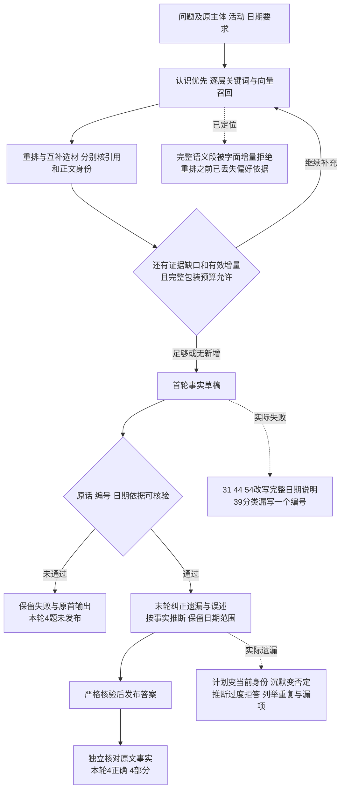
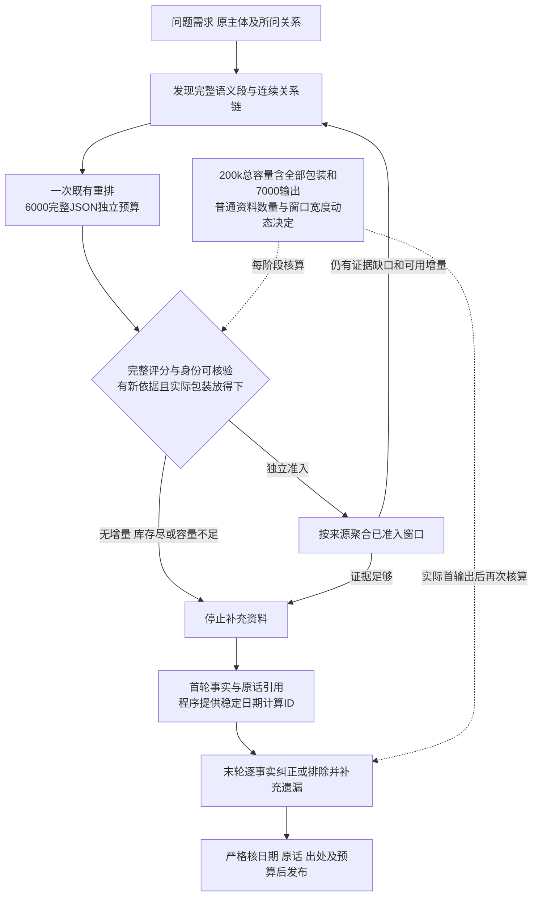
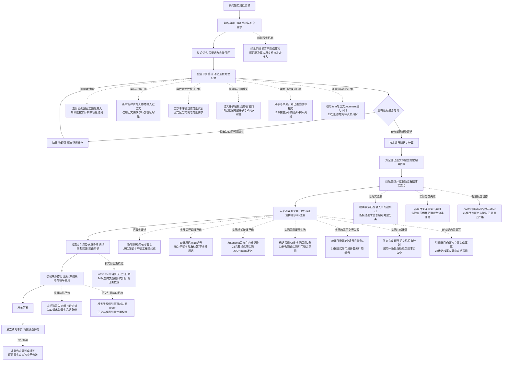

# LoCoMo 小规模 RAG 评测

## 当前状态 · 2026-10-21

当前默认为 `compose@33 / ladder@15 / retrieve@8 / rerank@2`，另用 `rank@4 / vector@1`。下述 `RAG30-20261011` 历史问答使用当时的 `retrieve@5`，实际模型为 `deepseek-flash`。2026-10-21 独立Agent对同一批冻结回答及完整原文复核为 **10正确、2部分正确、0错误、0未发布**，没有重新调用作答模型。原36次请求使用335,444输入、12,498输出词元；全12题总耗时中位数22.160秒，召回中位数14.292秒。新48题双批结果和当前默认策略的定向验证见[测评总览](evaluation.md)。

2026-10-12 的非默认 `31/16/5/2` 复测为 8 正确、2 部分、1 错误、1 未发布；`32/16/5/2` 有 6 题未发布，已发布题采用保守判定口径且仍有生日庆祝日遗漏。两组均未激活，不与不同判定口径的历史成绩绘制准确率提升曲线。材料先分析候选追加 38 次付费请求后，只有 7/19 份 L1 完成确认；累计调用序号 404 遇到领域引用拒收而停止，没有新的完整材料冻结、向量或 12 题问答成绩。

最新版本、用量、失败及复现范围统一见[测评总览](evaluation.md)。下文按对应日期保留历史协议、原分数、当时默认和当时下一步；历史状态不覆盖本节的当前默认。下文 `work/` 路径指维护者本地档案，原语料、逐题正文和运行产物不随仓库发布。

## 历史试点协议与记录

入口为 [`tools/rag_pilot.py`](../tools/rag_pilot.py)。它使用公开对话和真实模型，比较关键词、关键词加本机向量、关键词加向量加 DeepSeek 语义重排。第三组使用通用生成模型评分，不能代表专用重排模型的效果。

## 数据与适用范围

数据来自 [LoCoMo 官方仓库](https://github.com/snap-research/locomo)，按其 [README.MD](https://github.com/snap-research/locomo/blob/main/README.MD) 的结构读取 `data/locomo10.json`。上游 [LICENSE.txt](https://github.com/snap-research/locomo/blob/main/LICENSE.txt) 为 CC BY-NC 4.0；下载数据与逐题答案仅保存在被 Git 忽略的 `work` 中，不随本项目 AGPL 代码发布。

固定选第一份完整对话 `conv-26` 的全部 19 个 session，保留日期、说话人、`dia_id` 和图片文字描述。每个 session 作为一份 L0 原件直接播种进独立试验库，不摄入 `observation`、`session_summary`、`event_summary` 或 `qa` 标注。标准答案和证据标注只用于评分。

种子为 `20261010`，从原始数字类别 1、2、3、4 各抽 3 题，先保存 manifest 再运行模型；排除类别 5。题目名单不会按结果重新选择。有一题没有证据 ID 标注，它仍参与回答和盲评，证据召回指标只以另外 11 题为分母。

本轮覆盖真实 `WorkspaceQuery.prepare_ask → execute_ask` 的原件召回、逐层选材、内核回答和来源回执；没有覆盖 HTTP 上传、AI 自动整理、每日归纳和 L3 认识确认。采用本项目的阶梯、片段及预算限制，与 [OpenViking RAG 基准](https://github.com/volcengine/OpenViking/blob/main/benchmark/RAG/README.md) 的 Top-5 不是同一实验条件，不能直接比较公布分数。

## 运行方式

在已安装本机向量依赖、模型资产就绪的仓库中运行：

```powershell
.\.venv\Scripts\python.exe tools/rag_pilot.py `
  --output .\work\rag-pilot-20261010 `
  --config-root .\runtime `
  --config-db .\runtime\.rebuild-data\structured-records.sqlite3 `
  --models-root .\runtime\data\models `
  --questions 1
```

单题预检通过后将 `--questions` 改为 `12`。已通过的逐题结果经相同资格检查后复用；未执行题目继续运行。正式配置库仅以 SQLite `mode=ro` 读取指定模型配置，使用已有秘密存储读取凭据，只在试验进程内存重建密钥；不复制个人资料，不改正式外发开关，不调用正式应用的模型加载接口。试验数据、缓存、内核回执各组隔离。程序会加载一份现有 CPU 模型，完成或失败后卸载；内存紧张时首次加载可能较慢。

全局累计外部调用上限为 100，包括失败请求和续跑。结构化格式协商、网关重试和 LiteLLM 重试均关闭；程序不自动重跑失败题。三组答案都限制为 768 输出词元、温度 0，原题用于检索，统一英文指令只参与回答；没有对话历史。

向量组在提问前通过真实 `EmbeddingIndex` 完成索引，用实际适配器 `cache_identity` 遍历全部四键缓存，要求缺失和超长条目均为 0。每题另记录真实问题编码与非空块向量得分，防止静默降级被误报为向量评测。

语义重排通过隔离的 loopback HTTP 适配端点调用真实 DeepSeek，再经过生产 `HttpReranker`、来源校验、`MemoryTurn` 与按层排名融合。重排成功要求端点成功、`state.failed=False`，且 `state.layers` 留下候选绑定和分数。若端点评分失败，保留生产回退排序生成的真实答案，另写 `failure-*.json` 和 `attempt-*.json`，不记入重排成功数；全流程质量仍按固定 12 题计算，重排增益只在重排成功题中比较。后续评分保存公开输入、原始模型输出及明确错误原因。此适配端点仅用于本地试验，不是正式部署服务。

## 指标与结果文件

- 证据 ID Recall：在实际选中片段里提取完整 `D<session>:<turn>`，按标准证据 ID 计算覆盖比例，避免 `D1:1` 被 `D1:10` 错误命中。没有证据标注的题不进入此指标分母。
- Answer F1：去除引用标号和英文冠词后计算词项 F1；长解释会降低分数，因此与语义评分分开阅读。
- 语义正确与引用支撑：同一个 DeepSeek 模型对每题三个匿名答案分别评分，匿名顺序按固定种子打乱，保留映射。属于试点评分参考，存在同模型评分偏差，不是官方评测成绩。
- 延迟：分别记录首次模型加载、索引、检索和含回答总耗时。各组第一题含内核延迟构建，关键词预检时没有加载向量；首题与其余题中位数分开列出，不据此作稳定性能比较。记录实际向量编码、重排成功分数和调用用量。

`manifest.json` 固定样本；`run-config.json` 固定无密钥配置；`policy-versions.json` 登记实际回答及索引/重排的策略版本；`index-*.json` 保存索引完整性；`encodes.json` 和 `vector-scores.json` 证明实际向量路径；`wires.json` 是累计外部调用预算及真实用量；`rerank-wires.json` 保存重排输入与评分；三组逐题 JSON 保存回答、引用、窗口和评分；`judge-*.json` 保存盲评映射；`summary.json` 汇总指标；`unloaded.json` 记录模型最终状态。失败不会记为成功。

没有测试类别 5，也没有注入无答案问题，本轮不能据此判断拒答质量。12 题、单份英文对话只能验证流程并发现明显问题，不能作为稳定的总体质量结论。

## 2026-10-10 实测结果

固定 12 题均已完成真实回答和匿名盲评。证据 Recall 使用 11 道有标注题的平均值；语义正确使用全部 12 题。重排一列包含生产回退后的真实回答，因此代表整条流程的实际效果。

| 模式 | 证据 Recall | 语义正确 | Answer F1 | 重排成功 / 回退 |
| --- | ---: | ---: | ---: | ---: |
| 关键词 | 61.36% | 5/12 | 0.2226 | 不适用 |
| 关键词＋本机向量 | 70.45% | 6/12 | 0.2322 | 不适用 |
| 关键词＋向量＋DeepSeek 语义重排 | 70.45% | 6/12 | 0.2362 | 3/9 |

本样本中向量召回增加了约 9.09 个百分点的证据覆盖，语义正确多 1 题。重排没有显示增益：仅 3 题完整返回评分，其成功子集中三组 Recall 均为 66.67%，语义正确均为 1/3。成功评分均将原来第一条排在最高，其余并列，实际排序变化为 0；生产策略先把两组分数转为排名，再按 40% 与 60% 融合，没有发现分数尺度问题。

9 次评分失败均按生产逻辑保留原排序。其中 QA31 有 10 个候选却只返回 9 个分数，QA39 为 11 个候选返回 10 分，QA42 为 12 个候选返回 11 分，完整性校验正确拒绝了这些结果。QA30 的初次失败仅留下 `ValueError`，当时未保存原始评分，具体原因未知；后来一次独立公开语料诊断成功，不能覆盖原失败。后续评分已保存原文与错误原因。下一轮可比较专用重排模型，或试验带候选索引的受约束结构化输出，继续严格校验候选集合完整性。

累计 61 次外部请求，全部收到模型返回，其中 60 次用于评测、1 次用于协议诊断；模型返回成功与重排评分有效是两个指标。实际用量为 106,039 输入词元、3,282 输出词元，共 109,321 词元。未按价格推算费用。

首轮模型加载约 106.1 秒，向量与重排两组各建立 112 个分块索引，耗时约 161.5 秒和 164.3 秒；四键缓存均无缺失、无超长跳过。续跑的加载及缓存复核另行记录，不替代首次建索引耗时。排除各组第一题后，含回答总耗时中位数分别为 9.91、19.25、24.65 秒；检索中位数分别为 2.82、12.50、17.59 秒。首题内核延迟构建、关键词预检时模型未加载、机器内存压力和顺序执行都会影响延迟，本轮不据此作稳定性能结论。结束后试验模型状态为 `unloaded`，进程正常退出。

这些结果限定于 L0 原件、一个小规模英文样本、通用生成模型重排和同模型盲评。它们证明了真实检索、向量索引、内核回答及评分流程能够运行，也暴露了语义重排评分完整性不足；不能替代完整知识入库、L3 认识召回、中文场景或独立评委的验证。详细证据位于本机 `work/rag-pilot-20261010/summary.json`、`initial-*.json`、逐题结果与 `unloaded.json`，原始资料和逐题正文不提交到 Git。

## 固定样本复测

复测使用新输出目录，原试点目录只读。`--baseline` 复制原公开数据、manifest 和许可，并核对相同种子生成的全部 12 题；标准答案、证据 Recall、Answer F1、匿名盲评提示与映射算法保持原定义。类别和标准答案只用于评分，不传给检索或回答模型。

```powershell
.\.venv\Scripts\python.exe tools/rag_pilot.py `
  --output .\work\rag-retest-20261010 `
  --baseline .\work\rag-pilot-20261010 `
  --config-root .\runtime `
  --config-db .\runtime\.rebuild-data\structured-records.sqlite3 `
  --models-root .\runtime\data\models `
  --questions 12
```

候选策略通过可重复的 `--policy INTERFACE=VERSION` 选择，沿用项目 `parse_overrides` 和 `override`。同一选择覆盖索引、查询、回答与 HTTP 评分线程；本机向量线程沿既有实现接收提交时冻结的策略。`run-config.json` 同时固定实际 Turn 策略、策略覆盖、源代码 Git 提交、评分提示与结构化 schema；配置变化拒绝续跑。`summary.json.baseline_comparison` 给出汇总和逐题 Recall、F1、正确性、重排回退的前后差异，不因结果筛选题目。

语义重排桥接把候选编号为稳定的 `d0`、`d1` 等，通过现有 `ModelConfiguration.complete_structured` 和网关生成 `scores: [{id, score}]`。评分必须为有限的 0 至 1 数值，返回 ID 必须完整覆盖输入集合，不能重复或新增；允许返回顺序不同，按 ID 映射回原候选。缺分时拒绝评分并保留生产回退，绝不填默认分。每次最多一次外部 wire，格式协商也不能增发；公开原始响应和解析结果分别记录。此项修复位于试验桥接，生产候选融合与外发守卫保持原路径。

复测依然使用同一 DeepSeek 回答与盲评模型，三组都是空历史、768 输出词元预算。生产回答策略可按题意要求结合日期推算相对时间、依据事实作推断、事实回答尽量保留原词；试验不读取题型标签来改变提示。复测结果与首轮的差异包含检索、生产回答策略及评分桥接变化，不能单独归因于其中一项，也不能保证正确题数必然增加。

### 2026-10-10 固定 12 题复测结果

复测源码冻结为 `73cfe83e7e`，工作区干净；候选策略为 `rank@4`、`ladder@5`、`compose@5`，其余实际版本保存在 `run-config.json`。全部 36 个真实回答和 12 次匿名盲评完成；下表使用相同 11 道有标注题计算平均 Recall，全部 12 题计算正确性和 F1。正确性仍是同一模型评分，不能视为人工独立判定。

| 模式 | 原 Recall → 复测 | Recall 变化 | 原正确 → 复测 | 原 F1 → 复测 |
| --- | ---: | ---: | ---: | ---: |
| 关键词 | 61.36% → 75.00% | +13.64 个百分点 | 5/12 → 5/12 | 0.2226 → 0.2553 |
| 关键词＋本机向量 | 70.45% → 77.27% | +6.82 个百分点 | 6/12 → 7/12 | 0.2322 → 0.2734 |
| 关键词＋向量＋DeepSeek 语义重排 | 70.45% → 81.82% | +11.36 个百分点 | 6/12 → 8/12 | 0.2362 → 0.2908 |

完整评分从原来的 3/12 提高到 12/12，回退从 9 题降为 0 题；12 次桥接各使用一次外部 wire，完整 ID 集合与生产层绑定均校验通过。生产融合后 8 题排序发生变化。新轮重排比同轮向量组多答对 1 题，Recall 多 4.55 个百分点；小样本、同模型盲评及多个改动共同作用，不能据此估计长期稳定增益。

逐题检查中，QA39 的四条社区活动证据覆盖从 1/4 提高到 4/4，回答包含原标准答案要求的四类活动。QA44 根据 8 月 14 日对话的昨晚推算生日为 8 月 13 日，QA54 根据 8 月 23 日的上周给出前一周，均由错误变为正确。QA7 也由错误变为正确。

同时保留退步：重排组 QA30、QA31 从正确变为错误。QA31 的选中片段已有 6 月 27 日与上周露营，回答仍称证据不足；QA30 对是否属于 LGBTQ 社区的推断仍过于保守。QA56 继续漏掉一个关键符号，QA81 继续拒绝作回国意愿推断。因此日期和推理提示已接入并在部分题上生效，回答利用已召回证据仍有提升空间，不能声称时间题或推理题全部解决。

独立审查核对了隔离内核 SQLite 中全部 36 份不可变回答输入：冻结策略均为 `compose@5`，实际 system 消息包含日期和推断规则，user 消息与逐题选中资料一致。QA31、QA81 的失败输入确实包含日期锚、上周露营和收养计划，并非策略在线程间丢失或选材没有送到模型。日期计算目前由回答模型按规则执行，尚无确定性日期计算器。另发现 QA39 关键词回答漏列 art show，盲评仍判正确，与部分正确应判错的评分定义不一致；保留原始分数，不事后改变评分标准，因此表中正确数仅作为模型评分参考。

两组本机索引各有 112 个条目，四键缓存缺失与超长均为 0；24 次向量/重排提问均记录实际问题向量和非空块得分。新轮本身共 60 次外部 wire：36 次回答、12 次语义重排、12 次盲评；输入 145,411、输出 4,121，总计 149,532 词元。所有网络请求均收到返回，12 次重排也全部通过独立的协议完整性校验。

启动时曾发现桥接额外请求 governed retry control 却没有内核 wire sink，导致前三题重排在外发前拒绝。该尝试已中断，全部结果保留在 `work/rag-retest-attempt1-20261010/`，没有混入最终 12 题质量指标。修复仅移除多余 `retry_policy`，仍由 `SingleWireGateway` 强制一次 wire、底层 `num_retries=0`；正常、无效 JSON 和格式拒绝三种边界检查均只执行一次隔离 completion，未调用模型。随后从空试验库完整重跑，没有复用旧答案或更改题目、提示、schema、金标准和评分规则。

计入上述尝试的 12 次回答/盲评，整个本次任务累计 72/100 次外部 wire，输入 171,593、输出 5,009，总计 176,602 词元。第一次尝试通过终止自有进程释放模型内存，未声称执行 finally 卸载；最终完整复测进程正常退出，`unloaded.json` 确认为 `unloaded`。正式资料和设置保持只读。完整复测证据位于 `work/rag-retest-20261010/`，逐题差异位于 `summary.json.baseline_comparison`；原始公开语料与逐题正文仍不提交到 Git。

## 日期计算与评分复核

### 实际回答中的确定日期计算

默认 `compose@13` 通过 `policies/date_calculation.py` 为已选资料生成有来源的日期换算。支持完整 ISO、中文年月日及英文年月日为锚，计算昨天、昨晚、前天、明天、后天、数字天数等日偏移，正确处理跨月、跨年和闰年；上周、上个月保留区间并注明日历约定。缺少同句明确锚的事件相对时间保留未确定。

换算结果明确标为程序派生注释，不改原摘录或坐标，也不把庆祝生日等同于出生日期。`date_quote_boundaries.quote_spans` 只在原文起点和精确窗口可验证时恢复引语状态：后面的歧义撇号不污染前面的完整句，缺少前缀或正文/坐标失配则保守拒算；未选正文只用于引语状态，不作为日期或额外证据。注释沿实际来源格式在选材前计入预算。

实现检查包括原40个日期案例、6个边界案例、新52个引语控制和实际来源/预算检查，独立审阅另验57项。旧双组使用@6并暴露QA44撇号误拒；新双组使用@7，实际回答采用8月13日庆祝日期并保留生日事实的不确定性，详见下文。旧策略可覆盖重放，不把纯计算通过当作全部日期回答正确。

### 评分复核

当前工具使用 `atomic-reference-and-citation-check@3`，原匿名盲评和 `semantic_correct` 保留。先独立审核完整答案，再拆解参考要点并检查逐项回答。整答审核不接收参考、类别、原分或要点结果；程序固定所有完整分句及字符坐标，要求覆盖全部非空白答案，每句核对该答案自己的逐字来源；矛盾必须给出实际两端。支持合理且有依据的推断，区分精确日期未知与已有周范围、不同时间的同类活动。

程序严格检查完整唯一的答案、分句和要点ID、布尔值、状态枚举、完整句引用、实际来源摘录及矛盾两端，不接受只摘正确书名跳过否定句或省略号拼接。只有原始要点复核通过且整答一致、所有分句有依据，才记 `validated_correct`；漏项、冲突或不确定记 `review_required`；格式、引用或调用失败记 `invalid`。原始评分和错误保留，不能用原子要点通过绕过整答矛盾，也不把字符串相同当作语义正确。

`judge-validation-*.json` 独立保留完整分句、匿名输入、整答审核、参考要点及逐项结果；`wires.json` 保留所有实际消息、输出和用量。运行配置冻结@3合同、全部提示、Schema和输出预算。旧运行目录不能按新合同续跑，历史答案/评分不修改；不同合同的 `validated_correct` 不直接比较。

每题增加整答审核、参考拆解和要点检查三次调用，原三组完整运行通常96次，双组通常84次；严格拒收时跳过依赖该结果的后续调用，失败计入100次上限且无隐式重试。旧@1的JSON问题由@2显式Schema修复，但@2仍漏旧QA104自相矛盾；@3增加独立整答检查，新批单次旧答案回放已实际拦截，见下文。

复核用于发现和隔离错误评分，不修改实际回答、标准答案或历史 5/7/8 成绩，不能自动提升回答质量。两次使用同一模型仍可能共同误判；参考要点拆解、同义表达、推理依据和额外事实的支持程度最终仍需独立人工抽查。`validated_correct` 表示通过本合同，不能理解为客观正确的保证。

## 完整原文直接回答与项目对照

`tools/rag_compare.py` 使用独立的 `direct/project` 两组，不复用旧答案。direct 每题一次接收相同19份公开 session 的完整原文和标题日期，使用正常结构化网关及 `AskOutput`，不使用检索、日期计算或重排；返回资料仅包含实际引用编号对应的原文。project 复用真实 `WorkspaceQuery.prepare_ask/execute_ask`、本机向量缓存和完整评分的语义重排桥。当前源码默认 `compose@13`，各轮实际策略以对应冻结记录为准。两组共用基础资料约束和英文回答指令、同模型、温度0、输出768及空历史；项目额外的生产推断规则与程序日期注释是比较变量，实际消息逐 wire 保存供审计。

完整公开语料约7.5万字符，结构化输入估算约2.6万词元，超过生产通用网关固定1.6万窗口。对比工具仅在自己的 `CompareGateway` 中把两组及评分的实际 wire 窗口统一设为1,048,576，依据2026-10-10核验的 [DeepSeek Flash 官方窗口](https://api-docs.deepseek.com/quick_start/pricing/)；限定已核验的官方 HTTPS 主机及 `deepseek-flash`。选材读取的 `input_budget_limits` 保留原工厂16,000窗口，与普通配置的最终 `ask_budget` 同为4,500，避免大 wire 窗口扩大项目选材。正式配置与生产代码不改，不截断全文冒充完整输入。程序预检所有题目的估算长度，第一题全量真实请求成功后才加载向量。

示例，在已明确授权真实调用的情况下运行：

```powershell
.\.venv\Scripts\python.exe tools/rag_compare.py --output work/rag-compare-20261010 --baseline work/rag-pilot-20261010 --config-root runtime --config-db runtime/.rebuild-data/structured-records.sqlite3 --models-root runtime/data/models --questions 12 --max-calls 100
```

正式数据库路径以实际启动配置为准。baseline 的数据、清单、许可和说明只读拷贝，并拒绝目录祖先交叠和内容变化；正式模型凭据只读后在隔离试验库内存密钥存储中重建。模型资产复用只读路径，不下载，仅项目组建立一份向量索引，退出时卸载。

先冻结全部24份答案，再做12次重新匿名盲评及36次整答/要点复核，通常84次外部wire，失败计入100次上限且无隐式重试。原始评分、合同验证、待复核、协议无效、引用支撑、F1、实际用量与耗时分开保存；加载和索引单列。输入词元不等同实际账单，完整全文与检索Recall不直接比较。同12题参与过开发、同模型评分，不能据此推广总体正确率。

### 2026-10-10 实际双组结果

正式应用已重启，后端健康、网页可用；评测仅使用隔离的公开资料库。回答源码冻结为 `ce3d4894a3`，实际为 `rank@4/ladder@5/compose@6`。direct 每题接收全部19份原文；project 保持正式选材预算4500，实际最大3911，走112条已缓存向量、12次问题编码和12次完整重排，无回退。24份实际回答提示均已独立核对，未包含标准答案或题型标签。

| 指标 | 完整原文直接模型 | 项目检索链路 |
| --- | ---: | ---: |
| 首次同模型盲评正确 | 7/12 | 9/12 |
| 首次评分认为引用支持 | 10/12 | 12/12 |
| 答案 F1 | 0.2150 | 0.2676 |
| 回答及检索输入词元 | 227,323 | 68,506 |
| 回答及检索总词元 | 227,937 | 69,956 |
| 去掉首题后的耗时中位数 | 1.13秒 | 25.45秒 |

项目用量包括重排，输入减少69.86%、总量减少69.31%。两组输入长度不同；direct 缓存命中0，project 命中41,086词元，不能由词元总量直接推算账单。首题耗时分别17.10/30.53秒，向量加载135.72秒、一次索引156.57秒另列。项目检索阶段中位18.68秒，而每题两次网络请求合计中位约2.81秒，该轮显示耗时主要在本地流程；后续定位与优化见下节。

**7/12与9/12是原始模型评分，不能认定实际多答对两题。** 独立 Agent 审阅确认：项目 QA31 利用日期计算给出了6月19–25日，但开头又称没有六月日期；QA42 给出了有事实依据的户外偏好推断。direct QA39 列出了完整活动且被质疑内容有原文支持，首次评分误拒；QA104 direct 先否定推荐事实又给出推荐书名，首次评分漏判自相矛盾。QA30/81 的标准含有争议推断；QA56 标准要求的 transgender symbol 未出现在提供的文本/caption，双方漏项却都获对分。QA31/132 标准证据 ID 也有错位。原标注、原答案和原分数均未改。

原轮70次请求均网络成功，但 @1 复核因JSON结构不符全部无效。工具修复 `d397eb5c39/779e2284aa` 后，`tools/rag_compare_validate.py` 只读取冻结答案、原评分和来源，在新目录执行 @2 复核，未重新回答、重排或加载向量。24次新增调用均通过Schema，11题通过摘录校验，QA39 因模型用省略号拼接非连续原文而被严格拒绝。两组均为5个 `validated_correct`、6个 `review_required`、1个 `invalid`，不代表真实正确率为5/12，也不能把待复核或无效当作错误。QA104 direct 的矛盾仍被二评漏判，说明同模型复核还不能替代独立事实审阅。

本批累计94/100次请求，失败和无效结果均保留，无隐式重试；含所有评分合计输入467,444、输出12,818、总480,262词元。两个进程均正常退出，评测向量已卸载，39份冻结输入JSON与原件逐字节一致，正式资料和设置未写入，未推送。

证据入口：原轮 `work/rag-compare-20261010/summary.json`，补复核 `work/rag-compare-validation-20261010/summary.json`、`completion-check.json`，独立审阅 `work/rag-compare-20261010-review/review.md`，应用重启 `work/compare-restart-20261010.json`。这些包含公开原文的运行产物不提交Git。新入口运行时承接原轮调用数，两个目录不得覆盖或互为祖先。

该旧轮暴露了撇号污染日期与同模型评分漏判。随后实现可信原文边界和独立整答校验，已在下节复测；旧失败候选未合入、历史结果保留。仅L0英文资料与同一小批开发题的效果不能推广为完整第二大脑的总体表现。

## 日期边界、整答评分与耗时优化复测

2026-10-10 冻结 `e071f5f7b1`，使用同19份公开原文和同12题，两组保持同模型、温度0、输出768、空历史及项目4500选材预算。日期@7先登记并独审，再由独立提交切换默认；原始评分定义不变，新增评分合同@3另列。

一次提问原先107次本机能力探测，包版本和祖先路径检查约占17秒。修复只复用当前健康编码器实际加载成功的依赖事实，绑定目录/完整策略/代际；资产每次仍复验，来源修订/私密/遗忘检查保持。固定缓存向量、重排关闭且cProfile开启的独占回放24.27→8.80秒，19组向量分数、选择和窗口一致。实际整轮改善幅度如下，不能套用隔离回放的63.75%。

| 指标 | 修复前 | 本轮 |
| --- | ---: | ---: |
| 项目去首题耗时中位数 | 25.447秒 | 20.971秒 |
| 项目去首题检索中位数 | 18.678秒 | 14.642秒 |
| 全文直问去首题耗时中位数 | 1.126秒 | 1.524秒 |
| 原始盲评全文直问正确数 | 7/12 | 6/12 |
| 原始盲评项目正确数 | 9/12 | 7/12 |
| 项目答案F1 | 0.267628 | 0.267599 |

实际问答中位减少17.59%。本轮问题编码中位0.3505秒、重排wire1.015秒、两次wire合计4.486秒；逐题扣除后检索仍约13.058秒，包含本地读库、格式化、校验和调度，尚未在真实编码器驻留下进一步剖析。冷加载202.629秒和索引203.689秒单列，比旧轮慢，历史端到端对照也受本机资源和服务延迟影响。不能声称25秒问题彻底消失。

本轮未证明正确率提升。项目QA31仍有拒答开头但实际给出6月19–25日，前后两轮评委对相似表达判定不同；QA44已算出8月13日庆祝日期，原文明示生日日期仍不足；QA56标准要求的transgender symbol缺于提供文本，项目不补造该符号，新原评分从对改错。全文直问QA104新答拒绝推荐事实，被原评分判错；旧答的自相矛盾另由单次真实回放检验。原标注、旧答案和全部原评分均未改，个别评分变化不能直接解释成事实质量变化。

新合同@3：全文直问4验证/7待复核/1无效，项目5/6/1；与旧@2各5验证的合同不同，不作增减比较。QA30整答审核标记支持却未附来源，被程序拒收，未继续拆要点和检查，因此整轮82次而非84次；追加旧QA104单次回放后共83/100次。回放实际识别direct的自相矛盾（consistent=false、1条矛盾、audit_passed=false），project无矛盾且通过，原答案保持只读。评分校验用于隔离漏判，仍需独立事实审阅。

12次真实问题编码、112条资料向量、228次评分调用共1344个分数，12次完整重排无回退。83次请求网络均成功，评分无效单列，输入504787/输出18386/总523173词元；缓存命中294896、未命中209891。模型正常卸载，进程exit0，旧39份冻结JSON和4份公开基线文件逐字节相同。评测未写正式资料或设置，正式应用随后已重启并健康，模型保持未加载；未推送。

独立审阅核24份实际提示、114个精确来源窗口，最大输入含结构开销4025≤4500、证据3234≤3600；本轮9个合同通过答案逐条与其实际引用的原话核过，未发现实质错误、漏项或矛盾。QA56全文直问原评分仍漏参考符号，由要点检查降待复核；QA39原评分误拒了有来源的活动。QA81整答审核将拒答误标为non_factual，且把缺本答案引用支持的推断判为supported_inference，最终仍待复核，未计入合同通过。程序能校验覆盖和出处，语义标签仍会错，实际合同通过不等于普遍正确性保证。

证据 `work/rag-correctness-speed-20261010/summary.json`、`comparison-analysis.json`、`regression-result.json`、`restart-verification.json`；独立审阅 `work/rag-correctness-speed-20261010-review/`。以上为维护者本地档案，运行产物含公开原文，不随仓库发布。

## 评分下降的逐题事实审查与候选回答修复

2026-10-11 增量任务。先独立复核前两轮同12题、两组48个答案的实际消息、本人引用及原始评分，再修改生产回答，不按分数筛选问题。前两轮全文直问12份输入逐字相同，因此 direct 7→6 不能归因于项目 compose 修改；只能确认相同输入两次生成和评分存在变化。

| QA | 前两轮事实核对 | 原分 D/P 旧→新 |
| --- | --- | --- |
| 7 | 两组单身判断均有依据；原文是拟以单亲身份收养。 | 1→1 / 1→1 |
| 30 | 资料没有身份自认，保留未知合理；金标的 likely no 也是推断。 | 1→1 / 0→0 |
| 31 | 两轮项目答都先笼统拒答、再给6月19–25日，表述含混且原评分不同；新版另误拒六月计划日期。 | 0→0 / 1→0 |
| 39 | 主要四类活动均覆盖；评分误拒了有出处的额外活动，并混淆不同场游行。已参加与计划须分开。 | 0→0 / 1→1 |
| 42 | 项目新版明确国家公园是有据推断，表述改善；全文直问仍仅拒答。 | 0→0 / 1→1 |
| 44 | 项目新版正确算出8月13日庆祝，但实际生日是否同日未知；改善未反映在原分。 | 0→0 / 0→0 |
| 54 | 项目两轮上周区间8月14–20日均正确，具体日未知。 | 1→1 / 1→1 |
| 56 | 两轮项目均把含混的 togetherness 唯一归到玻璃窗；分数不同。标准符号未提供给模型，不能补造。 | 1→1 / 1→0 |
| 81 | 回国意愿未知合理；新版全文直问提收养却未引实际D19，属于真实引用退步，原分未变。 | 0→0 / 0→0 |
| 103 | Charlotte's Web 均有来源，稳定。 | 1→1 / 1→1 |
| 104 | 旧全文直问先否认后推荐，原评分漏判；新版彻底否认推荐，丢掉正确事实。项目两轮正确。 | 1→0 / 1→1 |
| 132 | Seven years 均正确；金标证据ID指向另一位说话人，保持原数据并单列问题。 | 1→1 / 1→1 |

候选继续复用同一个 `WorkspaceQuery → generate_answer` 调用。@10/@11私有结构要求先列连续原文引文及原资料编号，再生成答案；所有引用编号都须对应合法引文。引文在实际选中窗口内精确匹配；只有原文、坐标、每窗切片和显示文本全部一致时，才额外允许跨越首尾相接的窗口。模型可以引用连续原文，或照抄含人工分隔符的显示内容；后者必须完整跨过分隔符且两侧含真实正文。人工分隔符自身、缺口、伪造或失配来源均不能借此通过。显示等价不声称分隔符属于原文字节。诊断中四条引文的临时限制已解除，五份以上来源可正常引用，仍受既有输出预算约束。来源修订与外发资格复验通过后才发布公开答案。公开 `AskOutput`、URL、来源坐标、回执格式保持，旧冻结 AskOutput 的续答按原合同恢复。本次试点关闭隐式重试，已发生的用量仍记入原回执。出处匹配不能证明答案的每个断言都被引文蕴含。

日期修复包括两处。引语边界版本3限制后文歧义撇号的影响，保留可验证原文中的先前独立完整句；缺前缀和窗口失配仍保守处理。它依赖可信原文本身保留引语起点，原文已损失开引号时仍可能误判。日历说明版本2把上周限定为过去、下周限定为未来；6月27日的上一日历周是6月19–25日，另一种此前连续七天约定是6月20–26日，两者都在六月且在记录日前。旧的前后约七天说明会把未来可能性引入上周回答。周精度不自动变成具体日。

诊断失败完整保留：仅加提示的@8/@9未解决露营开头拒答和物件指代，第二次审稿方案也未通过。首版引文字段被模型理解为引文序号；明确 `source_number` 后出处结构正确，但日期方向说明仍造成QA31错误，QA56开始正确限定物件寓意及花的问句。第14、15次诊断使用实际生产编排、原窗口和来源快照，@10的露营题已正确，象征物题仍把询问写成确定陈述。因此保留@10原样，登记@11强调源问句不能确立其命题为事实；有独立陈述支持才能作为断言，否则保留疑问或试探。提示仍不保证模型遵从，最终只用同12题正式验证，不再追加诊断。诊断与整轮分开，诊断答案不复用于正式成绩。

### 同12题正式复测结果与裁决

正式回答使用 `compose@11` 显式覆盖，回答生成时源码默认仍为@8。原始模型评分 direct 从6降到5/12，project 从7升到9/12；F1 分别为0.2666和0.2055。合同@3的结果为 direct 4验证/8待复核、project 5验证/7待复核，两组均无无效项。这些数字不是客观正确率。

独立审查先固定全部24答的事实判断，再读取评分。实际项目回答仍有错误，因此不启用@11。QA31首句把六月露营断言为只有计划，随后又承认六月已完成，出现明确矛盾；QA56继续把含混的团结寓意固定归给玻璃窗，还把向日葵的询问改成确定陈述。直接问答QA104恢复正确书名，却仍先说不能确定推荐什么，整答仍矛盾；QA81仍缺少支持收养延伸的自身引用。12题direct的完整消息与上一轮逐字相同，不能把其波动归因于项目策略修改。

| QA | 本轮原分 D/P | 本轮独立事实结论 |
| --- | --- | --- |
| 7 | 1 / 1 | 有依据，稳定。 |
| 30 | 1 / 1 | 身份未知合理，分数改变不表示新增身份事实。 |
| 31 | 0 / 1 | 项目首尾明确矛盾，原评分漏判；直接问答仍漏已知周范围。 |
| 39 | 0 / 1 | 演讲和已参加会议均有据；本轮未选session-9，辅导和艺术展覆盖减少。直接问答仍被误评。 |
| 42 | 0 / 1 | 项目给出有据的有限偏好推断；直接问答保守拒答。 |
| 44 | 0 / 0 | 已正确算出庆祝夜8月13日，实际生日未必同日；金标更强。 |
| 54 | 1 / 1 | 保留周精度，两种过去周区间有据，具体日未知。 |
| 56 | 0 / 0 | 项目仍有物件归属和问句变断言错误；未提供标准符号的材料不能补造。 |
| 81 | 0 / 0 | 项目有引文支持收养且保留迁居未知；直接问答的收养延伸仍缺自身引用。 |
| 103 | 1 / 1 | 书名正确。 |
| 104 | 0 / 1 | 项目正确；直接问答书名局部恢复但仍自相矛盾。 |
| 132 | 1 / 1 | 七年有据，保持原金标证据ID错位的记录。 |

评分层也存在漏判：@3整答审核把QA31和QA56的错误标为一致且有支持，最终是其他要点门禁把它们留在待复核。QA39的额外活动有实际引用，却被原评与要点检查否认。未发现本轮合同验证通过条目有实质事实错误；这只限本样本，不能推出核验可靠性保证。引文出处检查和同模型语义审核均不能独立保证回答正确。

### 运行完整性与耗时

本轮累计100次外部请求：15次诊断、37次正式回答与重排请求（含一次被程序误拒的QA30回答）、48次原评分及复核。全部网络成功，程序验收失败单列，无隐藏重试、无评分跳过。第52次请求后固定24答，之后才评分。总输入599445、输出23327、合计622772词元；诊断和失败均计入。

QA30首次回答照抄了两个首尾相接窗口间的人工省略分隔，被旧守卫误当真实缺口。`2895024180` 在完整原文与坐标证明后允许显示等价，并拒绝仅人工标记、部分标记、正文空白和真实缺口。恢复只补一次答案，完整模型消息和Schema与失败请求相同，复用原已成功的重排、候选顺序、绑定与评分。原失败及3份成功答案均保留；原运行源码`21d1f1ac84`与恢复守卫`2895024180`明确分开，不能声称全轮单一源码。

实际12个问题编码、112条缓存向量、228次文段评分共1344个分值，12次完整重排无回退。35条私有引文中33条属于单窗口原文，2条是QA30严格零缺口显示等价；实际完整Schema包装最大4471≤4500，准备估算4472。原186份基线JSON、原冻结配置/失败/3份成功答案逐字节不变，旧账本前缀保持。

| 匹配同10题中位数 | 上一轮 | 本轮 |
| --- | ---: | ---: |
| 全文直问 | 1.511秒 | 1.089秒 |
| 项目整题 | 20.990秒 | 5.756秒 |
| 项目检索 | 15.094秒 | 3.580秒 |

双方均排除首次题QA7和恢复题QA30，QA30完整检索与整题耗时未知，保留为空；只记录补答耗时，不补零。冷加载90.048秒、初次索引70.595秒、恢复重载98.283秒单列。问题编码中位0.069秒、重排wire0.773秒，检索扣除两者后约2.716秒；这是观测值，未做独占因果剖析，不把全部差异归于本次回答代码。结束正常退出、卸载模型、关闭服务，正式配置只读、无正式资料写入。

### 上一轮候选与剩余问题（旧100次批）

主线只启用日期方向修正 `compose@13`，`0abc8c9c41` 注册、`012a300a57` 独立激活。@13使用@8完全相同的回答指令、公开AskOutput和单次生成，只将已选资料的周日期注释切换为calendar2；原文、来源编号和窗口保持。实现方184项纯控制及独立12份真实旧选材重建通过，完整三包装最大4073、准备估算4074≤4500，跨月/跨年/闰日及中英文上周/下周方向检查通过。主线48项定向控制、Ruff F821/F823与AST检查通过。@13没有再作真实模型复测，本节前面的9/12是@11实验成绩，不能当作@13成绩。正式应用未在本轮再次重启。

@12独立编辑保留在 `codex/answer-correctness-20261011` 候选分支，末端 `84a99f3c9a`，未合主线、未激活。它保留全部原资料、画像和历史，把草稿作为不可信数据，再用一个固定调用键生成最终AskOutput；只有来源复验、冻结输入/精确版本指令/最终答案引用绑定通过才对外发布。失败保留用量并收敛状态，草稿不进入公开输出。136项纯编排控制和旧291/119/36控制通过，独立定向复现确认指令、公开首字计时与中断后的配置变更计量修正。真实内核只验证了已完成结果重放，新请求失败编排使用替身，不能声称真实恢复或语义纠错已通过。

候选未就绪的具体原因：带历史追问可需要followup、multi-query、初答、校对共四次调用，而现有内核每轮只允许三次；独立审查用真实ToolExecutionContext证实第四次会被拒绝。没有扩大预算权限，也没有为了挤入校对而削减多证据召回。用本轮旧答案作长度夹具时校对输入最高4438≤4500，新草稿可能更长，运行时会明确拒绝超预算；此项长度检查不能证明校对效果。

本轮100次真实调用上限已用完，不追加诊断、重答或评分。QA31矛盾、QA56物件/疑问语气和列举覆盖等真实问题仍需继续修复。下一步先解决候选的一般工作台编排，再在新的调用授权内用相同12题验证语义效果；未通过前保持候选隔离。

详细本机证据位于 `work/answer-correctness-20261011/`，逐题独立事实审查 `work/answer-correctness-20261011-audit/`，实现独审 `work/answer-correctness-20261011-review/`。全部原始答案、评分和标注只读保留。数据是非商业许可的公开开发小样本，未放入Git；同模型评分与这12道开发题不能证明总体正确率或泛化。

## 回答流程与出错位置

冻结20d的非默认25/13/5/2已同十二题各尝试一次，8题生成答案、4题未发布；两个新独立Agent核实际输入和19份全文后为4正确、4部分、4未发布，未进行新模型评分，不能声称整体提升；原24/12首题失败与前轮23/11/5/2的5正确、4部分、2错误、1歧义均保持；默认仍为13/5/3/1，正式应用未在本轮重启。可信官方deepseek-flash的规划器和实际网关共用200000总窗口，未知端点及旧策略保留16000；能力依据已核[官方模型页](https://api-docs.deepseek.com/zh-cn/quick_start/pricing/)。200k是总容量上限。实际选材按原问题需求、证据增量和剩余空间停止，为指令、历史、画像、依赖、Schema与输出分别计量，不再固定五份、9000输入或80%证据比例。重排服务另有6000输入预算，未评分资料保留原槽位。

以下是冻结25/13的真实评测流程和已定位错误；后面的候选实现图另列26/14，均不能当作默认已启用。逐轮诊断大图保留历史。



### 本轮十二题的实际结果

以下是独立Agent按实际原文核对的事实与流水线结果。未发布题没有有效最终答案，不把空答案记成已发布错误，也未补造末轮。

| 题号 | 结果 | 实际问题或改善 |
|---|---|---|
| 7 | 部分 | 未来单亲收养计划被写成已有身份 |
| 30 | 正确 | 支持或参加活动不足以证明个人身份 |
| 31 | 未发布 | 周范围数值正确，模型改写完整计算说明被拒 |
| 39 | 未发布 | 143段分类漏一个编号，未进入末轮 |
| 42 | 部分 | 缺少强偏好窗口，已给行为事实也未用于限定推断 |
| 44 | 未发布 | 庆祝日期计算正确，改写计算说明被拒 |
| 54 | 未发布 | 两种周范围正确，改写计算说明被拒 |
| 56 | 部分 | 漏掉已给象征含义，补充9项重复或重叠内容 |
| 81 | 部分 | 收养计划不构成不会返乡的证据 |
| 103 | 正确 | 找回上轮遗漏的童年书名直接问答 |
| 104 | 正确 | 推荐书名及作者保持原词 |
| 132 | 正确 | 找回上轮遗漏的艺术创作七年直接问答 |

42的限制句本身忠实于没有明确两类公园比较的原文；部分判定指未交付行为与兴趣支持的有限推断。三个日期题未发现首日期算术错误，失败是长说明的逐字身份校验。39的首引文有真实出处，分类遗漏仍导致拒收。

实际每题选1至16份来源、1至22个窗口，12题均扫描到前沿结束，`skipped_budget=0`；首轮完整包装估算最高28,033，远未用满200k。QA42缺失偏好段已具真实完整向量seed，在重排之前被关系字面增量规则拒绝，预算扩大不会自动补上。旧max3选窗函数没有在本次动态输出路径限制数量。

新32次调用全部运输成功，产品结果仍为8成功、4失败。成功匹配8题的旧23到新25检索中位为6.530到7.0665秒，总中位12.857到15.0585秒；4失败只保留原attempt时间，不填补进中位数。两个原错题找回不代表总体准确率或速度提升。本批总342,861词元，冷加载76.381秒单列；112资料缓存无缺失、无重算，12问题向量为持久缓存命中，不是新编码性能样本。模型已卸载，未对这批运行评分。

### 已合入的候选实现

`compose@26 / ladder@14 / retrieve@5 / rerank@2`已完成实现及独立审查，尚未启用或进行新真实十二题复测。14在旧字面增量过滤之前保留真实完整seed和连续关系链，再对完整表示独立评分和准入。新topic通道要求原问题真实主体；普通无主体重排与近重复过滤保持13。先逐链核验，再按来源聚合，合并后的片段不借用任一链的相关分数。



26由程序维护冻结日期计算目录，模型引用稳定`date_ref`，仍严格核同单元、同句和实际精度。首轮提交抽取的事实与其余资料未审核范围，末轮逐事实采用、合并、纠正或明确排除，也可补遗漏；程序拒绝精确重复。模型同时审查计划与当前状态、无依据的否定和限定推断。结构、出处和计算核验不能替代语义判断。

独立机制检查通过：14的主体门控16项、纯控制32项、真实隔离工厂71项分别记录，普通来源和近重复13/14对照一致；26的日期引用、真实JSONmode、两轮衔接与完整包装已独审。固定HTTP、固定分数和向量替身没有产生新真实模型成绩，不能据此判断7/42/56/81已答对。

2026-10-11 14:55:11检查到本机可用物理内存约1.3 GiB，低于模型此前约1.84 GB实测峰值；这轮没有重新加载模型或开始真实十二题。保留卸载，待约2.5 GB可用后再完成最终源码预检和同题复测。真实调用账本仍116、内部上限132，评分资格关闭；离线准备的164/116参数组合尚未执行。最后真实结果仍为上表4正确、4部分、4未发布，默认13/5/3/1保持。

逐轮诊断历史：



QA39旧4500预算下额外Schema让一份资料超出26词元被拒。扩大容量后的离线夹具已保留五源全部15个精确窗口；这只证明容量和来源，不证明模型答对。QA56 batch6的明确遗漏位于实际输入的D14:23：彩虹人行道表示love/acceptance everywhere。首末两轮都拿到原文，却均跳过，不能归因于召回或截断。新候选用全部已选行的稳定目录约束分类完整性，仍需真实模型检验语义。

动态需求保留原问题的时态、日期、引用要求；追问解析后的语句仅辅助相关性与关系增量。普通认识不固定三条，普通资料层不固定两条或五条。摘要与整理稿遵守各自真实正文范围，原文使用原件正文，扩窗按完整记录和精确坐标进行；单条完整记录超过预算时拒绝，不截断成可能误导的半句。相关性、充分性和增量仍含启发式判断，不能保证穷尽全部真实事项。画像、灵感、翻书与搜索的专用边界仍保留。

首末实际输入包含完整目录、原问题、画像、历史、依赖与实际Schema三种包装。完整分类ID输出上界另经准入检查，公开回答有独立输出上限；不能沿用普通回答768来截断分类。旧版本保留，只有最终验证后的单独提交才切换默认。

重排用完整实际JSON计量，包含模型、问题、标题、转义及全部documents。资料过长时缩小送去重排的表示，最后选材仍保留原连续窗口。每层最多一次请求，分数要求ID完整唯一且有限；已评分项在同优先级槽位中调整，未评分尾部原顺序保留。失败保留原排序并写回执，不偷偷追加请求。

| 诊断 | 实际请求 | 事实与工程结论 |
| --- | ---: | --- |
| batch1，候选14，QA31/56 | 4 | 六月完成露营事实漏用；物件误绑和问句变事实存在 |
| batch2，候选15 | 0 | runner误读旧三额度，在网络前停止；实际作用域已修为3→4→3 |
| batch3，候选15，QA31 | 2 | 主体恢复六月完成露营及周范围；当次缺冻结胶囊未发布，后续共同入口已修 |
| batch4，候选15，QA56 | 2 | 正常发布，物件误绑和花语问句变事实消失；仍漏明确寓意 |
| batch5，候选16，QA56 | 2 | 玻璃窗潜能补回，却把含混togetherness猜给人行道；love/acceptance仍漏 |
| batch6，候选17，QA56 | 2 | 保留首轮六行并恢复部分寓意；D14:23在两轮实际输入中仍被跳过 |

本轮候选的作者64项聚焦控制通过，另有六文件Ruff、AST、diff检查。长资料实际首末包装约13519/13643，低于193000剩余输入空间，超过旧9000限制；非空摘要、整理稿、原文、部分重排以及四handle工作台路径已分别观察。无效最终ID和中途撤销外发拒绝发布并保留用量。独立审查报告位于work/answer-repair-20261011-review/dynamic-integration-review.md。控制仅隔离模型运输或向量编码边界，不能计入真实模型正确率。

实际诊断batch7沿用QA56原四份资料和45行，完整首末分类成功并补回D14:23。独立逐行审查未发现新增确定事实错误，但含混togetherness被排除、个人经历相关性偏低和930词元冗余仍在。两次调用正常发布，新增11977词元，不加载向量或重排。

随后启动正式P12，在第一题QA7停止：动态候选实际选19来源、438单位，首轮模型实际50922输入/18输出词元，返回selected/irrelevant/uncertain三个空数组。生产完整ID守卫拒绝并返回502，没有末轮调用、有效项目答案或评分。实际max_tokens为2146，未发生输出达到上限的截断迹象；原审计未保存finish_reason，不能补写。该题六项重排分数完整，但其余来源并未全部重排。失败的精确检索耗时未保存，保留未知。

当前100次上限已用16次，累计输入100589、输出2243、总102832词元；余84次只够一次完整36次项目回答和48次评分。旧328份基线、既有JSON和调用记录受字节保护，失败另存，无静默重试。encoder冷加载111.244秒，112条文段缓存零缺失、零补算；失败退出后已卸载并关闭资源。未形成有效问题向量记录，不能宣称12次问题编码完成。

候选尚未通过真实验收，默认不变。下一步同时分析有限动态选材为何扩展到近全文、分类合同为何返回空集合；不会把200k当作应填满的目标，也不会静默把漏ID补成无关。修复后先做零网络检查，再冻结同12题项目答案，独立核对事实后另启动评分。旧direct12不重新生成；容量与输出预算变化明确列出，不能描述成同预算比较。正式配置只读，正式数据无评测写入。

### 有限动态候选的第二次修正

compose@19去除可复制的空分类示例，明确必须分类冻结目录的全部编号；简短、引用与拒答要求属于最终回答阶段。原空三数组仍由严格全集门禁拒绝，不在程序里补写分类。独立21项纯检查已核旧18消息逐字兼容、真实438编号三包装预算、版本证明和非枚举末轮合同；不证明模型真实遵循。

ladder@10修正所有格s与子串命中，将定位词和正文实质维度分开。实际绑定的纯语义片段仍能进入；新内容须改善需求、状态、日期或相关局部关系。扩展保留完整原文及连续问答/否定邻域，向量只随真实种子坐标映射，不把整份资料的最大值广播给每一段。普通题和开放列举题不设固定几份上限，有限语义前沿仍是工程启发式，不保证推理证据充分。

QA7组件控制使用原19份原文及112个已观测块相似度，按冻结indexed_entries的payload文件名字典序、每组分块索引核对绑定。旧9选19源74871字符，新10最终修正后选3源3125字符；只比较离线选择组件，不是新真实模型回答。10首次独审8组中2组发现实际日期/状态遗漏，复审8/9另发现普通带日期活动被误收；补充要求旧属性延续，日期本身不打开通道。原报告与失败结果保留；后续修正只改变新候选。19独审及10原审/两次复审报告位于work/answer-repair-20261011-review/partition19-review.md、ladder10-review.md、ladder10-fix-review.md、ladder10-final-review.md。默认13/5/3/1未切换，原16次调用、失败答案、旧direct12和计量保持。下一轮使用独立attempt2目录，同12题项目调用全部成功并冻结后先核事实（最多36次），另启动48次评分。问题向量可依原生产缓存复用，实际缓存命中、运输调用和编码调用分开记录，不强制重算或把缓存命中称为新编码。

### 有限动态真实复测的后续失败

有限动态真实复测再定位（2026-10-11）：冻结e527c563cd/19+10+5+2，实际28/100次外发，输入313035/输出5557/合计318592词元。QA7生产已发布，评测工具误要求fresh query；从同turn product/capsule零网络恢复，完整来源及首末证明复验，原失败保留，total_seconds未知不插补。QA30、31随后成功；QA39两次分类均完整、selected89，却因确定性公开原话渲染7618>7000被拒，未发布产品答案，所有原件保留且模型卸载。开放召回112块相似度全部高于0.3，问法ways与任意新词对不断开通道，19源最终全文；事实独审正在逐项区分真正活动、他人活动、否定与计划。接着非默认ladder11按局部主体/主题/实际新信息有限选材；compose20拟复用第二次调用给简洁有据答案及完整证据处置记录，不加第三次primary、不仅抬高render帽。默认仍13/5/3/1。剩72次：12份旧ReferenceAtoms的实际请求/指令/Schema/合同逐字一致且原parsed通过，可作为固定参考分解缓存；尚未启动新批或新评分。如采用，完整新同12题36次回答及36次新盲评/整答审核/要点检查，原grade/audit/check绝不复用，旧raw分解响应缺失边界明示。根记录、作者隔离实施、独审后再冻结；不写正式runtime、不推送。

QA7同次恢复及缓存反例、null计时聚合检查见评测工作树work/compare-zero/qa7-cache-recovery-precheck-e527/与qa7-cache-continuation-precheck-e527.json。QA39原两轮目录、438单位、89项选择及未发布测量在该树work/compare-zero/qa39-readonly-render-e527/；真实原件在work/answer-repair-20261011-eval/answers-attempt/attempt2-continuation/。实际89原话自身约7405词元，移除包装仍超过7000；程序拼接长度与模型输出预算是两回事。两轮模型各只输出约890词元的分类，不能把公开超限说成模型截断。原话出处与分类全集不证明相关性或逐句蕴含；候选设计与最终真实验收分开记录。

### 动态需求与正文引用的独立审查

动态需求和引用独审续修（2026-10-11）：11两项主体/No邻域由4b46b82ac7修复，原16断言独立16/16、额外8/8；原c2失败保留。独审又发现all事件及各日期被当类别代表召回而漏独立事件，140c38f5a8新增event_instances需求及绑定语义/主体/参与动作的有限补足，作者12控制通过、独立复审中；ways/when/状态不打开该通道，不能称语义完备。20独审58控制/4临时HTTP确认正文可手写[999]并在proof通过后发布，当前未合入，已转作者最小修复。引用符号按当前前端的两类ASCII数字标记核验；手写正确号只认本声明真实来源并统一去重生成；仅完整连续原话中的真实数字字面量可全角显示，private原话不变、proof共用，此处显示不承诺字节逐字不变。原漏洞记录保留，无新增真实API/encoder；账本仍28/100，余72，默认13/5/3/1不变。下一步两候选独审通过后合入，再冻结新同12题回答并先核事实后评分。

### 有限动态最终候选与复测资格

有限动态最终候选独审通过（2026-10-11）：已合入ladder@11 7646dc00a3和compose@20 62e75b2b0b，待验组合20/11/5/2，默认13/5/3/1保持。11原主体/否定16控制、原事件遗漏1、额外事件15及邻域8、QA39事实保留24与原单位438分别通过；20引用修复独立62项、最终组合40项通过，含真实临时HTTP、实际首末预算、四handle/两primary、proof/gaps及旧19兼容。均使用隔离运输或固定既有分数，不算新真实模型成绩。总预算200000，输出预留7000时输入至多193000，且计入实际Schema/包装/历史/画像；资料量依需求和新增信息动态有限选取，all事件与ways类别分开，普通来源和窗口无固定数量。末轮统一简洁有据声明，私有记录全部编号处置及撤回，引用来源由程序生成；完整原引文数字字面量可全角显示而private原话不变。不可变capsule写保护与逐wire网关预算复验已检查，纯selector不承诺验证调用者任意替换的等价数值签名。原失败不改写，账本28/100、余72，无新API/encoder。下一步零网络预检后同12题全部新作答最多36次，冻结后先独立核事实，再新36次评分；只复用请求完全一致且原parsed有效的ReferenceAtoms，不复用答案或评分，不写正式runtime、不推送。

QA39原分数组件回放从19源74871字符收敛为16源13813字符，12类方式代表、必要青年中心和诗歌活动问答保留，未参加、他人活动与私人收养检查通过。此处ways只核类别代表，不声称不同Pride场次全部覆盖；原分数日志身份映射依赖冻结索引顺序。QA7组件控制仍缺生产旧成功答案曾使用的过去分手原句，必须以新真实全链结果验收，不能用组件尺寸推断答案正确。

独立报告保存在`work/answer-repair-20261011-review/ladder11-final-independent-review.md`与`compose20-final-review.md`，引用62项与组合40项结果单列。正常组合实际临时HTTP200、预算变化502且未发末primary，旧19实际HTTP/proof/gaps通过；模型运输和重排分数为合成固定值，未测服务商实际最大窗口或真实语义遵守率。200k为可信路由声明的总上限，7000是输出预留，输入硬上限至多193000，实际可用证据还须扣除所有包装。末轮结构输出仍受有限预留约束，不承诺任意200k输入都能穷尽。

### 实际JSONmode与内部Schema的差异

有据声明真实首题格式失败（2026-10-11）：冻结917ac063d6/@20+11+5+2的新全12在首QA7停止，3源18单位，新增wire29重排/30首分类/31末声明均运输成功finish_reason=stop，末434输出词元非截断，生产HTTP502、有效产品0，finally已卸载。实际JSONmode仅发通用JSON说明和字段描述，完整GroundedAnswerOutput Schema只存于canonical未进入wire；末3声明漏必填derived_notes。直接raw模型校验另含type=json_object多余字段共4错，而真实generic decoder先去type、实际只剩3个缺失，诊断更正与原4错/raw均保留。首末全部18ID及6处连续quote机械核对通过，但末Schema未过、后续声明守卫未到达，不算有据答案或语义通过。非默认compose@21将仅在共享末消息构建器加入同一完整Schema和required/非日期空数组要求，旧20/19/13及严格守卫保持；不补写旧失败答案、不加第三primary。global31/100，输入323666/输出6234/合计329900，余69。新同12全部重新回答至多36；冻结独立事实审查后12新盲评+12新AnswerChecks共24，machine whole-audit本轮不运行，由12题独立事实报告另列，使用新评分模式且不伪造旧@3 validated状态。余9不自动调用。下一步21实现、独审与零网络预检后新批，不写正式runtime、不推送。

原失败证据位于`work/answer-repair-20261011-eval/final-compose20/answers-attempt/final20/`，实际wire29–31在同global根；只读诊断与生产decoder更正位于评测工作树`work/compare-zero/final20-qa7-failure-917/`。新增评分模式保留原盲评与AnswerChecks各自提示词/Schema，所有12题均新评分与检查；独立事实审核在评分前冻结，未生成本轮旧合同的整答机器审核，验证状态与旧@3单列，不据不同流程合并比较validated数量。

### 实际末轮Schema候选

实际末轮Schema候选已接线（2026-10-11）：非默认compose@21 ac24352be7已合入，待验21/11/5/2，默认13/5/3/1仍保持。仅21共享末消息构建器从真实final_response_model取完整Schema，由策略序列化并明示全部required及derived_notes空数组；实际JSONmode、三包装成本、最坏分类准入、发送和proof同源，旧20/19/13消息与Schema保持。作者新增纯20项、临时HTTP42项及8失败场景通过，独立57项通过并观察实际JSONmode网关的固定运输；原31响应仍拒绝，四handle/两primary、预算复读、引用/撤回/失败用量保持。均非真实语义成绩，格式提示仍不能保证模型总遵守。原失败/全局31与余69保持。下一步新21同12题全新回答最多36，冻结后独立事实报告覆盖12题，再以新J24合同12盲评+12AnswerChecks，机器整答audit本轮0且不标旧@3 validated；上界91，余9不自动调用。不写正式runtime、不推送。

固定运输独审与原错误校验表明发送合同已完整接线，不表明新真实回答已经成功。历史四错诊断与生产三错更正分别保留，没有补写旧失败答案。独立报告`work/answer-repair-20261011-review/compose21-final-review.md`记录实际gateway观察、源码变体与旧策略兼容。

### 初步相关与最终采用的区别

末轮采用集合真实失败与新合同裁决（2026-10-11）：冻结e48faa73d0/21+11+5+2的新全12先QA7成功、后QA30失败关闭。新增wire32–37均运输成功且stop；QA30首末完整56编号均selected42，末轮唯一limitation只引用1和40，其余40个未覆盖，实际grounded_partition_coverage_missing拒绝，未发布本题答案；Schema与两处连续quote有效不能代替采用覆盖或语义正确，原42分类和失败不补写，模型已卸载。architect只读独立复现后，批准原六文件新非默认compose22：末轮statements为采用ID唯一来源，模型明确列unused/uncertain及非空理由；程序严格核全集、重叠、limitation后按新合同计算最终分类与精确撤回，再复用原出处/日期/引用/proof，不修补旧20/21原件。unused含相关但本次未采用，不宣称语义无关；不加第三primary、不放宽守卫。用户再次明确200k为多数任务可用总上限，资料量应按问题动态有限选择，不能固定条数、固定窗口或填满容量。全局37/100，输入355630/输出7304/合计362934，余63。下一轮完整同12全部新回答最多36，独立12题事实报告冻结后新J24最多24，总上界97；余3不自动调用，21的QA7不能混为22成绩，机器整答audit本轮0且不标旧@3 validated。默认13/5/3/1保持，不写正式runtime、不推送。

新22设计将实际引用集合E作为采用的唯一来源，未采用I和不确定U由模型显式逐编号处置并给理由。E与I不得相交、二者并集必须覆盖冻结目录；U须实际引用且只用于limitation。最终selected=E−U、irrelevant=I、uncertain=U，精确撤回差集的理由从显式处置读取，不自动填漏、不向声明追加原文凑覆盖。22内部irrelevant只表示本次未采用，可能是相关但重复、不能支持所问关系或答案无需使用。旧21原件不接受这种新顶层，旧失败继续失败。集合与原话校验仍不能证明概括的语义正确，须实际逐题审查。

独立设计及生产decoder复现：`work/answer-repair-20261011-review/compose22-design-review.md`及`compose22-readonly-diagnosis.json`。实际原件位于`work/answer-repair-20261011-eval/final-compose21/`；完整只读QA30诊断位于评测工作树`work/compare-zero/final21-qa30-failure-e48/`。

### 单一实际采用集合候选

实际采用新合同候选已接线并独审（2026-10-11）：非默认compose22 516d27fad5已合入，待验22/11/5/2，默认13/5/3/1保持。末轮私有GroundedUsageAnswerOutput仅statements和dispositions；实际引用唯一确定采用，未采用及不确定ID与理由由模型显式给出，严格核全集、重叠与limitation后复用原出处/日期/正文引用/精确撤回/renderer/proof。未采用不等于语义无关，原始新顶层保存在不可变结果，派生分类可重建，不另造权威副本。实际运行时Schema、发送、三包装成本及准入同源；200000总窗口含7000输出预留，实际输入至多193000且仍须扣所有包装；按问题与新增信息动态有限选材，无普通来源或窗口固定数量，不填满容量。作者纯48、临时HTTP53含重叠，独立118结构断言通过，实际JSONmode固定运输及临时HTTP覆正常/失败、两primary/四handle、失败用量与不可变证明；均不是新真实模型语义成绩，旧13/19/20/21消息与Schema保持，旧失败不修补。账本37/100及余63保持；下一步零网络预检后新完整同12最多36回答，卸载冻结再独立12事实审查和新J24最多24，上界97、余3不自动用。21首题成功不能混为22新成绩，machine whole-audit本轮0且不标旧@3 validated。不写正式runtime、不推送。

最终独立报告：`work/answer-repair-20261011-review/compose22-final-review.md`。完整编号外壳计量只是容量下界，不保证任意声明、引文和理由都能放入输出预留；完整处置也不能替代逐题语义审查。

### 逐项重抄未采用编号的边界

完整未采用列表真实失败与作用域设计（2026-10-11）：冻结8dc3216d73/22+11+5+2，新QA7和QA30生产成功且同轮canonical/proof完整，总耗时11.858/12.261秒、检索7.049/5.593秒；第三题QA31九来源70单位在grounded_usage_answer被grounded_disposition_coverage_invalid拒绝，未发布答案。原末实际引用{1,7,9,24,32,43,50}，未采用又含1，且15/16/60未覆盖；首末运输及Schema通过、finish_reason=stop，后续原话/日期守卫未到，不虚称该层通过。原失败与原件不修补，模型已卸载，112缓存缺失0/重算0、核验0.720秒，冷加载52.546秒单列。逐项重抄未采用ID仍会遗漏或重复，architect正在只读评估新23显式all_unreferenced作用域合同：实际引用唯一确定采用，模型明确未引用处置原则，程序按合同计算剩余编号；不声称逐条语义审查、无关或事实完整，不给旧22补漏，也不放宽旧守卫。global46/100，输入411164/输出9941/总421105，余54。完整新同12最多36回答后，独立12事实审查先冻结，再新盲评12，计划48/总94，余6不自动用。本轮不再有预算运行J24，拟用独立事实报告加新J12另合同；machine AnswerChecks/whole-audit均0，不冒充旧validated或J24。默认13/5/3/1保持，不写正式runtime、不推送。

生产诊断位于评测工作树`work/compare-zero/final22-qa31-failure-8dc/`；此次失败再次说明完整列表的机械记账不能替代答案正确性。新合同若明确把作用域定义为实际未引用集合，程序可据此生成准确的采用记录；该记录只描述使用事实，不能声称模型逐条审阅了所有资料或所有未用资料都不相关。

### 动态需求与新作用域裁决

动态召回与显式作用域裁决（2026-10-11）：用户明确200k为多数任务可用的总上限，资料量由问题需求和有效信息增量动态决定；事实、汇总和时间问题分别补直接证据、不同方面及日期锚，不固定条数或窗口，也不填满容量。architect只读核实22原QA31的12处连续原话、7项数字引用及唯一285字符冻结日期注释均机械匹配，但原生产仍在处置完整性处拒绝，后续守卫未实际通过。另发现实际语义矛盾：正面声明已有六月完成露营的周范围，末limitation却称六月只有计划。已批准六文件新非默认compose23：statements沿用，模型显式unused.scope=all_unreferenced和非空整体选择原则，uncertain用少量编号及理由；程序据真实引用E计算未采用C−E，精确撤回仍用模型理由。未采用只表示本答未使用，不代表逐条审阅、语义无关或问题已穷尽；原22失败不补写。23加入通用限制声明与正面事实、日期及推断一致性自检，禁止将已完成事件仅说成计划；提示不能证明语义正确。末轮常量scope外壳不能替代首轮完整分类预算，动态准入与首wire独立核首分类输出不超过冻结7000，全部实际包装仍计入200000总窗口。worker隔离实施、architect独审后再新完整同12回答与事实审查；J12新合同另列、不用旧validated标签。账本46/100保持，计划P36+J12至94，余6不自动用。默认13/5/3/1保持，不写正式runtime、不推送。

设计与只读证据：`work/answer-repair-20261011-review/compose23-design-review.md`和`compose23-readonly-diagnosis.json`。这次取消的是重复计算未引用集合的模型任务，未减少原话、日期、引用、冻结原件或精确撤回的验证。

### 显式作用域候选实现

显式未引用作用域候选已接线并独审（2026-10-11）：非默认compose23 3fdb24e574已合入，待验23/11/5/2，默认13/5/3/1保持。末轮私有GroundedScopeAnswerOutput要求statements、unused.scope=all_unreferenced及非空模型整体选择原则、uncertain小分组；grounded_scope_answer从实际引用E计算未采用C−E，不再要求模型重抄其补集，精确撤回保留模型整体或不确定理由。未采用不代表逐条审阅、语义无关或问题已穷尽，原22失败与原件不修补。只存原23结果，query和proof从不可变原件共用映射，再走原出处、日期、support/context、正文引用和renderer校验。通用limitation一致性提示不能证明语义正确，先前完成事件与仅计划矛盾须新事实审查。实际运行时Schema、三包装成本和发送同源；首轮完整分类在动态准入和首wire独立核冻结输出额度，常量scope外壳不能绕过7000。200000为总上限，含7000输出预留及全部包装；按问题与新增信息有限选材，无普通来源或窗口固定数量，不填满容量。作者纯53、临时HTTP53有重叠，独立134结构断言通过，均非真实回答正确率；两primary/四handle、失败用量、旧13/19/20/21/22消息Schema保持。账本46/100不变，零网络预检后新完整同12最多36回答，卸载冻结再独立12事实审查和新J12最多12盲评，总上界94、余6不自动用。J12合同blind-judge-with-independent-fact-review@1，不运行新机器AnswerChecks或整答audit，不标旧@3 validated；旧direct12生成用量及时间未知留空。不写正式runtime、不推送。

最终独立报告：`work/answer-repair-20261011-review/compose23-final-review.md`。最小输出外壳只是容量下界，不保证任意长声明、引文和理由都能返回；真实同12题不能与旧22前两题混合记分。

### 十二题结构通过后的事实核对

真实十二题已完成并发现事实缺口（2026-10-11）：冻结9ffb6b3996，候选23/11/5/2全部十二题运输、Schema、出处与proof通过，独立Agent逐题核对实际输入、原首末输出、公开答案及十九份公开session后为正确5、部分4、实际错误2、歧义1，不能据结构通过激活。QA103童年书名与QA132艺术年限的直接问答未进入实际选材；132问艺术创作年限，不是婚龄。QA39艺术展已预选但末答漏用，QA56同一已引用条目里的love/acceptance仍漏表达，另有对象解释未召回。QA31六月核心周范围有据，但末轮把不支持的two weekends ago自行写成七月1至2日且标inference，原日期计算器未产生该结果；不能归咎算术实现。QA7过去分手不能直接证明现在单身，QA44庆祝日与真实生日仍有歧义。模型评分J12暂停，原答案和错误不补写，默认13/5/3/1保持。

动态有限召回修复已批准：200000为总上限，冻结7000输出预留后输入至多193000，仍计全部指令、历史、画像、依赖和Schema。本轮动态选2至16来源、3至33窗口，各题扫描结束且skipped_budget=0，漏事实无证据由容量不足造成。新非默认ladder12保完整真实语义种子、连续问答和同对象解释链，增量必须对应所问属性或关系，相似度只排序，不以超过已选最高分为条件，亦不收满所有同主体句。新compose24拟复用两次primary：首轮整理简短有据事实要点，末轮逐要点采用、合并、纠正或说明排除，仍允许补首轮漏项；跨kind约束新绝对日期必须来自同句原文或同unit真实计算。新首Schema、末Schema与完整首输出均计实际包装，首输出使用冻结reserve并首后重新准入，旧版本和原严格守卫保持。细化合同、隔离实现与独审后再完整新十二题，不能把固定分数机制检查当新语义成绩。

实际运行：新增36请求，global82；本轮270165词元，累计691270。总耗时中位12.857秒、检索6.530秒，冷加载106.254秒单列；112缓存零缺失/零补算，十二次问题向量观测为受管持久缓存命中，不能写成十二次新编码。匹配旧优化默认十题总耗时中位5.756对本轮12.973秒、检索3.580对6.530秒，当前候选更慢；不同选材及两primary只作观测，不称提速。退出后已卸载、旧1094份JSON及328份基线逐字节保持、正式runtime只读。

调用额度记录更正：此前100是执行者内部上限，没有找到用户明确指定100次的原话，旧执行记录中归为用户硬限不准确。根据用户持续修复并用同十二题复测的既有授权，调度者将同一账本内部上限明确调整至130，不重置82次或隐去失败；只预留修复后完整P36及事实冻结后的J12，共48，不作额外诊断或隐式重试。ignored runner已离线核入口82/余48及负例，无新预检、encoder或API。J12沿blind-judge-with-independent-fact-review@1，须新源码对应独立十二题事实报告，无新机器AnswerChecks/whole-audit，不标旧@3 validated。证据work/answer-repair-20261011-eval/final-compose23/及work/answer-repair-20261011-fresh-facts/；不推送。

| 问题 | 独立事实核对 | 决定性发现 |
| --- | --- | --- |
| 7 | 部分 | 过去分手与现在状态须区分，单亲未来计划未召回 |
| 30 | 正确 | 活动与支持不能直接证明性取向或性别认同 |
| 31 | 部分 | 六月核心范围正确，额外七月具体日期无计算出处 |
| 39 | 部分 | 艺术展资料已预选，末答仍遗漏 |
| 42 | 正确 | 推断有依据并明确标注推断 |
| 44 | 歧义 | 庆祝日有据，是否同生日仍有解释空间 |
| 54 | 正确 | 自画像周范围与人物归属有据 |
| 56 | 部分 | 独立寓意未召回或已给仍漏用，含混指代须保留不确定 |
| 81 | 正确 | 原文没有回国愿望或计划，不能由其他行为猜出 |
| 103 | 错误 | 原文有童年书名直接问答，实际输入缺失 |
| 104 | 正确 | 推荐书名、作者及说话人有据 |
| 132 | 错误 | 原文有艺术年限短答，实际输入缺失 |

事实报告为独立Agent对原文核对，未调用额外被测API，不是真人审阅或新的模型评分。正确性分类按整题，检索未给直接答案仍算系统实际错误；谨慎拒答不能把该题改计正确。全部题均为反复用于开发的小样本，不能推出总体正确率。详细根因与设计为work/answer-repair-20261011-review/final23-fact-failure-design.md。

### 关系召回修复实现

动态关系召回已接线并独审（2026-10-11）：非默认ladder12 b5a6cbd5c5已合入，compose24仍在实现，默认13/5/3/1保持。只改策略ladder及其需求刷新、multi-query三文件；完整真实编码种子独立保留，分数只随实际完整seed，短答回补前问、对象解释保连续语境。新增信息须对应所问属性、真实问答或对象解释；较低分互补事实不必超过已选最高分，同主体新闲聊不构成增量。缺口改写仅刷新辅助锚，原主体、活动与任务不替换；辅助对象须有连续同主体同句原活动桥接，不能单凭改写获得另一活动的年限资格。同修订同坐标真实seed合并只在12门控；原预算、准入、来源资格与旧11保留。作者43固定分数控制及10辅助属性检查有重叠，独立87项行为/边界及47重复隔离前提、Ruff/AST/diff通过，机制检查不是新encoder效果或真实答案正确率。初审发现long误当活动属性，补审发现辅助dog替换原music活动；原5cc/df反例、通过记录与随后撤回结论均保留。返修保留音乐、done-it和writing正例，养狗及无原文桥接reeds拒绝；两项无桥接旧错误预期明确纠正并另存新脚本，不改原失败证据。200k总上限内动态有限召回，不固定份数或窗口，不填满容量。实际23事实缺口仍未用新真实十二题证明修复；82账本和原件保持，完整24/12独审冻结后才预检及新P36，事实冻结后J12，不作额外诊断、正式数据写入或推送。

最终独立报告为work/answer-repair-20261011-review/ladder12-attribute-final-review.md；原5cc失败见ladder12-final-review.md，df补审及撤回见ladder12-auxiliary-attribute-review.md。新实际十二题尚未运行，不能将原23错误改计已修好。

### 两轮事实审阅与日期依据绑定

两轮事实审阅候选已接线并独审（2026-10-11）：非默认compose24 b767beaf72已合入，完整组合24/12/5/2待真实复测，默认13/5/3/1保持。首轮FirstFactsOutput保存完整相关性分类及简短有据事实；末轮ReviewedScopeAnswerOutput逐首事实位置采用、合并、纠正或显式排除，并允许补充首轮漏项。采用与合并要求同unit连续包含真实首引文，纠正和排除理由由模型给出；原首末输出存于既有不可变结果，query/proof共用原件重建，不给旧失败补字段。日期跨kind核同unit同原句及真实计算record，正面计算须该record对应完整frozen note；context精度说明仅复用先前验证的同计算身份和区间。未扩展旧算术，weekends等未支持表达保留相对说法，不借其他句、别源同日、记录锚或问题范围许可新事件日期。预审31cf实际发现注释错源漏拦与合法精度说明误拒，原报告及失败保留；最终修复不得将两者改计原先通过。独立聚焦检查：主146项、注释3项、精度3项及记录身份12项分列通过，包含重复前提和重叠场景；三组实际24/12临时HTTP符合预期；固定provider运输与临时HTTP不代表真实回答质量。真实运行时Schema随首末JSONmode发送，冻结7000输出预留与200000总窗口，全部包装、历史、画像和首事实输出计实际成本，首后再准入。两primary/四handle、失败用量、旧13–23兼容及公开接口/存储/启动保持。普通召回按问题和新增关系动态有限，不固定份数或窗口，也不填满容量。原23十二题事实结论5正确/4部分/2错/1歧义不改；82账本保持，下一步零网络预检后新完整P36，再冻结独立十二题事实与J12，不作额外诊断、正式数据写入或推送。

最终独立报告：work/answer-repair-20261011-review/compose24-final-review.md。原阻断见work/answer-repair-20261011-review/compose24-initial-review.md。

### 两轮事实提取的首题失败

两轮事实首题失败已冻结（2026-10-11）：8217c52320/24+12+5+2在QA7首轮后返回502；实际首Schema解析成功、finish_reason=stop，但把资料未明确关系状态标为fact，两处引用均为context，触发grounded_statement_without_support。末primary未发，无新公开答案、十二题成绩或评分，不能用首运输成功代表回答成功。原首输出及失败不补写。新增两次请求后global84，新增输入7268/输出799/总8067，累计699337词元；冷加载71.408秒单列，112缓存零缺失/零补算、核验0.683秒，模型已卸载。默认13/5/3/1保持。正在审查如何在既有末轮明确纠正或排除首轮错误，不放宽最终出处与日期守卫，不新增primary或隐式重试。200k仍为含全部包装及输出的总上限，普通召回按问题动态有限。证据work/answer-repair-20261011-eval/final-compose24/。

### 首轮可纠正草稿与最终严格答案

首草稿诊断候选已独审合入（2026-10-11）：非默认compose25 8e647ade9f，固定运输组合25/12/5/2，默认13/5/3/1保持。首原件不改，程序先遍历全部真实unit/partition/连续quote/注释来源/数字引用硬边界，再仅诊断without_support、date_note_kind_invalid、calendar_provenance_invalid及专用uncertain_kind_invalid四类。invalid首位置末轮只能correct并给非空理由，或explicit excluded；adopt/merge拒绝，最终仍全量严格校验支持、日期、引用和预算。整条正面日期通过才许可同记录精度说明；原件、程序诊断与完整Schema进入真实三包装，首后重核，两primary/四handle不增加。独立141项结构及接线断言通过，含38旧兼容、55临时HTTP断言和重复前提，四场实际25/12符合预期；不计真实语义样本。原24 raw84仍按原守卫拒绝，新25真实十二题尚未运行。另只读证实QA7分手和单亲计划已进rerank却因topic增量字面词过滤被挡，skipped_budget=0；13候选拟给原问题完整绑定的互补语义材料保留有限资格，不能把标量相关分数当事实证明或广播给截片。200k为含全部包装及7000输出预留的总上限，普通召回按问题和信息增量动态有限，不固定份数或窗口。下一步独审13并冻结完整组合，再同12题独立尝试；原23事实5正确/4部分/2错/1歧义及24失败保留。

内部调用上限修订（2026-10-11）：实际global84，旧130是Agent内部帽；为既有同十二题修复复测剩余P36及J12明确改132，旧100→130历史和全部84请求保留，不重置。新批每qid只尝试一次，最多三wire；局部错误须从同turn原件按真实版本及消息复算明确拒收才可留null答案并继续下一独立题，预算/来源/冻结/未知异常立即停止。十二题outcomes先冻结，仅全部成功才写完整24答案并在新源码独立十二题事实报告冻结后另START J12；否则不评分、不激活。最多新增48请求，无额外诊断、自动重试或正式runtime写入。ignored runner v1版本绑定缺口已按ROOT审查修正，v2显式compose25及完整首末消息重建；静态参数控制尚不代表真实25预检。

### 原问题语义补充与正常资料绑定

原问题语义补充候选已独审合入（2026-10-11）：非默认ladder13 185641053e，完整候选25/13/5/2，默认13/5/3/1保持。只在topic为原问题真实重排过的完整表示增加互补探索资格；各评分批次按原始前沿固定首次探索参考，跨层独立，刷新不改参考。原query、引用身份、entry身份、修订、场景、完整窗口及真实原问题向量seed分别绑定；辅助评分、未评分尾部、裁剪或扩窗不能借用旧表示分数，持久旧缓存新闭包不倒造资格。duration与meaning沿12的原活动/对象关系，所有新通道仍走来源、拟合、去重、增量及三包装准入。初审a314实证普通投喂candidate为item ID、entry为document ID，错误相等条件令L0/L1关闭；最终请求内candidate_id分别绑定，旧缓存与公开存储形状保持，原阻碍保留。独立选择67项、真实资料factory24项及补充四handle23项通过；实际临时HTTP正常200、末原话错误502、首后预算不足502，固定运输不计真实语义成绩。运输控制62/65，三项恰四handle断言在空上层合法三handle路径失败，属于夹具前提错误且原失败保留；真实非空L3另证四handle两primary。完整包装成本估算4281/4280与4575/4574边界闭合，估算器不是服务商精确分词。旧QA7原分数复放纳入session2/3，不证明当前关系状态；固定参考仍为可撤回启发式，collector外漏项仍需真实检验。200k为全部包装及7000输出预留的总上限，普通来源与窗口数量按原问题和有效增量动态有限，不填满容量。global84及内部帽132保持；下一步零网络预检后同十二题各尝试一次P≤36，全部成功并冻结新独立十二题事实后另START J≤12，不作额外诊断、正式数据写入或推送。
